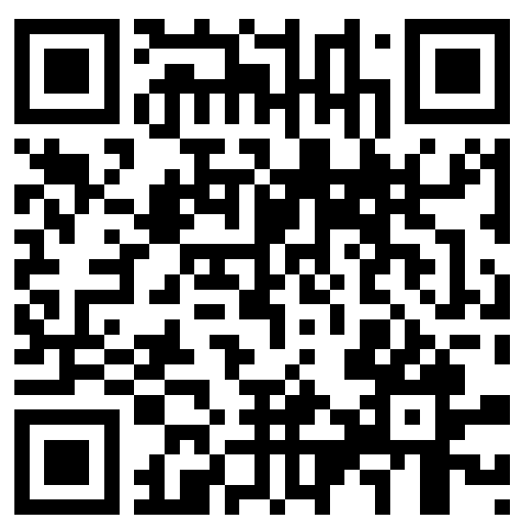

::: {.columns}
::: {.column width="58%"}
Scannez le **code QR**, ou ouvrez [Wooclap](https://app.wooclap.com/STNMOTL).

**Code de l’évènement : STNMOTL**

Gardez l’onglet ouvert pour les rondes et les propositions de pause.
:::
::: {.column width="42%"}
[{fig-alt="QR Wooclap STNMOTL" width="420"}](https://app.wooclap.com/STNMOTL)
:::
:::
