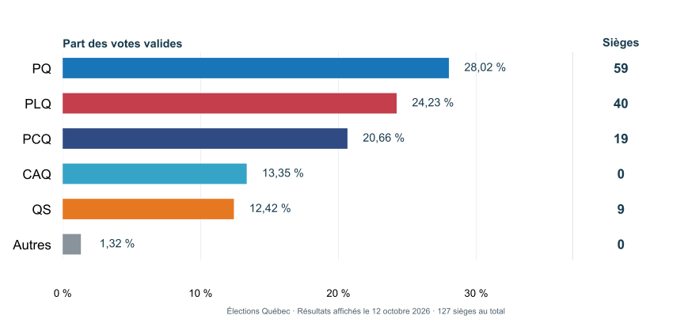
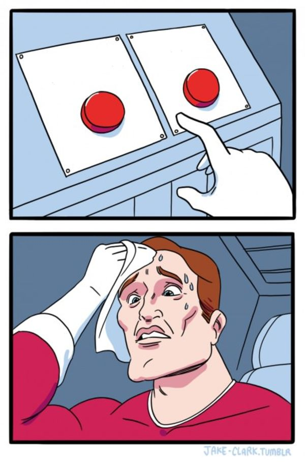
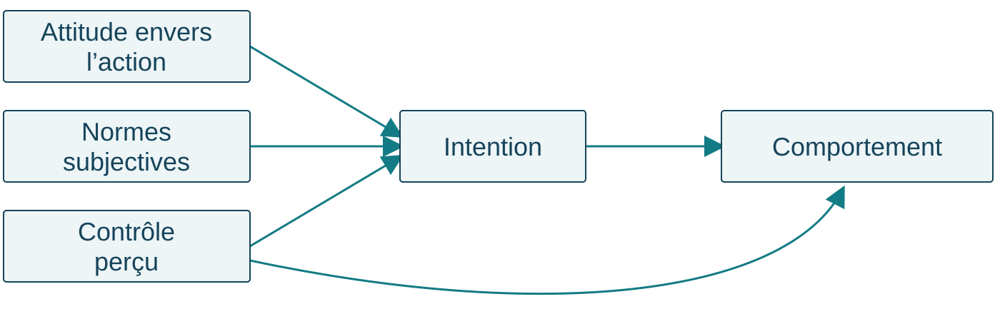
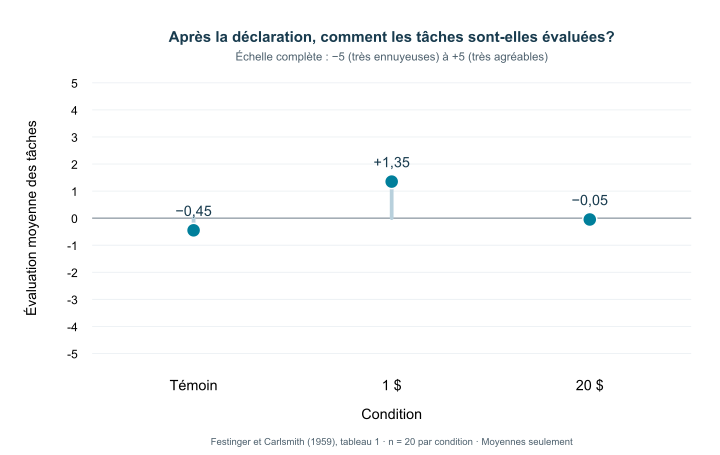

## Quiz de lecture 4 — 1,25 %

**Chapitre 5 et cours 5 · 8 questions · 10 minutes · Travail individuel**





::: {.notes}
10 minutes. Faire ouvrir le quiz avant de lancer le minuteur. Rappeler les accommodements applicables individuellement. Garder les accès du quiz distincts des activités formatives.
:::

## Les prochaines évaluations

**Quiz 5 · 20 octobre · 1,25 %**

**Matière évaluée : cours 6 et chapitre 6 — Les attitudes.**

8 questions · 10 minutes. Les 8 meilleurs quiz sur 10 comptent pour **10 %**.

**Examen 2 · 10 novembre · 30 %**

Cours **5 à 8** et chapitres **5, 6, 8 et 9**. Répartition annoncée : **50 % cours / 50 % manuel**.

Note : Puisque la plupart des concepts vus dans le cours sont aussi dans le manuel, cela implique que les 50 % des questions associées aux cours seront fort probablement aussi dans le manuel. Ainsi, il est conseillé de donner un peu plus de poids à l’étude des cours plutôt qu’au manuel.

[Guide d’étude de l’examen 2](../../examens/02/guide.qmd)

::: {.notes}
Reprendre les mêmes dates et pondérations qu’en ouverture. Le quiz comporte 8 questions et dure 10 minutes. Communiquer les accès séparément lorsqu’ils sont disponibles. Renvoyer au guide cumulatif sans le présenter comme une liste de questions d’examen.
:::

## Connectez-vous à Wooclap



Deux estimations, puis les résultats de la classe.

::: {.notes}
4 minutes. Dans Wooclap uniquement : faire estimer la médiane, puis le maximum; afficher ensuite la diapositive descriptive préparée pour l'évènement. Les valeurs de cohorte restent dans Wooclap et Box. Ne pas projeter la note minimale ni des copies individuelles.
:::

## Plan de la séance

1. **Qu’est-ce qu’une attitude?**
2. **Comment mesure-t-on les attitudes?**
3. **À quoi les attitudes servent-elles?**
4. **La formation des attitudes**
5. **Les attitudes et les comportements**
6. **Le changement d’attitude**

::: {.notes}
Reprendre les rubriques du chapitre, avec attitudes et comportements avant le changement d’attitude afin de préparer l’atelier au retour de la première pause. Demander deux réponses à la question de départ, sans recueillir les préférences politiques personnelles. Annoncer que les exemples politiques concernent des personnes fictives.
:::

## Une publicité avec Lise Dion



::: {.notes}
32 secondes. « Lise Dion - Gadoua Commercial 1 », archive publiée par Shivaxis. Ne pas inventer l'année de production. Ouverture après la logistique : laisser la chute arriver sans annoncer le mécanisme. Recueillir ensuite deux réactions à la manière dont la publicité présente le produit. Lecteur intégré, sans téléchargement. En cas de panne, raconter la situation en une phrase puis passer à la discussion; ne pas lire une transcription automatique comme verbatim fiable.
:::

## Faire aimer un produit

**Pourquoi une publicité pour du pain choisit-elle de nous faire rire?**

Quelle impression cherche-t-elle à donner du produit ou de la marque?

Nous reviendrons à cette scène pour comprendre **comment un message peut influencer une attitude**.

::: {.notes}
2 minutes avec le visionnement. L'humour peut contribuer à une impression favorable; le visionnement ne démontre pas que cette publicité a changé leur attitude. Ne pas encore nommer une voie de persuasion avant de l'avoir définie. Conserver la scène comme repère à reprendre plus tard, sans la rejouer.
:::

## Qu’est-ce qu’une attitude?

Une **attitude** est une évaluation favorable ou défavorable à l’égard d’un objet.

On peut avoir une attitude envers une **personne**, une **idée**, un **produit** ou une **activité**.

« J’aime ce politicien. »

« Je suis contre cette proposition. »

::: {.notes}
Définition du chapitre 6. Faire nommer l’objet dans les deux phrases : personne et proposition. On peut apprécier une personne et désapprouver une de ses idées.
:::

## Les attitudes en politique

::: {.columns}
::: {.column width="20%"}
{height=260 fig-alt="Paul St-Pierre Plamondon"}

**PQ**

Paul St-Pierre Plamondon
:::
::: {.column width="20%"}
{height=260 fig-alt="Charles Milliard"}

**PLQ**

Charles Milliard
:::
::: {.column width="20%"}
{height=260 fig-alt="Éric Duhaime"}

**PCQ**

Éric Duhaime
:::
::: {.column width="20%"}
{height=260 fig-alt="Christine Fréchette"}

**CAQ**

Christine Fréchette
:::
::: {.column width="20%"}
{height=260 fig-alt="Ruba Ghazal"}

**QS**

Ruba Ghazal
:::
:::

Peut-on apprécier une personne, aimer certaines de ses idées et refuser de voter pour elle?

::: {.credit}
Photos Commons : [Alexis G, BY-SA 4.0](https://commons.wikimedia.org/wiki/File:Paul_St-Pierre_Plamondon_(crop).jpg) · [TVA Nouvelles, BY 3.0 — Milliard](https://commons.wikimedia.org/wiki/File:Charles_Milliard_Ao%C3%BBt_2024_(cropped).jpg) · [Asclepias, BY-SA 3.0](https://commons.wikimedia.org/wiki/File:%C3%89ric_Duhaime_2022-07-05_(cropped).jpg) · [TVA Nouvelles, BY 3.0 — Fréchette](https://commons.wikimedia.org/wiki/File:Christine_Fr%C3%A9chette_(cropped).jpg) · [QuebecSolidaireMercier, BY-SA 4.0](https://commons.wikimedia.org/wiki/File:RubaGhazal_2.jpg).
:::

::: {.notes}
2 minutes. Visages des cinq principales formations de la campagne. Ruba Ghazal est porte-parole de Québec solidaire; Sol Zanetti est également porte-parole. Identification vérifiée auprès des partis et d'Élections Québec. Aucun propos fictif attribué à ces personnes. Photos conservées telles que distribuées sur Commons, sans nouvelle modification. Recadrages préexistants par les contributeurs Commons. Licence des extraits TVA : https://creativecommons.org/licenses/by/3.0/ ; photos PQ et QS : https://creativecommons.org/licenses/by-sa/4.0/ ; PCQ : https://creativecommons.org/licenses/by-sa/3.0/ .
:::

## Le Québec a voté le 5 octobre 2026

{height=570 fig-alt="Résultats du scrutin : PQ 28,02 % et 59 sièges; PLQ 24,23 % et 40; PCQ 20,66 % et 19; CAQ 13,35 % et 0; QS 12,42 % et 9; autres 1,32 % et 0."}

**Aimer un parti, vouloir voter pour lui et voter pour lui : trois choses différentes.**

::: {.credit}
Source : [Élections Québec](https://www.electionsquebec.qc.ca/resultats-et-statistiques/resultats-generales/2026-10-05/218/), consultés le 12 octobre 2026. Figure refaite dans R.
:::

::: {.notes}
3 minutes. Faire lire les pourcentages de votes valides puis les sièges. Le PQ a obtenu le plus de sièges, sans atteindre le seuil de majorité de 64 sur 127. Les chiffres décrivent le scrutin, pas la proportion de personnes qui aiment chaque chef. Demander une raison possible d'aimer un parti sans voter pour lui, puis l'inverse. Les raisons proposées sont des hypothèses, pas des résultats sur l'électorat. Les valeurs exactes ne sont pas à mémoriser. « Autres » regroupe les 56 560 autres bulletins valides sur 4 284 462. Ne pas présenter ces résultats affichés comme un rapport définitif déjà vérifié.
:::


## Progressiste ou conservateur : sur quel enjeu?

Une attitude porte sur un **objet précis**, pas seulement sur une étiquette politique.

| Enjeu | Proposition à évaluer |
|---|---|
| Ressources naturelles | Autoriser un nouveau projet d’exploitation minière |
| Environnement | Protéger un écosystème menacé |
| Transport | Investir davantage dans le transport en commun plutôt que dans de nouvelles routes |
| Impôts | Augmenter les impôts pour financer davantage de services publics |

**Une personne peut-elle être favorable à certaines propositions et défavorable à d’autres?**

::: {.notes}
3 minutes. Fusion des deux anciennes diapositives sur les enjeux. Imaginer un personnage qui soutient certaines propositions et en rejette d’autres; ne pas demander les préférences personnelles ni attribuer ces positions à un parti réel. Une étiquette globale ne suffit pas à connaitre une attitude envers chaque objet. L’ambivalence envers un même objet est définie plus loin.
:::

## Attitude, croyance et comportement

**Exemples fictifs à propos d’un politicien**

| Phrase | Ce qu’elle indique |
|---|---|
| « J’aime ce politicien. » | Attitude favorable |
| « Je crois qu’il tiendra ses promesses. » | Croyance |
| « J’ai voté pour lui. » | Comportement |

On peut voter pour une personne sans l’apprécier, par exemple pour éviter l’élection d’une autre.

::: {.notes}
Demander quel verbe permet de distinguer les phrases. Aimer donne une évaluation; croire rapporte une conviction; voter décrit une action. Ne pas attribuer ces phrases à un électorat réel.
:::

## Les composantes d’une attitude

**Modèle tripartite classique**

| Composante | Définition | Exemple fictif |
|---|---|---|
| **Cognitive** | Croyances à propos de l’objet | « Je crois que ce parti défend mes priorités. » |
| **Affective** | Émotions et sentiments associés à l’objet | « Son discours m’enthousiasme. » |
| **Conative** | Tendance ou préparation à agir | « J’envisage de voter pour ce parti. » |

Ces composantes peuvent aller dans le même sens ou se contredire.

::: {.credit}
Source : Vallerand et Paquette (2021), chapitre 6, p. 180–182. Exemples politiques fictifs.
:::

::: {.notes}
Employer aussi les termes du manuel : croyance, affect et conation. Conation ne signifie pas que le vote a déjà eu lieu. Le manuel distingue les modèles tripartite classique et révisé; ne pas les présenter comme identiques. Faire trouver une contradiction possible : enthousiasme pour un discours mais réserves envers le programme.
:::

## Ambivalence ou neutralité?

**Ambivalence** : présence simultanée d’évaluations positives et négatives envers le même objet.

**Proposition fictive : augmenter les impôts pour financer davantage de services publics.**

| Réaction | Évaluation |
|---|---|
| « De meilleurs services me plaisent, mais la hausse des impôts me déplait. » | Positive et négative |
| « Cette proposition m’est indifférente. » | Ni favorable ni défavorable |

Un point médian sur une seule échelle peut masquer cette différence.

::: {.notes}
2 minutes. Deux évaluations envers la même proposition, pas deux objets sans lien. Cas fictif, sans attribution à un parti. Faire distinguer une évaluation favorable et défavorable simultanées d'une absence d'évaluation marquée. On pourrait mesurer séparément l'évaluation positive et négative. L'hésitation seule ne suffit pas à établir l'ambivalence.
:::

## Comment mesure-t-on les attitudes?

**Mesure explicite :** demander à la personne de rapporter son évaluation.

Un **item de type Likert** mesure son degré d’accord avec un énoncé.

« Je suis favorable à la gratuité scolaire. »

<style>
.c6-likert {display:grid;grid-template-columns:repeat(5,1fr);gap:14px;align-items:stretch;background:#f4f6f8;padding:24px 18px;margin:28px 0;font-size:30px;text-align:center;}
.c6-likert label {display:flex;flex-direction:column;align-items:center;justify-content:space-between;gap:22px;cursor:pointer;line-height:1.25;}
.c6-likert input {width:30px;height:30px;accent-color:#235773;margin:0;flex-shrink:0;}
</style>
```{=html}
<div class="c6-likert" role="radiogroup" aria-label="Degré d’accord avec la gratuité scolaire">
<label><span>Pas du tout<br>d’accord</span><input type="radio" name="c6-likert" value="1" aria-label="Pas du tout d’accord"></label>
<label><span>Plutôt en<br>désaccord</span><input type="radio" name="c6-likert" value="2" aria-label="Plutôt en désaccord"></label>
<label><span>Ni l’un<br>ni l’autre</span><input type="radio" name="c6-likert" value="3" aria-label="Ni l’un ni l’autre"></label>
<label><span>Plutôt<br>d’accord</span><input type="radio" name="c6-likert" value="4" aria-label="Plutôt d’accord"></label>
<label><span>Tout à fait<br>d’accord</span><input type="radio" name="c6-likert" value="5" aria-label="Tout à fait d’accord"></label>
</div>
```

Quelle différence avec « Je compte signer une pétition pour la gratuité scolaire demain »?

::: {.notes}
2 minutes. Exemple original, pas échelle validée. Un item isolé n’est pas une échelle complète. La seconde phrase porte sur une intention. Le point médian peut correspondre à la neutralité ou à l’ambivalence; reprendre les deux exemples vus précédemment.
:::

## Le différenciateur sémantique

On demande d’évaluer le même objet entre deux adjectifs opposés.

**Objet : une proposition de gratuité scolaire**

**Choisissez une réponse sur chaque ligne.**

<style>
.c6-semantic {display:grid;grid-template-columns:repeat(5,1fr);gap:14px;background:#f4f6f8;padding:20px;margin:16px 0;font-size:28px;text-align:center;}
.c6-semantic label {display:flex;flex-direction:column;align-items:center;gap:18px;cursor:pointer;line-height:1.2;}
.c6-semantic input {width:30px;height:30px;accent-color:#235773;margin:0;}
</style>
```{=html}
<div class="c6-semantic" role="radiogroup" aria-label="Évaluation de la qualité">
<label><span>Très mauvaise</span><input type="radio" name="c6-semantic-qualite" value="1" aria-label="Très mauvaise"></label>
<label><span>Plutôt mauvaise</span><input type="radio" name="c6-semantic-qualite" value="2" aria-label="Plutôt mauvaise"></label>
<label><span>Ni mauvaise ni bonne</span><input type="radio" name="c6-semantic-qualite" value="3" aria-label="Ni mauvaise ni bonne"></label>
<label><span>Plutôt bonne</span><input type="radio" name="c6-semantic-qualite" value="4" aria-label="Plutôt bonne"></label>
<label><span>Très bonne</span><input type="radio" name="c6-semantic-qualite" value="5" aria-label="Très bonne"></label>
</div>
<div class="c6-semantic" role="radiogroup" aria-label="Évaluation de l’utilité">
<label><span>Très inutile</span><input type="radio" name="c6-semantic-utilite" value="1" aria-label="Très inutile"></label>
<label><span>Plutôt inutile</span><input type="radio" name="c6-semantic-utilite" value="2" aria-label="Plutôt inutile"></label>
<label><span>Ni inutile ni utile</span><input type="radio" name="c6-semantic-utilite" value="3" aria-label="Ni inutile ni utile"></label>
<label><span>Plutôt utile</span><input type="radio" name="c6-semantic-utilite" value="4" aria-label="Plutôt utile"></label>
<label><span>Très utile</span><input type="radio" name="c6-semantic-utilite" value="5" aria-label="Très utile"></label>
</div>
```

La formulation des questions détermine ce que l’on mesure.

::: {.notes}
2 minutes. Illustration pédagogique du différenciateur sémantique, pas questionnaire validé. Comparer une évaluation sur des adjectifs opposés et l’accord avec un énoncé de type Likert. Une ligne se lit d’un pôle à l’autre. Ne pas transformer cet exemple en test politique individuel.
:::

## La désirabilité sociale

La **désirabilité sociale** est la tendance à donner une réponse qui présente une image favorable de soi aux autres.

Une personne peut adapter ce qu’elle dit pour faire bonne impression.

**Lorsqu’on pose une question, à qui la personne pense-t-elle devoir plaire?**

::: {.notes}
1 minute. Relier aux mesures déclarées et à la présentation de soi déjà rencontrée dans le cours. La définition est enseignée ici avant la scène. Éviter de dire que toute réponse socialement acceptable est fausse. Rappeler le gag de la publicité du pain vue en ouverture; ne pas relancer la vidéo.
:::

## Ce qu’il mange… et ce qu’il dit

**Que voit-on dans la scène? Que raconte-t-il au téléphone?**

Pourquoi choisit-il cette réponse?

::: {.fragment}
Il cherche à faire bonne impression auprès de son interlocuteur.
:::

**Un questionnaire d’attitude pourrait-il susciter le même souci de plaire?**

::: {.notes}
1 minute de rappel. Dans la scène, le personnage mange du pain et affirme préparer des pâtes au pesto. Faire observer avant de donner l'explication. Relier au désir de faire bonne impression. Transfert : une question sur le recyclage pourrait recevoir une réponse valorisante pour l'image de soi. Ne pas conclure que l'on connait sa véritable attitude à partir de cette scène, ni appeler la scène un test implicite. L'humour illustre une situation; aucun effet de la publicité sur la classe n'est mesuré.
:::

## Attitudes explicites et implicites

Une **attitude explicite** est une évaluation que la personne rapporte consciemment.

Une **attitude implicite** est une évaluation dont l’activation ou l’expression peut échapper au contrôle conscient.

| Mesure | Information recueillie |
|---|---|
| Déclarée | Le jugement que la personne rapporte |
| Indirecte | Un indice de son évaluation dans une tâche |

::: {.notes}
2 minutes. Distinguer l’évaluation et sa mesure. Une réponse déclarée peut être influencée par la présentation de soi. Une mesure indirecte ne donne pas automatiquement accès à une attitude « plus vraie ». Le test d’association implicite compare notamment les temps de réponse entre des associations de catégories et d’évaluations. Un score isolé ne permet pas de diagnostiquer une personne ou de prédire une action particulière. Demander : quelle information collecte-t-on dans chacune des deux approches? Ne pas administrer de test individuel à la classe.
:::

## Comment fonctionne le test d’association implicite?

Le **test d’association implicite (TAI)** compare la performance quand des catégories et des évaluations partagent une réponse.

On compare les **temps de réponse** entre deux jumelages, en tenant compte des erreurs.

Reprenons la démonstration du cours 4, avec **Ruba Ghazal** et **Éric Duhaime**.

::: {.credit}
Principe : [Greenwald, McGhee et Schwartz (1998)](https://doi.org/10.1037/0022-3514.74.6.1464).
:::

::: {.notes}
Ces critères ne rendent pas les personnes équivalentes en familiarité ni la démonstration valide comme mesure politique. Ne pas présumer des préférences du groupe. La démonstration reprend le format du cours 4; ce n'est pas un protocole politique validé. Budget de l'ensemble : cinq minutes, dont la discussion finale. Les positions gauche/droite désignent les mains, pas les idéologies.
:::

<style>
.c6-iat-labels {display:grid;grid-template-columns:1fr 1fr;gap:70px;text-align:center;font-size:30px;margin-top:15px;}
.c6-iat-labels strong {display:block;font-size:40px;line-height:1.2;margin-top:12px;}
.c6-iat-stimulus {margin-top:80px;text-align:center;font-size:76px;font-weight:700;}
.c6-iat-stimulus img {height:300px;width:300px;object-fit:contain;margin:0;}
</style>

## TAI : à vos mains!

**Levez une main aussi rapidement que possible.**

- Catégorie de gauche → **main gauche**.
- Catégorie de droite → **main droite**.
- Si vous vous trompez, corrigez simplement votre réponse.

Nous allons classer des **personnes**, puis des **mots**, puis les deux ensemble.

::: {.notes}
Même consigne que dans le cours 4. Laisser les mains libres, sans comparer publiquement les personnes. Avancer manuellement les essais, sans chronomètre individuel. Nous montrons une tâche; aucun score n'est produit.
:::

## TAI : entrainement — les personnes

<div class="c6-iat-labels">
<div>MAIN GAUCHE<strong>RUBA GHAZAL</strong></div>
<div>MAIN DROITE<strong>DUHAIME</strong></div>
</div>

**Classez le nom ou le portrait de la personne.**

## TAI : essai 1 {data-transition="none"}

<div class="c6-iat-labels">
<div>MAIN GAUCHE<strong>RUBA GHAZAL</strong></div>
<div>MAIN DROITE<strong>DUHAIME</strong></div>
</div>

<div class="c6-iat-stimulus">Ruba Ghazal</div>

::: {.notes}
Main gauche. Enchainer après la réponse collective, sans commentaire individuel.
:::

## TAI : essai 2 {data-transition="none"}

<div class="c6-iat-labels">
<div>MAIN GAUCHE<strong>RUBA GHAZAL</strong></div>
<div>MAIN DROITE<strong>DUHAIME</strong></div>
</div>

<div class="c6-iat-stimulus">Duhaime</div>

::: {.notes}
Main droite. Enchainer après la réponse collective, sans commentaire individuel.
:::

## TAI : entrainement — les mots

<div class="c6-iat-labels">
<div>MAIN GAUCHE<strong>AGRÉABLE</strong></div>
<div>MAIN DROITE<strong>DÉSAGRÉABLE</strong></div>
</div>

**Classez le sens du mot.**

## TAI : essai 3 {data-transition="none"}

<div class="c6-iat-labels">
<div>MAIN GAUCHE<strong>AGRÉABLE</strong></div>
<div>MAIN DROITE<strong>DÉSAGRÉABLE</strong></div>
</div>

<div class="c6-iat-stimulus">Merveilleux</div>

::: {.notes}
Main gauche. Enchainer après la réponse collective, sans commentaire individuel.
:::

## TAI : essai 4 {data-transition="none"}

<div class="c6-iat-labels">
<div>MAIN GAUCHE<strong>AGRÉABLE</strong></div>
<div>MAIN DROITE<strong>DÉSAGRÉABLE</strong></div>
</div>

<div class="c6-iat-stimulus">Horrible</div>

::: {.notes}
Main droite. Enchainer après la réponse collective, sans commentaire individuel.
:::

## TAI : premier jumelage

<div class="c6-iat-labels">
<div>MAIN GAUCHE<strong>RUBA GHAZAL ou AGRÉABLE</strong></div>
<div>MAIN DROITE<strong>DUHAIME ou DÉSAGRÉABLE</strong></div>
</div>

**Même règle : une personne ou un mot, une seule main.**

## TAI : essai 5 {data-transition="none"}

<div class="c6-iat-labels">
<div>MAIN GAUCHE<strong>RUBA GHAZAL ou AGRÉABLE</strong></div>
<div>MAIN DROITE<strong>DUHAIME ou DÉSAGRÉABLE</strong></div>
</div>

<div class="c6-iat-stimulus"></div>

::: {.notes}
Main gauche. Enchainer après la réponse collective, sans commentaire individuel.
:::

## TAI : essai 6 {data-transition="none"}

<div class="c6-iat-labels">
<div>MAIN GAUCHE<strong>RUBA GHAZAL ou AGRÉABLE</strong></div>
<div>MAIN DROITE<strong>DUHAIME ou DÉSAGRÉABLE</strong></div>
</div>

<div class="c6-iat-stimulus">Merveilleux</div>

::: {.notes}
Main gauche. Enchainer après la réponse collective, sans commentaire individuel.
:::

## TAI : essai 7 {data-transition="none"}

<div class="c6-iat-labels">
<div>MAIN GAUCHE<strong>RUBA GHAZAL ou AGRÉABLE</strong></div>
<div>MAIN DROITE<strong>DUHAIME ou DÉSAGRÉABLE</strong></div>
</div>

<div class="c6-iat-stimulus"></div>

::: {.notes}
Main droite. Enchainer après la réponse collective, sans commentaire individuel.
:::

## TAI : essai 8 {data-transition="none"}

<div class="c6-iat-labels">
<div>MAIN GAUCHE<strong>RUBA GHAZAL ou AGRÉABLE</strong></div>
<div>MAIN DROITE<strong>DUHAIME ou DÉSAGRÉABLE</strong></div>
</div>

<div class="c6-iat-stimulus">Horrible</div>

::: {.notes}
Main droite. Enchainer après la réponse collective, sans commentaire individuel.
:::

## TAI : jumelage inversé

<div class="c6-iat-labels">
<div>MAIN GAUCHE<strong>RUBA GHAZAL ou DÉSAGRÉABLE</strong></div>
<div>MAIN DROITE<strong>DUHAIME ou AGRÉABLE</strong></div>
</div>

**Les mots changent de côté. Quatre nouveaux essais.**

::: {.notes}
Laisser lire la nouvelle règle avant de reprendre. La modification suit le cours 4 : inversion de la seconde paire de catégories. Les personnes restent en place.
:::

## TAI : essai 9 {data-transition="none"}

<div class="c6-iat-labels">
<div>MAIN GAUCHE<strong>RUBA GHAZAL ou DÉSAGRÉABLE</strong></div>
<div>MAIN DROITE<strong>DUHAIME ou AGRÉABLE</strong></div>
</div>

<div class="c6-iat-stimulus">Horrible</div>

::: {.notes}
Main gauche. Enchainer après la réponse collective, sans commentaire individuel.
:::

## TAI : essai 10 {data-transition="none"}

<div class="c6-iat-labels">
<div>MAIN GAUCHE<strong>RUBA GHAZAL ou DÉSAGRÉABLE</strong></div>
<div>MAIN DROITE<strong>DUHAIME ou AGRÉABLE</strong></div>
</div>

<div class="c6-iat-stimulus"></div>

::: {.notes}
Main droite. Enchainer après la réponse collective, sans commentaire individuel.
:::

## TAI : essai 11 {data-transition="none"}

<div class="c6-iat-labels">
<div>MAIN GAUCHE<strong>RUBA GHAZAL ou DÉSAGRÉABLE</strong></div>
<div>MAIN DROITE<strong>DUHAIME ou AGRÉABLE</strong></div>
</div>

<div class="c6-iat-stimulus">Merveilleux</div>

::: {.notes}
Main droite. Enchainer après la réponse collective, sans commentaire individuel.
:::

## TAI : essai 12 {data-transition="none"}

<div class="c6-iat-labels">
<div>MAIN GAUCHE<strong>RUBA GHAZAL ou DÉSAGRÉABLE</strong></div>
<div>MAIN DROITE<strong>DUHAIME ou AGRÉABLE</strong></div>
</div>

<div class="c6-iat-stimulus"></div>

::: {.notes}
Main gauche. Enchainer après la réponse collective, sans commentaire individuel.
:::

## TAI : que faudrait-il comparer?

**Quelle règle a changé entre les deux jumelages?**

Si l’on voulait mesurer la facilité du classement, quelles informations faudrait-il enregistrer?

::: {.fragment}
Les **temps de réponse**, en tenant compte des erreurs, puis comparer les deux jumelages.
:::

::: {.notes}
Le score D ne combine pas simplement un temps moyen et un nombre d’erreurs. Les essais erronés contribuent aux temps : temps jusqu’à la correction lorsque la tâche exige une réponse correcte, ou remplacement par un temps pénalisé (par exemple moyenne des réponses correctes du bloc + 600 ms dans l’algorithme de 2003). Ce détail de calcul n’est pas à mémoriser. Source : Greenwald, Nosek et Banaji (2003), https://pubmed.ncbi.nlm.nih.gov/12916565/ ; bonnes pratiques, https://pmc.ncbi.nlm.nih.gov/articles/PMC9170636/ . Recueillir des observations sur la tâche, pas les préférences politiques. Une impression de facilité ne fournit pas un score. Les essais sont peu nombreux, les temps ne sont pas mesurés et tout le groupe suit le même ordre. Ne pas attribuer les hésitations à une attitude personnelle. Les crédits des deux portraits figurent sur la diapositive des cinq formations.
:::

## À quoi les attitudes servent-elles?

| Fonction | Exemple fictif de soutien à un parti |
|---|---|
| **Connaissance** : organiser l’information | « Son programme m’aide à comprendre les enjeux. » |
| **Adaptation sociale** : faciliter l’intégration | « Militer me rapproche de mes amis. » |
| **Expression** : manifester ses valeurs | « Ce parti exprime mes priorités. » |
| **Défense du soi** : protéger son image | « Mon choix ne pouvait pas être une erreur. » |

Une même attitude peut remplir plusieurs fonctions.

::: {.notes}
2 minutes. Repères du manuel p. 186–187. Exemples inventés, pas description d'un électorat. Lire deux exemples, puis faire comparer intégration et expression. Les autres servent de repères lors de la relecture. La défense du soi est un rôle possible de l'attitude, pas une preuve que la personne rationalise nécessairement.
:::

## La formation des attitudes

| Processus | Définition brève | Exemple |
|---|---|---|
| **Simple exposition** | L’appréciation peut augmenter avec la répétition | Une chanson devient familière et nous plait davantage |
| **Évaluation conditionnée** | L’évaluation change après l’association avec un élément positif ou négatif | Une marque associée à des scènes amusantes |
| **Conditionnement opérant** | Les conséquences d’une conduite influencent sa répétition | Une activité gratifiante nous donne envie de recommencer |

La famille, la culture et nos expériences contribuent à la formation des attitudes.

::: {.notes}
2 minutes. Repères p. 189–193. Ne pas développer trois expériences supplémentaires. La publicité du pain fournit une association possible entre marque et émotion agréable. La répétition d'une chanson illustre un effet possible, pas une appréciation garantie. Les concepts restent dans le guide du manuel; la lecture complète fournit les autres sources et modèles. Le conditionnement opérant porte d'abord sur le comportement et ses conséquences, qui peuvent contribuer à l'attitude envers l'activité.
:::

## L’apprentissage social et les croyances

L’**apprentissage social** consiste à apprendre en observant les autres.

**Exemple fictif :** dans une famille, on admire un parti et on critique un autre. Un jeune peut reprendre ces évaluations.

Le **modèle croyance-évaluation** relie l’attitude aux conséquences que l’on croit associées à l’objet et à l’importance qu’on leur accorde.

« Je crois que cette proposition réduirait mes dépenses, et c’est important pour moi. »

::: {.notes}
3 minutes. p. 193–196. L’observation peut influencer une attitude sans déterminer celle de tous les membres d’une famille. Pour le modèle croyance-évaluation, relever séparément la conséquence attendue et sa valeur pour la personne. Aucun programme réel n’est attribué à un parti. Comparer avec une personne qui croit la même conséquence mais y accorde peu d’importance.
:::

## Les attitudes prédisent-elles les comportements?

« J’aime ce parti » est une attitude envers un parti.

Pour comprendre un vote précis, rapprochons :

| Dimension | Exemple |
|---|---|
| Action | Voter |
| Cible | Pour une candidature de ce parti |
| Situation | Aux élections québécoises |
| Temps | Le 5 octobre 2026 |

**Quelle était son attitude envers le fait de voter pour cette candidature ce jour-là?**

::: {.notes}
2 minutes. Correspondance action, cible, situation et temps, appliquée rétrospectivement au scrutin. Aimer un chef ou un parti n'est pas identique à évaluer ce vote précis. Une personne peut apprécier un parti et préférer une autre candidature locale. Le graphique du début rapporte des votes, sans mesurer ces évaluations individuelles.
:::

## L’intention et le comportement

**Intention comportementale** : volonté ou projet d’accomplir une action déterminée.

Avant le scrutin : « Je compte aller voter le 5 octobre. »

**Comportement** : action effectivement réalisée.

Après le scrutin : « Le 5 octobre, je suis allé voter. »

Une intention ne garantit pas la réalisation de l’action.

::: {.notes}
2 minutes. Distinguer l'intention d'aller voter de l'intention de voter pour une candidature précise; maintenir le même comportement dans chaque comparaison. Demander si trouver une élection importante suffit à établir l'intention d'y voter : non. Une intention peut ne pas se réaliser si les conditions changent. Les phrases sont fictives.
:::

## Peut-on voter pour quelqu’un sans le préférer?

<style>
.c6-buttons {position:relative;width:370px;height:560px;margin:auto;}
.reveal .c6-buttons img {width:370px;height:560px;margin:0;max-width:none;max-height:none;}
.c6-button-text {position:absolute;text-align:center;font-size:17px;font-weight:700;line-height:1.1;color:#111;transform:rotate(-12deg);}
.c6-button-one {left:38px;top:55px;width:115px;}
.c6-button-two {left:161px;top:40px;width:112px;}
.c6-fine {position:relative;width:940px;height:457px;margin:18px auto;}
.reveal .c6-fine img {width:940px;height:457px;margin:0;max-width:none;max-height:none;}
.c6-fine-phrase {position:absolute;left:65%;top:8%;width:28%;height:17%;background:white;border-radius:12px;display:flex;align-items:center;justify-content:center;color:#111;font-family:Arial,sans-serif;font-weight:bold;font-size:32px;}
</style>

::: {.columns}
::: {.column width="48%"}
```{=html}
<div class="c6-buttons"><div class="c6-button-text c6-button-one">Ma candidature<br>préférée</div><div class="c6-button-text c6-button-two">Le vote<br>stratégique</div></div>
```
:::
::: {.column width="52%"}
**Deux choix possibles :**

« Voter pour ma candidature préférée. »

« Voter stratégiquement pour bloquer une autre candidature. »

**Quel lien avec la préférence, l’intention et le vote?**
:::
:::

::: {.credit}
Jake Clark, *Daily Struggle / Two Buttons* · [Modèle Imgflip](https://imgflip.com/memetemplate/Two-Buttons) · légendes françaises ajoutées.
:::

::: {.notes}
30 secondes, dans les deux minutes du vote stratégique. Faire proposer une possibilité avant le cas Noa. Le dilemme ne suffit pas à établir de la dissonance : ni malaise lié à une action déjà réalisée ni changement d’attitude ne sont établis. L’image sert d’illustration humoristique, pas de résultat empirique.
:::

## Voter pour son deuxième choix

**Cas fictif : Noa préfère la candidature A.**

Avant l’élection, Noa prévoit voter pour B afin d’éviter la victoire de C.

Le jour du scrutin, Noa vote pour B.

**Distinguez sa préférence, son intention et son comportement.**

::: {.fragment}
Préférence : **A**. Intention : **voter pour B**. Comportement : **vote pour B**.
:::

::: {.notes}
2 minutes. L'intention et le comportement concordent, malgré le décalage avec la préférence entre candidatures. Noa peut apprécier l'action de voter pour B comme stratégie sans préférer B à A. Ne pas conclure à un malaise ou un changement d'attitude à partir de ce seul vote. Revenir à ce cas après l'étude de dissonance; changer d'évaluation reste une possibilité, pas une conséquence automatique.
:::

## Les normes subjectives et le contrôle perçu

**Normes subjectives** : pression sociale perçue de personnes ou de groupes importants concernant l’action.

« Ma famille s’attend à ce que je vote pour le même parti qu’elle. »

**Contrôle comportemental perçu** : perception de sa capacité et des possibilités de réaliser cette action.

« Je pense pouvoir me rendre au bureau de vote à temps. »

::: {.notes}
2 minutes. Exemple fictif : la pression familiale perçue peut concerner le choix du parti, pas seulement la participation au scrutin. Elle ne prouve ni que la personne partage cette préférence ni qu’elle votera ainsi. Distinguer cette phrase de « Je trouve souhaitable de voter pour ce parti », qui indique une attitude envers l’action. Le contrôle est illustré séparément par la possibilité de se rendre au bureau de vote. Le contrôle perçu peut être inexact. Imaginer une contrainte rencontrée par un personnage, sans attribuer un incident réel au scrutin.
:::

## La théorie du comportement planifié

{width=1400}


L’intention et les possibilités de réaliser l’action comptent aussi.

::: {.notes}
Schéma simplifié du modèle présenté dans le manuel. Lire une voie à la fois : attitude, normes et contrôle perçu contribuent à comprendre l’intention; l’intention est liée au comportement; le contrôle perçu a aussi une voie vers le comportement. Une flèche n’indique ni une garantie ni que chaque composante pèse également dans toutes les situations. Reprendre le fait d’aller voter au même scrutin pour chaque composante.
:::

## Une application de mes recherches

**Nos identités sociales peuvent influencer les trois éléments de base du modèle : attitudes, normes subjectives et contrôle perçu** (illai, Globig, Rathje, Sternisko, Thériault, & Van Bavel, 2026).

<style>
.c6-model-b {position:relative;width:552px;height:440px;overflow:hidden;margin:20px auto;background:white;}
.reveal .c6-model-b img {position:absolute;left:-552px;top:0;width:1104px;height:460px;max-width:none;max-height:none;margin:0;}
</style>
```{=html}
<div class="c6-model-b"></div>
```


Notre revue applique cette idée aux **comportements de santé publique**.

::: {.credit}
Pillai et al. (2026), avec Rémi Thériault. *An Identity-Based Approach to Polarization and Public Health*. [Article](https://doi.org/10.1111/spc3.70125).
:::

::: {.notes}
Exemples : Républicains, COVID, masques, mesures de distanciation physique, vaccination, etc. Mais aussi : lait non-pasteurisé, anti-vaccination en générale, consommation de viande rouge, etc.

2 minutes. Bonus : un seul message à retenir, la phrase en gras. Identité sociale : part de la définition de soi liée à l’appartenance à des groupes. Seule la partie B de la figure originale est affichée par recadrage HTML, sans modifier ni télécharger le fichier. Le rôle de l’identité dans la partie A est résumé par la phrase en gras. Ne pas faire mémoriser les flèches ou les termes anglais. En cas d’indisponibilité de l’image distante, la phrase suffit. Présenter comme une revue théorique qui rapproche identité sociale et comportement planifié dans le domaine de la santé publique. Ce n’est pas une nouvelle expérience démontrant l’efficacité d’un message. Une appartenance peut influencer les croyances considérées et leur importance relative; cela n’implique pas que les membres d’un groupe pensent tous de la même façon. L’article n’est pas une lecture obligatoire supplémentaire.
:::

## L’identité sociale et les attitudes politiques

**Cas fictif :** une personne s’identifie fortement à un parti.

Elle accorde beaucoup d’importance aux recommandations des membres qu’elle respecte.

Elle peut aussi juger une proposition plus favorablement lorsqu’elle la croit soutenue par son groupe.

**Comment son appartenance peut-elle influencer ce qu’elle croit et ce qui compte pour elle?**

::: {.notes}
2 minutes. Application fictive du rapprochement théorique de Pillai et al. (2026). L’appartenance peut orienter les croyances et leur importance dans les attitudes, normes et contrôle perçu. Aucun parti ou électorat réel n’est décrit. Ne pas demander le vote personnel. Ne pas conclure que les membres pensent tous pareil. L’article demeure une référence, pas une lecture supplémentaire obligatoire.
:::

## Exemple résolu : le contenant réutilisable de Sam

**Sam prévoit apporter son contenant réutilisable à la cafétéria demain.**

| Ce qu’il dit | Concept |
|---|---|
| « Apporter mon contenant réutilisable serait une bonne chose. » | Attitude favorable |
| « Mes amis m’encouragent à l’apporter. » | Normes subjectives |
| « Je peux le mettre dans mon sac avant de partir. » | Contrôle perçu |
| « Je compte l’apporter demain. » | Intention |

**S’il l’apporte demain, nous observerons son comportement.**

::: {.notes}
4 minutes. Présenter la démarche avant l’atelier : relever une phrase puis expliquer le concept qu’elle illustre. Vérifier que la cafétéria accepte le contenant dans le cas proposé, sans attribuer une politique réelle à l’UQAR. L’action précise est apporter son contenant, pas avoir une attitude générale envers l’environnement.
:::

## Ronde 1 : définition, mesure et formation



Trois questions, puis une explication des réponses.

[Passer à la pause](#pause-1)

::: {.notes}
7 minutes pour la ronde, après le bloc d’explication. Fermer chaque vote avant le débreffage. Faire expliciter l’indice décisif, puis expliquer l’erreur dominante. Les diapositives suivantes permettent de relire les questions après le cours.
:::

## 1. Attitude, croyance ou comportement?

« Je trouve cette proposition politique souhaitable. »

A. Une attitude favorable

B. Une croyance sur ses conséquences

C. Un comportement réalisé

::: {.notes}
Réponse A. Souhaitable exprime une évaluation. Comparer avec « Je crois qu’elle réduira mes dépenses » et « J’ai voté pour elle ».
:::

## 2. Que mesure cette question?

« Je suis favorable à la gratuité scolaire. »

La personne indique son degré d’accord avec cet énoncé.

A. Son intention de signer une pétition demain

B. Son attitude déclarée envers cette proposition

C. Le fait d’avoir signé une pétition

::: {.notes}
Réponse B. L’accord porte sur une évaluation de la proposition. Les trois réponses distinguent le construit mesuré, sans clause méthodologique piégeuse.
:::

## 3. Comment cette attitude s’est-elle formée?

Une personne commence à aimer une chanson après l’avoir entendue plusieurs fois, sans récompense particulière.

A. Par simple exposition

B. Par conditionnement opérant

C. Par dissonance cognitive

::: {.notes}
Réponse A. La répétition est l’indice central. Le conditionnement opérant ferait intervenir les conséquences du comportement. Le cas ne décrit pas de conflit ressenti. Exemple fictif, pas effet garanti pour toute chanson.
:::

## Pause — 10 minutes {#pause-1}

**10 minutes**

Proposez une chanson ou une photo de votre animal pour la pause.



::: {.notes}
Annoncer oralement l’heure de retour. Maintenir le rituel habituel de chanson et de photo, sans imposer de participation personnelle.
:::

## Atelier : inventez le vote d’Andréa

**Andréa est un personnage fictif. Vous choisissez son histoire.**

Votre équipe choisit sa candidature préférée, celle pour laquelle elle prévoit voter et celle pour laquelle elle vote finalement.

Ces trois choix peuvent être identiques ou différents.

**Inventez les raisons de ses choix, sans raconter votre propre vote.**

::: {.notes}
25 minutes : 12 de création, 5 de partage et 8 de débreffage. Équipes de 3 ou 4. Utiliser des candidatures des partis présentés ou des candidatures A, B et C. Ne pas attribuer de position politique inventée à un candidat réel. Les personnages et leurs raisons sont fictifs. Annoncer une courte reprise du personnage après les théories du changement d’attitude.
:::

## Votre équipe écrit cinq répliques

| À préciser | Réplique d’Andréa |
|---|---|
| Attitude envers le vote envisagé | « Voter pour cette candidature serait… » |
| Normes subjectives | « Les personnes importantes pour moi attendent que… » |
| Contrôle perçu | « Je pense pouvoir voter parce que… » |
| Intention | « Je prévois voter pour… » |
| Comportement | « Finalement, j’ai voté pour… » |

**Ajoutez sa préférence et expliquez un éventuel vote stratégique.**

::: {.notes}
La préférence envers une candidature et l’attitude envers l’action de voter pour elle sont distinguées. Chaque équipe ajoute un indice concret de pression sociale et de contrôle perçu. Si intention et vote diffèrent, inventer un évènement qui explique cet écart; ne pas invoquer une panne non documentée comme fait réel. Demander un bref récit plutôt que la répétition des définitions.
:::

## Présentez votre histoire et défendez votre explication

**En une minute :** racontez le choix d’Andréa et expliquez deux liens avec le modèle du comportement planifié.

Les autres équipes posent une question : **quel détail du récit soutient votre explication?**

Conservez votre histoire : nous reviendrons à ce qu’Andréa dit **après son vote**.

::: {.notes}
Cinq minutes : quelques équipes volontaires présentent des histoires différentes. Huit minutes de débreffage : distinguer préférence, attitude envers l’action, intention et comportement; relier les attentes des proches aux normes subjectives et les possibilités de voter au contrôle perçu. Les flèches ne garantissent pas le vote. Un vote différent de la préférence ne suffit pas à établir une dissonance. Le changement d’attitude sera expliqué après l’atelier.
:::

## Le changement d’attitude : la dissonance cognitive

La **dissonance cognitive** est un état d’inconfort associé à des cognitions incompatibles.

Une conduite peut entrer en conflit avec une attitude ou une conviction.

La personne est alors motivée à réduire cet inconfort.

**Un écart observé ne suffit pas à établir cet état.**

::: {.notes}
Définir les cognitions comme des connaissances, croyances ou représentations, notamment à propos de sa conduite. Il faut considérer l’incompatibilité perçue et l’inconfort; ne pas diagnostiquer la dissonance à partir d’une simple incohérence vue de l’extérieur. Le changement d’attitude est une possibilité de réduction, pas une conséquence automatique.
:::

## La dissonance après un achat

**Alex : « J’ai dépensé 800 $ pour une console alors que je voulais économiser pour déménager. Je m’en veux. »**

```{=html}
<div class="c6-fine"><div class="c6-fine-phrase">Tout va bien</div></div>
```

« Je vais économiser sur autre chose. »

**Quel conflit ressent-il? Comment essaie-t-il de se rassurer?**

::: {.credit}
KC Green, *Gunshow — This Is Fine* · [Modèle Imgflip](https://imgflip.com/memetemplate/This-Is-Fine) · adaptation française et contexte fictif ajoutés.
:::

::: {.notes}
Deux minutes. Rémi a choisi le mème pour reprendre le cas de la console. Incompatibilité : projet d’épargne et dépense; malaise : « je m’en veux ». La réplique ajoute une justification. Le chien seul ne prouve pas une dissonance et peut illustrer d’autres mécanismes; c’est le récit fictif qui précise l’application. Ne pas demander les achats personnels des étudiants. Les 800 $ sont une valeur fictive, non à mémoriser.
:::

## Comment réduire la dissonance?

| Possibilité | Ce qu’Alex pourrait faire ou penser |
|---|---|
| Changer son comportement | Retourner la console |
| Changer son évaluation | « Finalement, cet achat en valait la peine. » |
| Ajouter une justification | « Je vais économiser sur d’autres loisirs. » |
| Réduire l’importance du conflit | « Mon déménagement est encore loin. » |

Alex cherche à se sentir plus cohérent avec sa décision.

::: {.notes}
2 minutes. Possibilités fictives, pas choix observés. Faire distinguer action, réévaluation et justifications. La cohérence ressentie ne dit pas si l’achat était financièrement judicieux. Ne pas transformer ce point en piège méthodologique dans une évaluation.
:::

## Pourquoi agir peut-il influencer nos attitudes?

| Explication | Ce que la personne cherche à faire |
|---|---|
| **Présentation de soi / gestion de l’impression** | Donner une image cohérente de soi aux autres |
| **Dissonance cognitive** | Réduire un malaise lié à des cognitions incompatibles |
| **Perception de soi (autoperception)** | Comprendre son attitude en observant sa conduite et son contexte |

**Faire bonne impression peut changer ce qu’on déclare, sans changer ce qu’on pense.**

::: {.notes}
Une minute. Gestion de l’impression : rappel de la présentation de soi et de la désirabilité sociale, pas preuve d’un changement d’attitude privé. Perception de soi : quand les indices internes sont peu clairs, nos comportements et leur contexte peuvent nous renseigner sur nos attitudes. Les trois explications ne sont pas nécessairement exclusives. Terminologie du glossaire p. 449 : théorie de la perception de soi.
:::

## Au laboratoire : un même geste, trois explications

**Cas fictifs : trois personnes donnent du temps à un laboratoire de recherche.**

<style>
.c6-lab-cards {display:grid;grid-template-columns:repeat(3,1fr);gap:24px;margin-top:22px;}
.c6-lab-card {background:#f3f6f8;border-radius:18px;padding:20px;font-size:25px;line-height:1.25;}
.c6-lab-card h3 {font-size:28px!important;margin:0 0 10px!important;text-align:center;}
.c6-lab-card svg {display:block;width:100%;height:125px;}
.c6-lab-bubble {position:relative;background:white;border:3px solid var(--lab-color);border-radius:22px;padding:18px;margin:14px 0 22px;}
.c6-lab-bubble:before {content:"";position:absolute;top:-14px;left:45%;width:22px;height:22px;background:white;border-left:3px solid var(--lab-color);border-top:3px solid var(--lab-color);transform:rotate(45deg);}
.c6-lab-cue {font-size:23px;text-align:center;margin:0;}
</style>
```{=html}
<div class="c6-lab-cards">
<div class="c6-lab-card" style="--lab-color:#b17c21"><h3>Présentation de soi</h3><svg viewBox="0 0 320 125" aria-hidden="true"><rect x="150" y="25" width="135" height="75" rx="7" fill="#b17c21" opacity=".2"/><rect x="164" y="37" width="105" height="49" rx="3" fill="white"/><path d="M174 69 L193 57 L212 64 L235 45 L257 52" fill="none" stroke="#b17c21" stroke-width="4"/><circle cx="80" cy="33" r="22" fill="#b17c21"/><path d="M42 111 Q40 63 80 63 Q120 63 124 111" fill="#b17c21" opacity=".8"/><path d="M118 83 L154 98" stroke="#b17c21" stroke-width="12" stroke-linecap="round"/><path d="M28 114 H294" stroke="#495565" stroke-width="5"/></svg><div class="fragment" data-fragment-index="0"><div class="c6-lab-bubble">« Je dis que j’adore la recherche : c'est que je veux faire bonne impression pour ma candidature au doctorat. »</div><p class="c6-lab-cue"><strong>Image auprès des autres</strong></p></div></div>
<div class="c6-lab-card" style="--lab-color:#638b45"><h3>Dissonance cognitive</h3><svg viewBox="0 0 320 125" aria-hidden="true"><rect x="150" y="25" width="135" height="75" rx="7" fill="#638b45" opacity=".2"/><rect x="164" y="37" width="105" height="49" rx="3" fill="white"/><path d="M174 69 L193 57 L212 64 L235 45 L257 52" fill="none" stroke="#638b45" stroke-width="4"/><circle cx="80" cy="33" r="22" fill="#638b45"/><path d="M42 111 Q40 63 80 63 Q120 63 124 111" fill="#638b45" opacity=".8"/><path d="M118 83 L154 98" stroke="#638b45" stroke-width="12" stroke-linecap="round"/><path d="M28 114 H294" stroke="#495565" stroke-width="5"/></svg><div class="fragment" data-fragment-index="1"><div class="c6-lab-bubble">« Je trouvais ce projet inutile au départ. J’ai pourtant choisi d’y consacrer mes samedis, et ça me dérange… mais finalement, c'est un bon projet. »</div><p class="c6-lab-cue"><strong>Conflit et malaise</strong></p></div></div>
<div class="c6-lab-card" style="--lab-color:#287b9b"><h3>Perception de soi</h3><svg viewBox="0 0 320 125" aria-hidden="true"><rect x="150" y="25" width="135" height="75" rx="7" fill="#287b9b" opacity=".2"/><rect x="164" y="37" width="105" height="49" rx="3" fill="white"/><path d="M174 69 L193 57 L212 64 L235 45 L257 52" fill="none" stroke="#287b9b" stroke-width="4"/><circle cx="80" cy="33" r="22" fill="#287b9b"/><path d="M42 111 Q40 63 80 63 Q120 63 124 111" fill="#287b9b" opacity=".8"/><path d="M118 83 L154 98" stroke="#287b9b" stroke-width="12" stroke-linecap="round"/><path d="M28 114 H294" stroke="#495565" stroke-width="5"/></svg><div class="fragment" data-fragment-index="2"><div class="c6-lab-bubble">« Je ne savais pas si la recherche me plaisait. Mais finalement, même sans attestation ni obligation, je reviens : ça doit vouloir dire que j'aime ça. »</div><p class="c6-lab-cue"><strong>Observation de sa conduite</strong></p></div></div>
</div>
```

::: {.notes}
Deux minutes. Avant chaque dévoilement, demander quelle pensée pourrait illustrer la théorie de la colonne. Avancer une fois pour révéler ensemble la bulle et son indice, de gauche à droite; trois révélations. Scènes originales, inspirées du principe de comparaison des diapositives de West; aucune image de son support reproduite. Le dossier doctoral est une motivation possible dans ces cas fictifs, pas une règle d’admission annoncée. Plusieurs motivations peuvent coexister. Dans la troisième scène, les indices internes sont peu clairs et la personne ne rapporte pas de contrainte ou d’avantage attendu; le seul fait de faire du bénévolat ne suffirait pas à inférer un intérêt. La deuxième scène explicite le malaise; une justification externe forte pourrait réduire ce conflit. Ne pas diagnostiquer une motivation réelle à partir d’une seule bulle.
:::

## Une étude — Dire qu’une tâche est agréable

Pendant une heure, des étudiants répètent des gestes monotones : déplacer des bobines, puis tourner des chevilles.

On demande ensuite à certains de présenter cette tâche comme **agréable à une autre personne** :

- **Témoin** : pas de demande de la présenter comme agréable.
- **1 $** : la présenter comme agréable contre une faible rémunération.
- **20 $** : la présenter comme agréable contre une rémunération plus forte.

On mesure ensuite **l’évaluation personnelle de la tâche**.

::: {.notes}
Raconter le dispositif original de Festinger et Carlsmith (1959) : deux tâches de trente minutes; la personne à convaincre est une complice. Le détail des gestes sert à imaginer la scène, pas à la mémorisation. Ne pas faire mémoriser les montants ou les détails procéduraux. Le groupe témoin fournit une comparaison. L’évaluation présentée est finale et entre groupes, pas une mesure de changement avant/après chez les mêmes personnes. Demander une prédiction avant de montrer la figure.
:::

## Votre prédiction

Quel groupe évaluera la tâche le plus favorablement?

A. Le groupe témoin

B. Le groupe 1 $

C. Le groupe 20 $



::: {.notes}
Recueillir une prédiction individuelle et une courte raison, puis fermer le vote avant d’afficher le résultat. Ne pas donner l’explication pendant le vote. Si le lien n’est pas disponible, faire noter la prédiction individuellement.
:::

## Résultat — L’évaluation de la tâche

{height=570 fig-alt="Évaluation moyenne de la tâche sur une échelle de −5 à +5 : témoin −0,45; 1 dollar +1,35; 20 dollars −0,05. Vingt personnes analysées par groupe."}

::: {.credit}
Source : [Festinger et Carlsmith (1959), tableau 1](https://psychclassics.yorku.ca/Festinger/). Moyennes publiées; 20 personnes analysées par groupe.
:::

::: {.notes}
Lire d’abord l’axe complet de −5 à +5 et le sens des valeurs. Le groupe 1 dollar donne l’évaluation la plus favorable. Ce sont des moyennes finales de groupes, pas des trajectoires individuelles. La figure ne donne ni données brutes ni intervalles de confiance et ne mesure pas directement l’inconfort. Les auteurs rapportent des analyses supplémentaires dans l’article; ne pas déduire la significativité de la seule hauteur des points.
:::

## Pourquoi le groupe 1 $ apprécie-t-il davantage la tâche?

**À deux : pourquoi le groupe payé 1 $ a-t-il donné l’évaluation la plus favorable?**

Que pourrait se dire une personne payée 1 $? Et une personne payée 20 $?

::: {.fragment}
**20 $ :** « J’ai dit cela pour l’argent. »

La rémunération fournit une **justification externe**, une raison liée à la situation.
:::

::: {.fragment}
**1 $ :** « Cette petite somme explique moins bien ce que j’ai dit. Peut-être que la tâche était intéressante… »

Réévaluer la tâche peut réduire la dissonance.
:::

::: {.notes}
4 minutes. Une minute individuelle pour relever le résultat, deux minutes d'échange, puis explication et fragments. Raisonner à partir de la conduite contraire à l'appréciation initiale. La forte rémunération offre une justification externe; la faible rémunération laisse davantage à expliquer par une réévaluation interne. Les phrases sont des illustrations de l'interprétation, pas des citations de participants. Le graphique montre des moyennes finales entre groupes, pas le malaise ni le changement individuel. Demander un exemple différent d'une justification externe.
:::

## Retour à Andréa : que dit-elle après son vote?

**Reprenez votre personnage. Choisissez une des trois explications.**

Écrivez une bulle qui montre :

- l’image qu’elle veut donner aux autres;
- **ou** son malaise et une façon de le réduire;
- **ou** ce qu’elle infère de son vote, alors que sa préférence était peu claire.

**Présentez votre bulle et justifiez votre choix par un détail précis.**

::: {.notes}
Trois minutes, en remplacement de l’ancienne comparaison Noa/Alex : une minute d’écriture, deux minutes pour deux ou trois partages volontaires et une justification. Les équipes peuvent préciser leur récit pour rendre le mécanisme choisi plausible; si une préférence était déjà claire, ne pas appeler automatiquement l’inférence perception de soi. Une contrainte familiale ou un calcul stratégique peut expliquer le vote sans changement d’attitude. Pour la dissonance, exiger incompatibilité perçue et malaise; pour la gestion de l’impression, distinguer propos publics et attitude privée. Demander à une autre équipe une explication différente du même vote. Aucune opinion personnelle n’est demandée.
:::

## Pause — 10 minutes {#pause-2}

**10 minutes**

Proposez une chanson ou une photo de votre animal pour la pause.



::: {.notes}
Annoncer oralement l’heure de retour. Préserver les dix minutes, même si un exemple secondaire doit être abrégé ensuite.
:::

## Convaincre quelqu’un sur Internet

{height=390 fig-alt="Un personnage refuse d’aller se coucher parce que quelqu’un a tort sur Internet."}

**« Tu viens te coucher? » — « Je ne peux pas. Quelqu’un a tort sur Internet. »**

**Vouloir convaincre suffit-il pour convaincre?**

::: {.credit}
Randall Munroe, [xkcd nº 386 — Duty Calls](https://xkcd.com/386/) · [CC BY-NC 2.5](https://creativecommons.org/licenses/by-nc/2.5/). Image originale; résumé français du dialogue.
:::

::: {.notes}
30 secondes, prises dans l’introduction à la persuasion. Essai proposé par Rémi. Image anglaise accompagnée d’un résumé français; l’image n’est pas traduite. Faire sourire, puis distinguer vouloir persuader et obtenir un changement. Ne pas déduire du dessin une voie de traitement précise ni un biais. Aucun nouvel objectif d’étude.
:::

## La persuasion

La **persuasion** est un changement d’attitude produit par une communication.

Une campagne, une discussion ou une publicité peut chercher à persuader.

Recevoir un message ne signifie pas nécessairement changer d’attitude.

**Que fait la personne avec le message reçu?**

::: {.notes}
Distinguer une tentative persuasive de son effet. Exemple : un message encourage à utiliser l’autobus; la personne peut l’ignorer, examiner ses arguments ou réagir à sa présentation. Nous allons surtout travailler le processus de traitement du message, sans refaire toutes les variables source/message/récepteur.
:::

## La persuasion : voies centrale et périphérique

**Élaboration cognitive** : réflexion sur le contenu pertinent d’un message.

**Voie centrale**

Examen attentif des arguments et des pensées qu’ils suscitent.

**Voie périphérique**

Appui sur des indices qui demandent moins d’examen du fond.

La **motivation** et les **ressources disponibles** orientent le traitement.

::: {.notes}
Le modèle de vraisemblance de l’élaboration cognitive organise ces deux voies selon le degré d’élaboration. Faire redire la définition avant de classer les cas. Les voies ne sont pas deux types de personnes et ne mesurent pas leur intelligence. Une même personne peut traiter différemment deux messages ou le même message dans deux situations. En moyenne, un changement issu d’un examen approfondi peut être plus durable et résistant, sans en faire une garantie.
:::

## Une étude — Un examen de plus pour obtenir son diplôme?

Des étudiants entendent un message proposant un **examen obligatoire avant l’obtention du diplôme**.

Pour un groupe, la mesure commencerait **l’année suivante**; pour l’autre, **dans dix ans**.

**Le même sujet vous toucherait-il autant dans les deux situations?**

::: {.credit}
[Petty, Cacioppo et Goldman (1981), p. 849–851](https://richardepetty.com/wp-content/uploads/2019/01/1981-jpsp-pettycacioppogoldman.pdf).
:::

::: {.notes}
Étude originale; pas une annonce de l'UQAR. Cette séquence complète le modèle du manuel, p. 205–206. Huit minutes pour les quatre diapositives, prédiction comprise.
:::

## Ce que les chercheurs font varier

| Élément | Deux versions |
|---|---|
| Conséquences personnelles | L’année suivante / Dans dix ans |
| Arguments | Solides / Faibles |
| Expertise annoncée | Commission spécialisée / Classe du secondaire |

On recueille ensuite **l’attitude envers l’examen proposé**.

::: {.notes}
Les trois éléments sont croisés. Le message est enregistré avec la même voix. Éviter de faire apprendre les détails du protocole.
:::

## Prédiction : qu’est-ce qui pèsera le plus?

**Si l’examen peut vous toucher bientôt**, qu’est-ce qui devrait surtout influencer votre jugement?

Et **s’il ne vous touche pas**, qu’est-ce qui pourrait peser davantage?

À deux : comparez le rôle des **arguments** et celui de **l’expertise annoncée**.

::: {.notes}
Une minute individuelle, puis une minute à deux. Recueillir deux prédictions avant le résultat; ne pas révéler la réponse pendant l'échange.
:::

## Résultat — Deux influences selon l’enjeu personnel

| Situation | Influence plus forte observée |
|---|---|
| Examen l’année suivante | Qualité des arguments |
| Examen dans dix ans | Expertise annoncée de la source |

**Comment la motivation aide-t-elle à comprendre ces résultats?**

::: {.credit}
[Petty, Cacioppo et Goldman (1981), p. 851](https://richardepetty.com/wp-content/uploads/2019/01/1981-jpsp-pettycacioppogoldman.pdf). Résumé qualitatif des résultats.
:::

::: {.notes}
Faire relier aux voies centrale et périphérique. Ce résultat n'établit pas deux catégories fixes de personnes.
:::

## Une proposition politique : deux façons de la juger

**Cas fictif : un message propose la gratuité scolaire.**

**Alex** compare le cout, le financement et les conséquences pour les études.

**Noa** soutient la proposition surtout parce que son artiste préféré l’appuie.

**En deux phrases : nommez la voie suivie par chaque personne et expliquez votre choix.**

::: {.fragment}
Alex suit la **voie centrale**, car il examine les arguments et les conséquences de la proposition.

Noa suit la **voie périphérique**, car il s’appuie surtout sur l’approbation d’une personne qu’il admire.
:::

::: {.notes}
3 minutes. Laisser écrire avant d'afficher. Chaque réponse associe un concept à un élément précis du cas et explique le lien. Reprendre ensuite le pain : l'humour du message ne dit pas à lui seul ce que chaque spectateur examine. Ce sont les mêmes opérations que celles attendues dans une réponse courte; aucune question confidentielle d'examen n'est diffusée.
:::

## Ronde 2 — Expliquer le mécanisme



Trois cas nouveaux pour retrouver les mécanismes.

[Passer aux rappels de fin de séance](#synthese)

::: {.notes}
7 minutes. Faire rappeler les concepts sans réafficher immédiatement leur définition. Fermer les votes avant chaque explication; corriger d’abord la confusion la plus fréquente.
:::

## 4. Réduire la dissonance

Alex regrette un achat qui contredit son projet d’économiser. Pour se sentir mieux, il se convainc que cet achat en valait la peine.

Quelle façon de réduire la dissonance illustre ce cas?

A. Réévaluer son achat plus favorablement.

B. Modifier sa conduite en retournant l’achat.

C. Justifier sa conduite par une récompense reçue.

::: {.notes}
Réponse A. Le changement porte sur l'évaluation de l'achat. B illustre un changement de conduite et C une justification externe, qui ne sont pas décrits dans le cas. Reprendre une autre stratégie possible pour comparer ce qui changerait dans la situation.
:::

## 5. Examiner un message

Noa lit une proposition de pipeline, vérifie ses données et formule deux contre-arguments avant de la rejeter.

A. Voie périphérique, puisqu’il y a rejet

B. Voie centrale, puisqu’il y a examen du fond

C. Aucun traitement, puisque l’attitude ne change pas

::: {.notes}
Réponse B. L’examen peut produire des pensées défavorables et un rejet. Ne pas confondre traitement approfondi et persuasion réussie. Le passage sur les données et les contre-arguments constitue l’indice décisif.
:::

## 6. Après la publicité

Après avoir vu la publicité du pain, Alex compare les ingrédients, la valeur nutritive et le prix du produit avant de se faire une opinion.

Quel traitement du message illustre surtout sa démarche?

A. Voie centrale : il examine les arguments.

B. Voie périphérique : il se fie surtout au prestige de la source.

C. Évaluation conditionnée : la marque est associée à une émotion agréable.

::: {.notes}
Réponse A. Les informations décisives sont les ingrédients, la valeur nutritive et le prix examinés. B et C décrivent d'autres processus plausibles pour une publicité, mais pas la démarche précisée dans ce cas. L'humour présent dans la publicité ne détermine pas à lui seul la voie empruntée par Alex.
:::

## Les prochaines évaluations {#synthese}

**Quiz 5 · 20 octobre · 1,25 %**

**Matière évaluée : cours 6 et chapitre 6 — Les attitudes.**

8 questions · 10 minutes. Les 8 meilleurs quiz sur 10 comptent pour **10 %**.

**Examen 2 · 10 novembre · 30 %**

Cours **5 à 8** et chapitres **5, 6, 8 et 9**. Répartition annoncée : **50 % cours / 50 % manuel**.

Note : Puisque la plupart des concepts vus dans le cours sont aussi dans le manuel, cela implique que les 50 % des questions associées aux cours seront fort probablement aussi dans le manuel. Ainsi, il est conseillé de donner un peu plus de poids à l’étude des cours plutôt qu’au manuel.

[Guide d’étude de l’examen 2](../../examens/02/guide.qmd)

::: {.notes}
Reprendre les mêmes dates et pondérations qu’en ouverture. Le quiz comporte 8 questions et dure 10 minutes. Communiquer les accès séparément lorsqu’ils sont disponibles. Renvoyer au guide cumulatif sans le présenter comme une liste de questions d’examen.
:::

## Pour le prochain cours

**20 octobre · Cours 7 — Les relations interpersonnelles**

Lire le **chapitre 8** du manuel.

Revenir avec une question sur une notion ou un exemple du chapitre.

::: {.notes}
Rappeler que le cours 7 correspond au chapitre 8; le chapitre 7 est facultatif. Ne pas déduire ici le périmètre du quiz de la seule lecture suivante.
:::

## Sources {visibility="hidden"}

**Manuel** : Vallerand, chapitre 6, « Les attitudes », p. 175–219; glossaire.

**Étude présentée** : Festinger, L., et Carlsmith, J. M. (1959). *Cognitive consequences of forced compliance*. [Article original](https://psychclassics.yorku.ca/Festinger/).

**Étude sur la persuasion** : Petty, R. E., Cacioppo, J. T., et Goldman, R. (1981). *Personal involvement as a determinant of argument-based persuasion*. [Article original](https://richardepetty.com/wp-content/uploads/2019/01/1981-jpsp-pettycacioppogoldman.pdf).

**Mesure implicite** : Greenwald, A. G., McGhee, D. E., et Schwartz, J. L. K. (1998). *Measuring individual differences in implicit cognition: The implicit association test*. [Article original](https://doi.org/10.1037/0022-3514.74.6.1464).

**Application théorique** : Pillai, R. M., Globig, L. K., Rathje, S., Sternisko, A., Thériault, R., et Van Bavel, J. J. (2026). *An Identity-Based Approach to Polarization and Public Health*. [Article](https://doi.org/10.1111/spc3.70125).

Les cas présentés sont fictifs.

Version du 12 octobre 2026.

::: {.notes}
Les noms, années, statistiques exactes et détails procéduraux secondaires ne constituent pas des objectifs de mémorisation, sauf indication explicite donnée dans les consignes du cours.
:::
