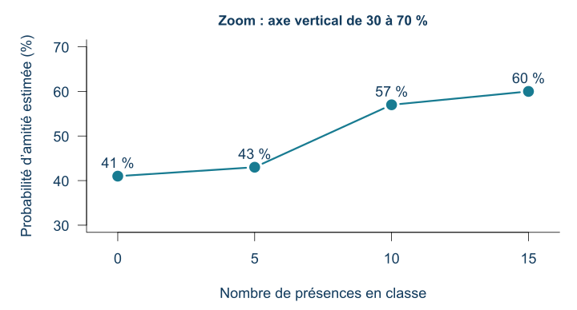
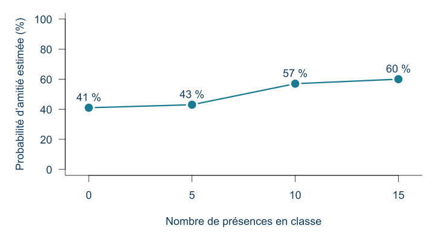
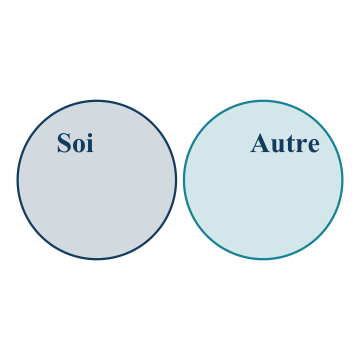
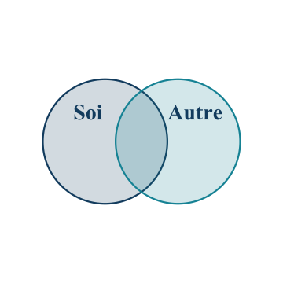

## Quiz de lecture 5 — 1,25 %

**Cours 6 et chapitre 6 · 8 questions · 10 minutes · Travail individuel**





## Les prochaines évaluations

**Quiz 6 · 3 novembre · 1,25 %**

**Matière évaluée : cours 7 et chapitre 8 — Les relations interpersonnelles.**

8 questions · 10 minutes. Les 8 meilleurs quiz sur 10 comptent pour **10 %**.

**Examen 2 · 10 novembre · 30 %**

Cours **5 à 8** et chapitres **5, 6, 8 et 9**. Répartition annoncée : **50 % cours / 50 % manuel**.

Note : Puisque la plupart des concepts vus dans le cours sont aussi dans le manuel, cela implique que les 50 % des questions associées aux cours seront fort probablement aussi dans le manuel. Ainsi, il est conseillé de donner un peu plus de poids à l’étude des cours plutôt qu’au manuel.

[Guide d’étude de l’examen 2](../../examens/02/guide.qmd)

::: {.notes}
Reprendre les mêmes dates et pondérations qu’en ouverture. Le quiz comporte 8 questions et dure 10 minutes. Communiquer les accès séparément lorsqu’ils sont disponibles. Renvoyer au guide cumulatif sans le présenter comme une liste de questions d’examen.
:::


## Plan de la séance

1. **Communiquer et faire connaissance**
2. **L’amour et l’attachement**
3. **L’engagement et les conséquences des relations**

**Pour commencer :** comment comprend-on ce que l’autre personne veut dire?

## La communication non verbale {#que-se-passe-t-il-entre-ces-personnes}

**Sans son, notez : 1. les émotions; 2. le sujet.**

```{=html}
<iframe id="ramdam-extrait" width="1450" height="540" src="https://www.youtube.com/embed/yn9RoD24bDY?start=27&end=63&mute=1&cc_load_policy=0&rel=0" title="Ramdam — échange entre deux personnages" allow="autoplay; fullscreen; encrypted-media" allowfullscreen></iframe>
<div style="display:flex;gap:18px;margin-top:12px">
<button type="button" onclick="document.getElementById('ramdam-extrait').src='https://www.youtube.com/embed/yn9RoD24bDY?start=27&amp;end=63&amp;mute=1&amp;autoplay=1&amp;cc_load_policy=0&amp;rel=0'" style="font:inherit;font-size:26px;padding:8px 18px;cursor:pointer">Rejouer sans son</button>
<button type="button" onclick="document.getElementById('ramdam-extrait').src='https://www.youtube.com/embed/yn9RoD24bDY?start=27&amp;end=63&amp;mute=0&amp;autoplay=1&amp;cc_load_policy=0&amp;rel=0'" style="font:inherit;font-size:26px;padding:8px 18px;cursor:pointer">Rejouer avec son</button>
</div>
```

::: {.credit}
Ramdam, saison 3, épisode 14 · Extrait de 0:30 à 1:03 · [Ouvrir la vidéo](https://www.youtube.com/watch?v=yn9RoD24bDY&t=30s).
:::

::: {.notes}
Premier visionnement sans son ni sous-titres. Avant de lancer : « Pendant le visionnement, écrivez dans vos notes : d’abord les émotions que vous pensez reconnaitre chez chaque personne, puis le sujet précis dont elles parlent. Quelques mots suffisent; si le sujet reste incertain, notez votre hypothèse. » Laisser les personnes écrire pendant la vidéo, sans solliciter de réponses publiques avant la fin. Retenir les indices observés pour le débreffage. Ne pas annoncer laquelle devrait être la plus facile. Ne pas annoncer le conflit ou la colère à l’avance. Après l’extrait, recueillir les prédictions et distinguer les observations (regard, visage, posture, mouvements) des émotions inférées. Le titre du lecteur peut fournir un indice : lancer l’extrait dès que possible sans commenter ce titre. Le lecteur démarre muet; vérifier aussi que les sous-titres sont désactivés.
Utiliser « Rejouer avec son » sous le lecteur pour relancer les mêmes 33 secondes à 0:30. « Rejouer sans son » relance également au bon repère. Éviter le bouton natif de reprise YouTube, qui peut repartir au début de l’épisode. Si nécessaire, utiliser le lien de la vidéo et revenir à 0:30. Lecture et débreffage : environ cinq minutes au total.
:::

## Comparons nos prédictions

**Reprenez les deux prédictions écrites dans vos notes pendant le visionnement.**

| 1. Quelles émotions vivent-ils? | 2. De quoi parlent-ils? |
|---|---|
| Qu’avez-vous perçu chez chaque personne? | Quel sujet précis avez-vous imaginé? |

::: {.fragment}
**Rejouons avec le son.** Quelles prédictions sont confirmées, à préciser ou à revoir dans chaque colonne?
:::

::: {.fragment}
**Qu’avez-vous le mieux anticipé : les émotions ou le sujet? Quels indices vous ont aidés?**
:::

::: {.notes}
Après le premier passage, recueillir quelques réponses dans chacune des deux colonnes, avant de rejouer avec le son via le bouton dédié. Faire garder les prédictions initiales pour éviter de les reconstruire après coup. Après le second passage, demander séparément qui avait anticipé les émotions et qui avait anticipé le sujet; accepter une confirmation partielle. Le contraste attendu par Rémi est une reconnaissance des émotions plus facile que celle du sujet précis; recueillir ce qui se produit réellement sans annoncer un taux de succès ni fabriquer une différence. Le dialogue et le contexte permettent de vérifier le sujet et d’étayer ou nuancer les émotions inférées; ils ne mesurent pas directement l’état intérieur. Faire relever ce qu’apportent les mots et ce qu’ajoutent le ton, le rythme et le volume. Transition vers la définition des systèmes verbal et non verbal sur la diapositive suivante, puis vers les aspects informationnel et relationnel. L’activité ouvre la matière immédiatement après le plan, avant les définitions, pour préserver la découverte. Environ cinq minutes au total; aperçu de communication maintenu à 12–15 minutes. Repli sans vidéo : jouer une même phrase avec deux tons et faire comparer les indices. Sources conceptuelles : chapitre 7, p. 223–227 et 236–237. Aucun objectif évaluable supplémentaire.
:::

## La communication verbale et non verbale

La **communication** est un échange dans lequel les personnes transmettent des informations et construisent du sens ensemble.

| Système | Exemples |
|---|---|
| **Verbal** : les mots, à l’oral ou à l’écrit | Une question, une invitation, un message texte |
| **Non verbal** : les autres indices de l’échange | Le ton de la voix, le regard, les expressions du visage, les gestes, la distance |

Ces indices se combinent pour interpréter un message.

::: {.notes}
3 minutes. Aperçu du chapitre 7, p. 222–225. Reformulation de la perspective de construction du sens. La communication verbale ne se limite pas à la parole; le ton est un indice non verbal qui accompagne les mots. Ne pas ajouter une typologie de sous-disciplines ni de pourcentages sur le poids du verbal/non-verbal.
:::

## Un message transmet aussi une relation

L’**aspect informationnel** concerne le contenu du message.

L’**aspect relationnel** concerne la façon dont les personnes se situent l’une par rapport à l’autre : proximité, distance, autorité, soutien…

**« Tu peux fermer la porte? »**

Selon le ton et la situation, la même phrase peut être une demande calme, un reproche ou une manière de préserver une conversation privée.

::: {.notes}
4 minutes. Chapitre 7, p. 223–224, 226–227 et 236–237. Exemple original. Faire entendre deux tons, puis donner le contexte. Les mots, le ton et la situation se combinent : un indice isolé ne détermine pas toujours le sens. Pas de vocabulaire détaillé des actes de langage à mémoriser.
:::

## Les relations interpersonnelles {#un-intérêt-réciproque}

**Manolo et Constance : quels signes d’attirance réciproque?**

```{=html}
<iframe id="ramdam-attraction" width="1450" height="540" src="https://www.youtube.com/embed/bWQuCQm-X20?start=878&end=982&cc_load_policy=0&rel=0" title="Ramdam — Manolo et Constance" allow="autoplay; fullscreen; encrypted-media" allowfullscreen></iframe>
<div style="display:flex;gap:18px;margin-top:12px">
<button type="button" onclick="document.getElementById('ramdam-attraction').src='https://www.youtube.com/embed/bWQuCQm-X20?start=878&amp;end=982&amp;mute=0&amp;autoplay=1&amp;cc_load_policy=0&amp;rel=0'" style="font:inherit;font-size:26px;padding:8px 18px;cursor:pointer">Rejouer</button>
</div>
```

::: {.credit}
Ramdam · Manolo et Constance · Extrait de 14:38 à 16:26 · [Ouvrir la vidéo](https://www.youtube.com/watch?v=bWQuCQm-X20&t=878s).
:::

::: {.notes}
Ouverture du thème des relations après l’aperçu de communication. Montrer avec son : on cherche ici à comprendre l’attirance et l’incertitude quant à sa réciprocité. Avant : demander de retenir un indice pour chaque personne. Après : environ une minute de discussion, en séparant ce que Manolo éprouve, ce qu’il communique effectivement et ce que Constance manifeste. Distinguer les pensées ou situations imaginées du personnage de l’échange réel. Son hésitation ne permet pas à elle seule de conclure sur l’intérêt de Constance. Recueillir les indices favorables à une interprétation et ceux qui restent ambigus, sans résoudre toute l’histoire. Reprendre brièvement cette scène à la diapositive sur l’attirance réciproque. Environ trois minutes au total, vidéo comprise; garder le débreffage bref avant de passer aux concepts. Le bouton « Rejouer » relance le même extrait avec son; le premier visionnement se fait aussi avec son. Repli : raconter une situation fictive où une personne souhaite inviter l’autre, hésite, puis reçoit une proposition de rencontre sans déclaration explicite d’attirance.
:::

## Qu’est-ce qu’une relation interpersonnelle?

Une **relation interpersonnelle** est un lien continu entre des personnes qui s’influencent mutuellement dans un contexte social et au fil du temps.

Une amitié a une histoire, des attentes et une tonalité émotionnelle.

Le **besoin d’appartenance** est le besoin de créer et de maintenir des relations importantes, durables et positives.

::: {.notes}
Manuel p. 248–251 et glossaire p. 438, 447. Reformulations. Le cadre cognitif comprend les croyances sur la relation et les attentes à l’égard de l’autre.
:::

## L’interdépendance sociale

L’**interdépendance sociale** désigne la dépendance mutuelle entre les personnes dans leurs échanges.

Pour décrire l’influence réciproque, regardons :

- **la fréquence** des interactions;
- **les domaines** de vie concernés;
- **la force** de l’influence sur les comportements.

Choisir un jeu une fois ou organiser ensemble logement, finances et loisirs ne mobilise pas les mêmes domaines.

::: {.notes}
Manuel p. 250. La théorie examine les effets des échanges sur les pensées, les motivations et les comportements. Exemple fictif, sans hiérarchiser les différentes formes de relation.
:::

## L’attraction interpersonnelle

L’**attraction interpersonnelle** désigne une évaluation positive d’une autre personne et le désir de s’en rapprocher.

Elle peut concerner une amitié ou une relation amoureuse.

Aimer passer du temps avec Manolo ne signifie pas nécessairement souhaiter une relation amoureuse.

**Quels facteurs peuvent faciliter cette attirance?** Nous examinerons la proximité, la familiarité, la similitude, l’attirance réciproque et l’apparence physique.

## Proximité et familiarité

*Imaginons d’autres situations avec Manolo et Constance pour explorer les concepts.*

L’**effet de proximité** : les personnes proches géographiquement ont davantage d’occasions de nouer une relation.

L’**effet de simple exposition** : les expositions répétées peuvent augmenter l’appréciation d’une personne, devenue plus familière.

::: {.fragment}
**Proximité géographique → occasions de se rencontrer et de se revoir → familiarité accrue → attraction favorisée.**

La familiarité contribue ainsi à expliquer l’effet de proximité, dans la formation d’amitiés comme de relations amoureuses.
:::

**Manolo et Constance suivent le même cours de mathématiques et se retrouvent en classe chaque semaine. Quel indice montre la proximité? Que faudrait-il observer pour parler d’un effet de simple exposition?**

::: {.notes}
Manuel p. 252. Environ quatre minutes. Développer la chaine : suivre le même cours dans la même classe facilite la première rencontre, mais aussi les rencontres suivantes, parce que les occasions reviennent et demandent moins d’organisation. La répétition peut rendre la personne plus familière et favoriser l’appréciation. La familiarité est une explication de l’effet de proximité, pas son unique mécanisme ni une garantie d’amitié ou d’amour. Contraste : même salle de cours = proximité; croiser souvent = exposition répétée; apprécier davantage après ces rencontres = changement à observer pour illustrer la simple exposition. Ajouter « Au fil des semaines, Manolo apprécie davantage Constance » après les réponses de la classe. Si utile, demander de penser en privé au contexte d’une rencontre amicale, sans nommer la personne : qu’est-ce qui permettait de se revoir? Possibilité d’utiliser le cas fictif seulement. Transfert : dans une nouvelle ville, quelle activité régulière pourrait créer des occasions de revoir les mêmes personnes? Intégrer cette question au temps prévu, sans nouvel atelier. La prochaine étude examine une exposition sans conversation.
:::

## La simple exposition en classe {#voir-plus-souvent-apprécier-davantage}

Dans un **cours universitaire en présentiel**, quatre femmes participent à l’étude avec l’équipe de recherche : elles se font passer pour des étudiantes du cours.

- Chacune vient à un nombre différent de cours pendant le trimestre : **0, 5, 10 ou 15**. La classe ne voit donc jamais l’une d’elles.
- Lorsqu’elles sont présentes, elles **ne discutent pas avec les personnes étudiantes** : celles-ci peuvent les voir, sans apprendre à les connaitre par une conversation.
- À la fin du trimestre, **130 personnes étudiantes du cours** voient leurs photographies et évaluent notamment la possibilité de devenir leur amie ou ami.

**Votre prédiction : une personne vue plus souvent semblera-t-elle plus attirante comme amie, même sans lui avoir parlé?**

::: {.notes}
Moreland et Beach (1992), résumé original revérifié le 20 octobre sur le profil Academia de Richard Moreland. Quatre femmes d’apparence similaire jouent le rôle d’étudiantes dans un grand cours universitaire. Les présences sont physiques dans la classe; les photographies sont présentées lors de l’évaluation finale, pas pendant la manipulation. La femme à zéro présence fournit la comparaison avec un visage jamais rencontré dans ce cours. Faire imaginer à la classe une personne qui vient s’assoir à différents cours sans engager de conversation. Distinguer les femmes qui collaborent au protocole des personnes étudiantes qui les évaluent. Facteur comparé : nombre de présences. Mesure montrée sur la figure suivante : probabilité subjective de devenir proches par une amitié, pas amitiés effectivement formées. Recueillir une prédiction avant le résultat. Lien avec la familiarité p. 252 du manuel. Les nombres exacts et détails du protocole ne sont pas à mémoriser.
:::

## La présence et l’envie de nouer une amitié

{height=450 fig-alt="Probabilité moyenne estimée de nouer une amitié : 41 %, 43 %, 57 % et 60 % pour 0, 5, 10 et 15 présences."}

<details style="font-size:24px"><summary>Voir l’échelle complète de 0 à 100 %</summary></details>

::: {.credit}
Source : [Moreland et Beach (1992), tableau 2](https://doi.org/10.1016/0022-1031(92)90055-O). Moyennes publiées; figure redessinée.
:::

::: {.notes}
Lire les axes : horizontal = présences; vertical = probabilité subjective de nouer une amitié, pas proportion de relations réellement créées. Graphique principal : zoom identifié de 30 à 70 %. Montrer aussi l’échelle complète 0–100 % dans le volet. Le zoom facilite la lecture des différences; il ne démontre ni leur importance pratique ni leur significativité. Moyennes .41, .43, .57, .60; écarts-types .27, .26, .24, .25, non représentés. Le profil illustre qu’une exposition sans conversation peut favoriser l’attirance. Ne pas demander de mémoriser les valeurs ni conclure à une amitié réelle.
:::

## La similitude et l’attirance

La **similitude** correspond à des ressemblances entre les personnes, notamment dans leurs attitudes, leurs valeurs et leurs intérêts. Ces ressemblances peuvent **favoriser l’attirance**.

**Imaginons que Manolo découvre que Constance aime les mêmes groupes de musique que lui.**

Pourquoi cette découverte pourrait-elle lui donner davantage envie de passer du temps avec elle?

::: {.fragment}
Un gout commun leur donne un sujet de conversation et une activité à partager. Manolo peut aussi avoir le sentiment que Constance le comprend.
:::

::: {.notes}
Objectif : comprendre pourquoi découvrir une ressemblance peut favoriser le rapprochement, au-delà de simplement classer le type de ressemblance. Cas imaginé, pas une affirmation sur les préférences réelles des personnages. Recueillir deux propositions avant de révéler les pistes. Faire développer : parler d’un groupe apprécié, échanger des chansons, envisager un spectacle ensemble. Le sentiment d’être compris est une interprétation possible du personnage, pas une donnée établie par ce scénario. Contraste avec la proximité : ici, l’information pertinente est le gout partagé, pas le nombre de rencontres. Contraste avec l’attirance réciproque, présentée ensuite : aimer la même musique ne dit pas encore si Constance apprécie Manolo. Demander oralement « Quelle information supplémentaire montrerait qu’elle l’apprécie aussi? » Deux à trois minutes. La similitude favorise le rapprochement sans garantir une relation; ne pas présenter toutes les différences comme des obstacles. La définition et le lien similitude/attraction reprennent la matière déjà au cours; les mécanismes illustratifs ne constituent pas de nouveaux objectifs évaluables.
:::

## L’attirance réciproque

L’**attirance réciproque** : apprendre qu’une personne nous apprécie peut favoriser notre attirance envers elle.

« Constance m’a dit avoir aimé notre conversation. »

::: {.fragment}
Ce nouvel indice porte sur ce que Constance ressent; il ne prouve pas que Manolo et Constance se ressemblent.
:::

::: {.notes}
Retour bref à Manolo et Constance : quels indices de la scène permettent de penser que l’intérêt pourrait être réciproque? Quelle information manque encore? Distinguer pensées de Manolo et indices exprimés par Constance.
:::

## Deux envies à concilier

::: {.columns}
::: {.column width="42%"}
```{=html}
<div style="position:relative;width:370px;height:560px;margin:auto">

<div style="position:absolute;left:38px;top:55px;width:115px;text-align:center;font-size:17px;font-weight:700;line-height:1.1;color:#111;transform:rotate(-12deg)">Me rapprocher<br>de cette personne</div>
<div style="position:absolute;left:161px;top:40px;width:112px;text-align:center;font-size:17px;font-weight:700;line-height:1.1;color:#111;transform:rotate(-12deg)">Ne pas trop<br>m’exposer</div>
</div>
```
:::
::: {.column width="58%"}
« J’ai envie de lui parler. »

« Je ne veux pas risquer un refus. »

**Quelle information rendrait le rapprochement moins incertain?**

::: {.fragment}
Un signe que l’autre personne apprécie aussi la rencontre peut favoriser l’attirance réciproque.
:::
:::
:::

::: {.credit}
Jake Clark, *Daily Struggle / Two Buttons* · [source du modèle](https://imgflip.com/memetemplate/Two-Buttons) · légendes françaises originales.
:::

## L’apparence physique

L’apparence peut influencer les premières impressions et l’attraction.

Une impression favorable peut aussi déborder vers des qualités qui n’ont pas été observées directement.

**Exemple fictif :** « Cette personne est attirante, donc elle doit être attentionnée. »

Quel élément de cette conclusion demanderait une information supplémentaire?

::: {.notes}
Réponse attendue : « Elle doit être attentionnée. » C’est la qualité personnelle attribuée qui demande des informations supplémentaires; juger une personne physiquement attirante ne renseigne pas à lui seul sur sa façon de traiter les autres. Demander quel indice serait pertinent : par exemple, observer comment elle écoute une personne en difficulté ou tient compte de ses besoins. Le cas illustre l’attribution de qualités positives à partir de l’apparence physique, phénomène décrit au chapitre 8, p. 253. Présenter ce mécanisme en mots simples; ne pas introduire « effet de halo » comme terme supplémentaire à apprendre. Ne pas conclure que la personne n’est pas attentionnée : cette qualité reste à vérifier. Faire reformuler : « Je la trouve attirante; je ne sais pas encore si elle est attentionnée. »
:::

## Ronde 1 — Qu’est-ce qui favorise le rapprochement?



Trois questions, puis une explication des réponses.

[Passer à la pause](#pause-1)

::: {.notes}
Présenter les questions dans Wooclap, puis reprendre à la pause. Les diapositives suivantes conservent les questions pour la consultation. Repli sans connexion : les projeter et recueillir les réponses oralement.
:::

## 1. Même corridor, mêmes horaires

Manolo et Constance empruntent régulièrement le même corridor.

Quel facteur facilite leurs rencontres?

A. La proximité géographique

B. La similitude des intérêts

C. La révélation de soi

::: {.notes}
Réponse A. La proximité. Les rencontres répétées peuvent aussi favoriser la familiarité. Faire préciser le détail utilisé.
:::

## 2. Les mêmes activités

Manolo et Constance constatent : « On aime les mêmes activités. »

Quel facteur d’attirance cette information illustre-t-elle?

A. La proximité géographique

B. La similitude des intérêts

C. L’attirance réciproque

::: {.notes}
Réponse B. La similitude des intérêts.
:::

## 3. Un signe d’intérêt

Manolo apprend que Constance l’apprécie, ce qui augmente son envie de se rapprocher d’elle.

Quel mécanisme illustre ce cas?

A. La similitude des intérêts

B. La simple exposition

C. L’attirance réciproque

::: {.notes}
Réponse C. L’attirance réciproque. Le signe d’intérêt ne prouve pas la similitude.
:::

## Pause — 10 minutes {#pause-1}

**10 minutes**



Proposez une chanson ou une photo de votre animal pour la pause.



::: {.notes}
Annoncer oralement l’heure de retour. Maintenir le rituel habituel de chanson et de photo, sans imposer de participation personnelle.
:::

## Atelier : imaginons la suite de leur rencontre



**Équipes de 3 ou 4 · 10 minutes de discussion**

Manolo et Constance suivent le même cours de maths. Au lieu d’écouter le prof, ils discutent et découvrent des gouts musicaux communs. Constance lui dit : « J’aime vraiment parler avec toi! » Manolo souhaite la revoir.

1. Repérez **deux facteurs qui facilitent l’attirance** et leurs indices dans cette scène.
2. **Manolo change de groupe de maths : ils ne partagent plus ce cours.** Inventez une suite avec **deux actions ou échanges concrets** qui pourraient favoriser leur rapprochement, en utilisant deux facteurs étudiés.
3. Préparez **une minute pour raconter votre scène**, donner une réplique de Constance et expliquer à quels facteurs vos deux actions correspondent.

::: {.notes}
Objectif : passer du repérage des facteurs à leur application dans une nouvelle situation, puis montrer le lien entre une action précise et un mécanisme de rapprochement. Aucun dessin ni texte à remettre; discussion et quelques notes seulement. Personnages et suite imaginaires. Dix minutes après les consignes, puis présentations et débreffage hors minuterie. Répartition indicative : deux minutes pour identifier les facteurs, cinq pour inventer et discuter la suite, trois pour préparer la restitution. Une personne porte-parole raconte; deux personnes peuvent aussi lire les répliques si elles le souhaitent.

Première partie, réponses acceptées : similitude = gouts musicaux communs; attirance réciproque = appréciation exprimée par Constance et désir de Manolo de la revoir; proximité = même classe de maths avant le changement de groupe. La répétition des rencontres rend possible la familiarité, mais le scénario ne permet pas d’isoler un effet de simple exposition. Faire choisir deux facteurs, pas les énumérer tous.

Problème imposé : le changement de groupe enlève une occasion régulière de contact. Il n’efface ni les gouts communs ni l’appréciation déjà exprimée. Les équipes doivent inventer deux actions ou échanges observables et les relier à deux facteurs; « ils tombent amoureux » ou « ils se rapprochent » sont des issues, pas des actions précises.

Exemple de scène acceptable : Manolo propose d’aller au club de musique du midi chaque mercredi. Constance répond : « Oui, et je pourrais te faire écouter le nouvel album du groupe dont on parlait! » Elle lui écrit ensuite : « J’ai aimé notre midi ensemble; on recommence mercredi? »

Liens possibles dans cet exemple : rendez-vous régulier au même endroit = nouvelles occasions de proximité et de rencontres répétées; album apprécié en commun = similitude des intérêts; réplique et invitation de Constance = signe d’intérêt qui peut favoriser l’attirance réciproque. L’équipe en sélectionne deux et cite les détails correspondants. Ne pas compter automatiquement deux activités musicales comme deux facteurs distincts. Une invitation isolée ne suffit pas à établir la familiarité; plusieurs rencontres sont nécessaires pour envisager le rôle de l’exposition répétée.

Modèle de restitution d’une minute : « Manolo change de groupe et perd ses occasions de voir Constance en maths. Il lui propose le club de musique du mercredi. Elle accepte et propose un album qu’ils aiment tous les deux, puis lui demande de revenir. Le club recrée des rencontres régulières : c’est la proximité. Son invitation à recommencer montre à Manolo qu’elle apprécie sa compagnie : c’est l’attirance réciproque. »

Autres suites acceptables : rendez-vous régulier à la bibliothèque, activité partagée en lien avec un intérêt commun, expression explicite du plaisir de se revoir. Pour une réponse de Constance ambigüe ou moins enthousiaste, accepter la scène si l’équipe explique que la réciprocité reste incertaine : une démarche de rapprochement ne garantit pas son succès. Le but n’est pas de produire une recette pour obtenir l’affection de quelqu’un.

Débreffage : demander « Quelle action crée des occasions de se revoir? », « Quel détail montre une ressemblance? » ou « Quelle réplique indique un intérêt réciproque? » selon les choix. Faire préciser un lien manquant plutôt que demander vaguement une explication. Selon le temps et le nombre d’équipes, recueillir quelques scènes contrastées puis une autre proposition d’une équipe restante.
:::

## Tour des équipes

**Une minute par équipe : racontez votre scène ou faites entendre ses répliques.**

- Comment Manolo et Constance se retrouvent-ils après le changement de groupe?
- Que fait ou dit chaque personne?
- Quels sont les **deux facteurs** mobilisés, et quels détails de votre scène les illustrent?

::: {.notes}
Faire présenter une scène concrète avant les noms des concepts. Écouter les liens action/facteur : occasions de contact pour la proximité; ressemblance identifiable pour la similitude; appréciation exprimée favorisant le rapprochement pour l’attirance réciproque. Inviter brièvement la classe à repérer un facteur avant la justification de l’équipe, si le temps le permet. Valoriser la diversité des suites cohérentes plutôt qu’une fin romantique obligatoire. Garder présentations et débreffage hors des dix minutes de travail.
:::

## Révélation de soi et intimité

La **révélation de soi** consiste à communiquer des informations personnelles à son sujet.

L’**intimité** renvoie au sentiment de proximité et de lien dans une relation.

**Constance raconte une déception. Comparez les deux réponses de Manolo :**

- « Tu exagères. »
- « Qu’est-ce qui t’a le plus affectée? »

::: {.fragment}
**Quel indice montre la révélation de soi? Quelle information manque pour savoir si Constance ressent davantage d’intimité?**
:::

::: {.notes}
Réponse à « Quel indice montre la révélation de soi? » : Constance raconte une déception personnelle à Manolo. Elle communique une information sur son vécu; c’est cet acte de confidence qui illustre la révélation de soi, quelle que soit la réponse de Manolo.

Réponse à « Quelle information manque pour savoir si Constance ressent davantage d’intimité? » : il manque une indication du sentiment de proximité de Constance après cet échange, comparativement à avant. Nous connaissons les paroles de Manolo, mais pas ce que Constance ressent ensuite. Une réponse attentive peut favoriser l’intimité sans suffire à établir qu’elle a augmenté.

Information à ajouter pour illustrer l’intimité : « Après cet échange, Constance se sent plus proche de Manolo et mieux comprise qu’avant. » Faire ensuite identifier ce que cette information apporte : elle renseigne sur le lien ressenti, alors que la confidence renseignait sur la communication d’un vécu personnel.

Comparaison des réponses de Manolo : « Tu exagères » minimise le vécu de Constance; « Qu’est-ce qui t’a le plus affectée? » l’invite à développer ce vécu. Demander laquelle pourrait davantage l’aider à se sentir comprise et pourquoi. On attend une possibilité plausible, pas une certitude sur l’effet produit chez Constance. Faire proposer une autre réponse attentive si le temps le permet.

Conclusion à formuler : raconter quelque chose de personnel = révélation de soi; se sentir plus proche après l’échange = intimité accrue. Les deux notions sont liées mais ne sont pas synonymes. Environ cinq minutes, aucune confidence personnelle demandée à la classe. Manuel p. 254–255.
:::

## L’inclusion de l’autre en soi

L’**inclusion de l’autre en soi** est l’intégration de ressources et d’aspects de l’autre personne dans sa représentation de soi.

```{=html}
<div style="display:flex;justify-content:center;align-items:center;gap:25px;margin:10px auto 25px;">



</div>
```

**Davantage de chevauchement représente une plus grande inclusion perçue de l’autre en soi.**

**Que représente la zone commune aux deux cercles?**

::: {.credit}
Visualisation avec [Rémi Thériault, rempsyc — overlap_circle](https://rempsyc.remi-theriault.com/reference/overlap_circle.html). Trois exemples illustratifs; styles adaptés.
:::

::: {.notes}
Manuel p. 254; glossaire p. 443. Ressources matérielles, personnelles ou informationnelles. Exemple fictif à raconter : Manolo découvre les jeux et le cercle d’amitié de Constance, puis commence à se voir comme une personne capable d’animer une soirée. Quel changement concerne la façon dont Manolo se perçoit? Le concept dépasse le partage d’un loisir. Les cercles reprennent la représentation visuelle du soi et de l’autre utilisée dans l’échelle IOS. Présenter ici trois exemples, sans administrer l’échelle ni demander de confidences. Ils ne montrent pas des résultats d’étude ou des étapes obligatoires. La fonction overlap_circle a été développée par Rémi Thériault; elle produit des chevauchements à partir d’un score IOS. Les nombres sont masqués pour centrer l’attention sur le concept. Ne pas présenter le chevauchement comme un pourcentage littéral d’identité partagée ni comme un idéal à maximiser.
:::

## Le schéma relationnel

Un **schéma relationnel** organise ce que nous attendons d’une interaction :

- une représentation de **soi**;
- une représentation de **l’autre**;
- un **scénario** de ce qui se passe habituellement entre les deux.

**Exemple fictif :** « Quand je demande de l’aide, Constance m’écoute et nous cherchons une solution. »

::: {.notes}
Manuel p. 255–256; glossaire p. 447. Le soi relationnel renvoie à la représentation de soi dans une relation avec une personne importante. Différents liens peuvent rendre accessibles différentes façons de se percevoir. Les expériences avec des personnes marquantes contribuent aux attentes, y compris dans une nouvelle relation.
:::

## L’amour-tendresse et l’amour-passion

L’**amour-tendresse** se caractérise par l’affection, la confiance, la proximité et le souci du bien-être de l’autre.

L’**amour-passion** correspond à un désir intense d’union avec l’autre, accompagné d’émotions vives.

| Forme d’amour | Expériences associées |
|---|---|
| **Amour-tendresse** | Satisfaction relationnelle, respect, intimité; moins de sentiments négatifs |
| **Amour-passion** | Euphorie et excitation, mais aussi anxiété et instabilité émotionnelle possibles |

**Une relation moins « électrisante » est-elle nécessairement moins satisfaisante?**

::: {.notes}
Manuel p. 257, directement revérifié le 20 octobre; glossaire p. 437. L’amour-tendresse est associé au respect, à la tolérance, à l’amitié, à la satisfaction relationnelle et à l’intimité sexuelle. Le texte indique aussi qu’il préviendrait des expériences négatives : colère, anxiété, dépression et solitude. Présenter ces liens comme des associations, sans promettre qu’une forme d’amour protège chaque personne de toute difficulté.

L’amour-passion peut comporter désir, euphorie et activation agréable, mais aussi crainte du rejet, anxiété, instabilité et préoccupations envahissantes. Il ne faut donc pas assimiler intensité émotionnelle et bonheur : les émotions peuvent être positives ou négatives, notamment selon la réciprocité. Le manuel rapporte également une étude sur la difficulté à maintenir son contrôle cognitif en début de relation passionnelle; détail non nécessaire au débreffage, sans nouvelle notion à mémoriser.

Réponse à la question : non. Une relation moins électrisante peut être satisfaisante grâce à l’affection, la confiance et la proximité. Inversement, la passion ne signifie pas automatiquement insatisfaction : tendresse et passion peuvent coexister. Ne pas imposer un remplacement universel de la passion par la tendresse avec le temps, ni confondre amour-passion et modèle dualiste de la passion retiré de l’oral.

Complément de recherche, facultatif : Kim et Hatfield (2004), Love types and subjective well-being: A cross-cultural study, https://www2.hawaii.edu/~elaineh/104.pdf. Leur enquête distingue satisfaction générale envers la vie et émotions positives/négatives; le résumé rapporte une association plus forte de l’amour-tendresse avec la première, et de l’amour-passion avec l’expérience émotionnelle. Ce n’est pas une comparaison causale de traitements ni une mesure limitée à la satisfaction conjugale. Ne pas présenter l’amour-passion comme un synonyme d’affect négatif.
:::

## Le modèle triangulaire de l’amour

```{=html}
<svg viewBox="0 0 1300 560" role="img" aria-labelledby="triangle-amour-titre triangle-amour-description" style="display:block;width:100%;height:540px;margin:0 auto">
<title id="triangle-amour-titre">Le modèle triangulaire de l’amour</title>
<desc id="triangle-amour-description">Les trois sommets représentent l’intimité, la passion et l’engagement. L’intimité correspond à la proximité et au lien affectif, la passion à l’attirance et au désir amoureux, et l’engagement à la décision de maintenir la relation. Ces composantes peuvent varier séparément.</desc>
<polygon points="650,110 290,390 1010,390" fill="#edf4f6" stroke="#24566a" stroke-width="5"/>
<g fill="#24566a"><circle cx="650" cy="110" r="10"/><circle cx="290" cy="390" r="10"/><circle cx="1010" cy="390" r="10"/></g>
<g font-family="Arial,sans-serif" text-anchor="middle" fill="#193e50">
<text x="650" y="35" font-size="38" font-weight="700">Intimité</text>
<text x="650" y="75" font-size="28">Proximité et lien affectif</text>
<text x="290" y="450" font-size="38" font-weight="700">Passion</text>
<text x="290" y="490" font-size="28">Attirance et activation</text>
<text x="290" y="525" font-size="28">liées au désir amoureux</text>
<text x="1010" y="450" font-size="38" font-weight="700">Engagement</text>
<text x="1010" y="490" font-size="28">Décision de maintenir</text>
<text x="1010" y="525" font-size="28">la relation</text>
<text x="650" y="285" font-size="28">Trois composantes</text>
<text x="650" y="325" font-size="28">qui peuvent varier séparément</text>
</g>
</svg>
```

::: {.notes}
Schéma conceptuel original du modèle triangulaire de l’amour de Sternberg, reprenant les trois définitions déjà présentées au cours. Chaque sommet représente une composante; ce dessin ne représente ni des données ni les niveaux mesurés d’un couple. Faire évoquer les indices observés dans la scène de Manolo et Constance, puis passer au cas suivant pour distinguer désir, proximité affective et décision de poursuivre la relation. Les composantes peuvent évoluer séparément au fil de la relation.
:::

## Trois composantes, un exemple

Manolo et Constance ont beaucoup de désir et se connaissent encore peu.

<label><input type="radio" name="triangle"> Intimité</label><br>
<label><input type="radio" name="triangle"> Passion</label><br>
<label><input type="radio" name="triangle"> Engagement</label>

Quelle composante est la plus directement décrite? Quel indice manque pour parler d’engagement?

::: {.notes}
Passion. L’engagement demande une information sur la décision de poursuivre la relation. L’exercice ne vise pas à attribuer une étiquette globale à un couple à partir d’une seule phrase.
:::

## Pause — 10 minutes {#pause-2}

**10 minutes**



Proposez une chanson ou une photo de votre animal pour la pause.



::: {.notes}
Annoncer oralement l’heure de retour. Maintenir le rituel habituel de chanson et de photo, sans imposer de participation personnelle.
:::

## L’attachement : deux dimensions

L’**attachement** est un lien affectif qui pousse à chercher la proximité d’une personne pouvant apporter attention et réconfort.

- **Anxiété d’abandon** : crainte de perdre l’affection de l’autre ou de voir la relation se terminer.
- **Évitement de l’intimité** : inconfort devant la proximité et la dépendance affective.

::: {.fragment}
| | Anxiété faible | Anxiété élevée |
|---|---|---|
| **Évitement faible** | Sécurisant | Préoccupé |
| **Évitement élevé** | Détaché | Craintif |
:::

::: {.notes}
Manuel p. 260–262; glossaire p. 438, 444–445. Prendre environ quatre minutes : définir chaque dimension, puis construire les quatre combinaisons avec la classe. Les styles sont relativement stables mais peuvent changer et varier selon la relation. La matrice est une représentation conceptuelle originale. Passer ensuite au même évènement interprété de différentes façons.
:::

## Manolo attend une réponse de Constance

**Constance ne répond pas depuis quelques heures. Voici trois réactions fictives de Manolo :**

1. « Constance n’est sans doute pas disponible. Je lui raconterai ma journée plus tard. »
2. « Et si Constance ne voulait plus me voir? Je vais envoyer plusieurs messages. »
3. « J’aimerais avoir une réponse, mais parler de ce que je ressens me met mal à l’aise. »

**Pour chaque réaction : quel indice concerne la peur de perdre le lien? Lequel concerne l’inconfort devant la proximité?**

::: {.notes}
Environ cinq minutes de discussion guidée, pas un atelier supplémentaire. Réactions illustratives, pas des données ni un diagnostic. La première est compatible avec peu d’anxiété; elle ne suffit pas à établir tout un style. La deuxième illustre une anxiété plus élevée et une recherche accrue de proximité. La troisième illustre l’inconfort devant l’intimité; vouloir une réponse ne suffit pas à conclure à une anxiété d’abandon élevée. Reprendre les deux dimensions plutôt que forcer une étiquette à partir d’une phrase. Contraster explicitement ce qui est redouté : perdre le lien pour l’anxiété d’abandon; se rapprocher ou dépendre affectivement pour l’évitement. Les deux peuvent coexister. Pour illustrer le profil craintif : ajouter explicitement à la troisième réaction « J’ai peur que notre relation se termine ». Pour le profil détaché : faible peur d’abandon et mise à distance de l’intimité. Montrer comment une information supplémentaire change l’interprétation. Manuel p. 260–262.
:::

## Les échanges et l’équité

L’**échange social** examine les avantages et les couts perçus d’une relation.

L’**équité** est la perception d’un rapport juste entre les contributions et les bénéfices de chaque personne.

::: {.fragment}
**Manolo et Constance préparent un travail d’équipe en maths et recevront la même note.**

Manolo résout les problèmes; Constance vérifie les calculs et rédige les réponses. Manolo doit aussi planifier les rencontres et rappeler les échéances, ce qui lui pèse.

**Que faudrait-il savoir pour comprendre si le partage leur semble équitable?**
:::

::: {.notes}
Manuel p. 249–250; glossaire p. 441. Environ quatre minutes. Scénario imaginé dans le contexte scolaire actuel des personnages, sans emménagement ni saut dans le temps.

Réponses acceptées : temps et effort demandés par chaque tâche; difficulté perçue; préférences et compétences; répartition de la planification et des rappels; bénéfices retirés (note commune, apprentissages); jugement de chaque personne sur sa contribution et celle de l’autre. La même note est un bénéfice commun, mais ne permet pas à elle seule de conclure que le partage est juste ou injuste. Le malaise de Manolo signale une charge perçue à explorer; le point de vue de Constance reste à connaitre.

Exemple concret de question : « Combien de temps chacune de ces tâches vous demande-t-elle, et qui s’occupe de coordonner le travail? » Faire ensuite proposer un ajustement : Constance prend en charge les échéances et l’organisation des rencontres, puis les deux vérifient si le partage leur convient. Ce n’est pas une solution universellement équitable : elle répond à la charge exprimée dans ce cas.

Conclusion : l’équité n’exige pas de faire les mêmes tâches ni de les compter seulement; il faut tenir compte des contributions et des bénéfices perçus par les deux personnes. Ne pas déclarer le partage juste à partir de sa seule description.
:::

## Satisfaction et engagement : deux questions

| Notion | Question à distinguer |
|---|---|
| **Satisfaction** : évaluation de la relation selon les attentes et les échanges vécus | « Cette relation me convient-elle? » |
| **Engagement** : lien qui influence l’intention de poursuivre la relation | « Est-ce que je compte poursuivre cette relation? » |

Le **niveau de comparaison** correspond au standard utilisé pour évaluer ce que l’on reçoit.

::: {.fragment}
Une réponse moins favorable à la première question n’impose pas automatiquement la même réponse à la seconde. Quelles autres informations aideraient à comprendre?
:::

::: {.notes}
Manuel p. 250 et 262–264; glossaire p. 441, 445. Trois minutes. D’abord définir et contraster les deux opérations, puis recueillir les propositions avant le modèle. Reprendre deux phrases : « Je suis bien dans cette relation » renseigne sur la satisfaction; « Je compte poursuivre cette relation » renseigne sur l’engagement. Demander quelle information manque dans chaque phrase pour conclure sur l’autre notion. Attentes et satisfaction ne sont pas identiques à la qualité des autres possibilités. Éviter d’assimiler toute continuation à une relation satisfaisante.
:::

## Le modèle de l’investissement

Les **investissements** sont les ressources consacrées à la relation qui seraient perdues ou diminuées si elle se terminait.

Les **autres possibilités** comprennent une autre relation ou la vie sans cette relation. Leur évaluation correspond au **niveau de comparaison des options possibles**.

::: {.fragment}
| Dans le modèle… | Engagement généralement attendu |
|---|---|
| Plus de satisfaction | Plus fort |
| Plus d’investissements | Plus fort |
| De meilleures autres possibilités | Plus faible |
:::

::: {.notes}
Manuel p. 250 et 262–263. Environ quatre minutes; révéler le tableau après les prédictions de la classe. Définir les ressources par des exemples concrets : temps, projets communs, réseau partagé. Les possibilités ne se limitent pas à une nouvelle personne partenaire. Passer au cas suivant plutôt que multiplier les nouveaux termes.
:::

## Pourquoi Manolo poursuit cette relation?

**Manolo dit : « Les disputes me pèsent, mais je compte poursuivre notre relation. »**

::: {.fragment}
Manolo et Constance ont consacré beaucoup de temps à un projet commun et partagent un cercle d’amitié.
:::

::: {.fragment}
Manolo imagine difficilement une vie satisfaisante sans cette relation.
:::

**Quels éléments éclairent la satisfaction? Lesquels éclairent l’engagement?**

**Si Manolo découvrait des possibilités satisfaisantes en dehors de cette relation, que prédit le modèle pour son engagement?**

::: {.notes}
Environ cinq minutes. Cas fictif, pas un conseil de vie. Faire identifier d’abord ce qui est connu : les disputes sont vécues comme un cout; le jugement global de satisfaction n’est pas entièrement connu. Les projets et le réseau peuvent être des investissements dans la mesure où leur perte serait perçue en cas de rupture. La troisième information concerne la qualité perçue des autres possibilités. Selon le modèle, de meilleures possibilités vont dans le sens d’un engagement plus faible, les autres facteurs étant comparables; elles ne déterminent pas à elles seules une rupture.
En prolongement oral seulement si utile : l’engagement personnel renvoie à la valeur accordée au lien; l’engagement d’obligation aux contraintes/normes/couts de rupture. Demander quelle information manque pour distinguer ces motivations chez Manolo, plutôt qu’attribuer automatiquement un motif à sa décision. Manuel p. 263–264.
:::

## Le soutien social

Le **soutien social** comprend l’aide disponible pour répondre à des besoins et la perception de pouvoir compter sur d’autres personnes.

- **Émotionnel** : écouter, exprimer de l’affection.
- **Informatif ou évaluatif** : fournir des informations ou des conseils.
- **Matériel** : offrir du temps, un service ou une ressource.

**Manolo déménage :** quelle aide est utile maintenant? Comment le savoir?

::: {.notes}
Manuel p. 264–265; glossaire p. 448. Distinguer soutien reçu et disponibilité perçue. Une aide non sollicitée ou répondant mal au besoin peut être moins utile. Le nombre de contacts ne suffit pas à décrire le soutien.
:::

## Quand une relation devient difficile

La qualité du lien compte : les relations peuvent aussi apporter conflits, rupture et blessures.

Dans la **violence conjugale**, des actes de domination visent à exercer du pouvoir sur l’autre personne. Ils peuvent être psychologiques, verbaux, physiques, sexuels ou économiques.

Un désaccord et un acte de domination ne décrivent pas la même situation.

::: {.notes}
Manuel p. 267–268. Présentation académique brève, sans solliciter de témoignages. Les stratégies ordinaires de discussion ne suffisent pas à répondre à la violence. Les statistiques détaillées ne sont pas à mémoriser.
:::

## Les conseils relationnels de xkcd

```{=html}
<div style="height:330px;display:flex;align-items:center;justify-content:center"></div>
```

**Résumé français :** « Les relations demandent des efforts… c’est un travail… un fardeau écrasant! » — « Est-ce que ça va? »

**Question :** quels éléments renseigneraient vraiment sur la qualité de cette relation?

::: {.credit}
Randall Munroe, [xkcd nº 2890, *Relationship Advice*](https://xkcd.com/2890/) · [CC BY-NC 2.5](https://creativecommons.org/licenses/by-nc/2.5/) · résumé français ajouté.
:::

::: {.notes}
Le dessin illustre la différence entre un conseil vague sur l’effort et l’expérience concrète du lien. Faire chercher les comportements, les besoins et la satisfaction. Il ne permet pas, à lui seul, de conclure à la violence ni de donner un diagnostic.
:::

## La solitude interpersonnelle

La **solitude interpersonnelle** est une expérience désagréable liée à l’écart entre les relations vécues et souhaitées, dans leur quantité ou leur qualité.

- **Solitude sociale** : manque d’un réseau satisfaisant et d’un sentiment d’appartenance.
- **Solitude émotionnelle** : manque d’une relation intime satisfaisante.

**Manolo connait beaucoup de monde, mais n’a personne à qui parler d’une difficulté.** Quelle dimension est surtout décrite?

::: {.notes}
Manuel p. 269–271; glossaire p. 447–448. Réponse : solitude émotionnelle. Distinguer vivre seul et se sentir seul. La solitude existentielle renvoie à une autre expérience, liée à la conscience de la séparation entre soi et autrui et à la finitude. Les évènements et perceptions contribuent à la solitude. Le chapitre présente les approches cognitives et les habiletés sociales.
:::

## Ronde 2 — Comprendre une relation fictive



Trois questions, puis une explication des réponses.

[Reprendre les prochaines évaluations](#synthese)

::: {.notes}
Présenter les questions dans Wooclap, puis reprendre aux annonces. Repli sans connexion : questions projetées et discussion.
:::

## 4. Une confidence accueillie

Constance raconte une difficulté personnelle à Manolo, qui écoute et montre de la compréhension.

Quel processus Constance illustre-t-elle en racontant cette difficulté?

A. La simple exposition

B. La révélation de soi

C. L’inclusion de l’autre en soi

::: {.notes}
Réponse B. La révélation de soi, accueillie avec attention et compréhension, peut favoriser l’intimité.
:::

## 5. Un partage jugé juste

Manolo et Constance font des tâches différentes et jugent le partage juste.

Quel concept décrit ce jugement?

A. L’équité

B. La similitude

C. L’engagement

::: {.notes}
Réponse A. L’équité. Il n’est pas nécessaire de faire les mêmes tâches.
:::

## 6. Rester dans une relation peu satisfaisante

Manolo trouve sa relation peu satisfaisante, mais compte la poursuivre.

Quelles autres informations le modèle de l’investissement invite-t-il à chercher pour comprendre son engagement?

A. La fréquence des rencontres et la proximité géographique

B. La similitude des intérêts et l’apparence physique

C. Les investissements et la qualité des autres possibilités

::: {.notes}
Réponse C. Les investissements et la qualité des autres possibilités. Reprendre les définitions et les indices, sans diagnostic de personnes réelles.
:::

## Les prochaines évaluations {#synthese}

**Quiz 6 · 3 novembre · 1,25 %**

**Matière évaluée : cours 7 et chapitre 8 — Les relations interpersonnelles.**

8 questions · 10 minutes. Les 8 meilleurs quiz sur 10 comptent pour **10 %**.

**Examen 2 · 10 novembre · 30 %**

Cours **5 à 8** et chapitres **5, 6, 8 et 9**. Répartition annoncée : **50 % cours / 50 % manuel**.

Note : Puisque la plupart des concepts vus dans le cours sont aussi dans le manuel, cela implique que les 50 % des questions associées aux cours seront fort probablement aussi dans le manuel. Ainsi, il est conseillé de donner un peu plus de poids à l’étude des cours plutôt qu’au manuel.

[Guide d’étude de l’examen 2](../../examens/02/guide.qmd)

::: {.notes}
Reprendre les mêmes dates et pondérations qu’en ouverture. Le quiz comporte 8 questions et dure 10 minutes. Communiquer les accès séparément lorsqu’ils sont disponibles. Renvoyer au guide cumulatif sans le présenter comme une liste de questions d’examen.
:::


## Pour le prochain cours

**3 novembre — Cours 8 : L’agression**

Lire le **chapitre 9** du manuel.

**Quiz 6 : cours 7 et chapitre 8**, 1,25 %, 8 questions en 10 minutes.

Le **27 octobre : semaine de lecture**, sans cours.


## Joyeuse Halloween! {#joyeuse-halloween .halloween background-image="assets/halloween.svg" background-color="#100f20" background-size="cover" center="true"}

```{=html}
<style>
.reveal section.halloween {text-align:center;}
.reveal section.halloween h2 {color:#ffcc85;font-size:100px;text-shadow:0 3px 18px #000;margin-top:155px;margin-bottom:35px;}
.reveal section.halloween p {color:#fff4e5;font-size:40px;text-shadow:0 2px 10px #000;}
</style>
```

Bonne semaine de lecture et à bientôt!
