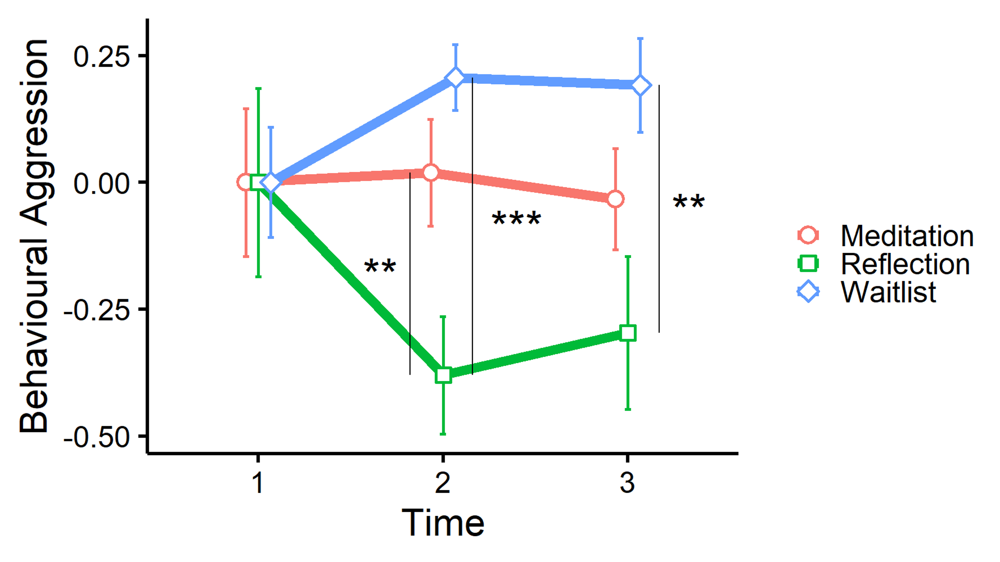
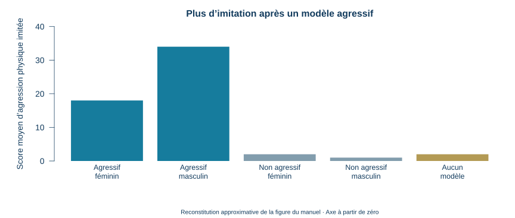
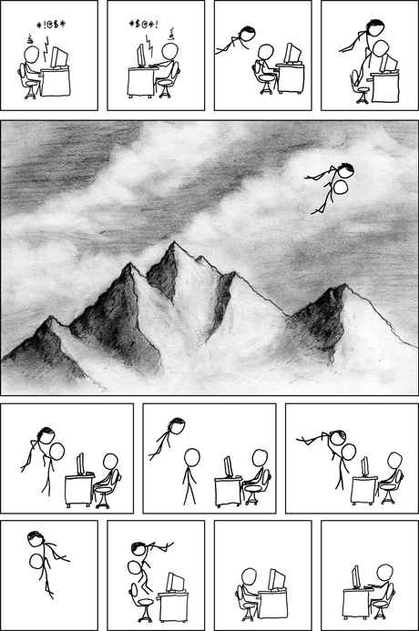

## Quiz de lecture 6 — 1,25 %

**Cours 7 et chapitre 8 · 8 questions · 10 minutes · Travail individuel**





::: {.notes}
10 minutes. Vérifier identification UQAR et accès avant le départ. Code du quiz : JIESIIR; évènement distinct des activités IFDJTAT. Questions évaluées et clé conservées séparément dans Box. Les huit meilleurs quiz sur dix valent ensemble 10 %.
:::

## Les prochaines évaluations

**Quiz 7 · 17 novembre · 1,25 %**

**Matière évaluée : cours 8 et chapitre 9 — L’agression.**

8 questions · 10 minutes. Les 8 meilleurs quiz sur 10 comptent pour **10 %**.

**Examen 2 · 10 novembre · 30 %**

Cours **5 à 8** et chapitres **5, 6, 8 et 9**. Répartition annoncée : **50 % cours / 50 % manuel**.

Note : Puisque la plupart des concepts vus dans le cours sont aussi dans le manuel, cela implique que les 50 % des questions associées aux cours seront fort probablement aussi dans le manuel. Ainsi, il est conseillé de donner un peu plus de poids à l’étude des cours plutôt qu’au manuel.

[Guide d’étude de l’examen 2](../../examens/02/guide.qmd)

**Pour l’examen :** carte étudiante, matériel d’écriture et identifiant UQAR.

::: {.notes}
3 minutes. Distinguer le quiz 6 du jour (cours 7, chapitre 8) du quiz 7 suivant. Aucun cours le 27 octobre. L’examen occupe la séance du 10 novembre. Les articles cités sont des ressources, pas des lectures intégrales obligatoires.
:::

## Plan de la séance

1. **Les formes d’agression et les réactions à une situation aversive**
2. **L’apprentissage, la socialisation et le traitement de l’information**
3. **Les contributions biologiques et la violence dans les médias**

**Pour commencer :** qu’est-ce qui permet de distinguer une plaisanterie d’une agression?

::: {.notes}
4 minutes avec lancement. Fil conducteur : comprendre un geste exige de distinguer ce qui arrive, ce qui est interprété et ce qui est appris. Situations fictives, aucune confidence demandée. On peut participer en analysant les indices, sans raconter une expérience personnelle. Les prolongements mettant en scène Manolo, Mariane et leur entourage sont imaginaires, sauf la scène vidéo identifiée.
:::

## Le conflit et l’agression

**Que se reprochent-ils? Comment chacun répond-il aux reproches de l’autre?**

```{=html}
<iframe id="ramdam-agression" width="1450" height="540" src="https://www.youtube.com/embed/2FUEJDVWyQk?start=420&end=532&rel=0&cc_load_policy=0" title="Ramdam — Fureur et taï chi : le conflit et l’agression" allow="autoplay; fullscreen; encrypted-media" allowfullscreen></iframe>
<div style="display:flex;gap:18px;margin-top:12px">
<button type="button" onclick="document.getElementById('ramdam-agression').src='https://www.youtube.com/embed/2FUEJDVWyQk?start=420&amp;end=532&amp;autoplay=1&amp;cc_load_policy=0&amp;rel=0'" style="font:inherit;font-size:26px;padding:8px 18px;cursor:pointer">Rejouer</button>
</div>
```

::: {.credit}
Ramdam · saison 5, épisode 40 · *Fureur et taï chi* · 7:00–8:52 · [Ouvrir la vidéo](https://www.youtube.com/watch?v=2FUEJDVWyQk&t=420s).
:::

::: {.notes}
6 à 8 minutes, extrait compris. Avant : « Repérez le reproche de chaque personnage et la manière dont l’autre y répond. » Après : recueillir deux observations, puis demander quel but poursuit chaque personnage et quels indices permettent de le proposer. Distinguer un désaccord, une émotion de colère et une conduite visant à faire du tort; la définition vient à la diapositive suivante. Ne pas attribuer automatiquement une intention hostile à toute réaction ferme. Demander : « À quel moment pourrait-on interrompre cette escalade sans renoncer à son objectif? » Faire proposer une phrase ou une action concrète plutôt qu’un simple conseil de rester calme.
Réponses possibles à la question de visionnement (paraphrases, pas citations) : vers 7:18–7:27, les reproches sur les dégâts et le travail perdu entretiennent l’accusation; vers 7:28–7:43, la réponse ramène la prise de la musique et les conséquences pour l’émission, ce qui déplace l’échange vers les torts de l’autre plutôt que vers une réparation. On peut donc répondre : « chacun reproche à l’autre ce qu’il a fait », « chacun justifie sa réaction par le geste précédent de l’autre », ou « ils reviennent sur les dommages et leurs conséquences au lieu de chercher une solution ». Faire préciser la parole ou le moment qui soutient l’interprétation. La succession reproche → contre-reproche est l’indice à discuter; ne pas exiger un terme technique. Les dommages aux objets et la prise de musique évoqués dans le dialogue sont des actes rapportés : ne pas dire que tous sont montrés dans ces 112 secondes. Pour une réponse sur un geste ou un ton, demander de décrire ce qui est effectivement visible ou audible, sans imposer une observation non vérifiée.
Débreffage : réclamer une réparation n’est pas en soi une agression. L’escalade tient ici à la dynamique de riposte et de reproches; conclure à une intention de nuire exige des indices supplémentaires. Une réponse qui interromprait cette dynamique pourrait reconnaitre le tort et formuler une demande concrète : « La prise de ma musique a compromis mon émission; comment répare-t-on cela? » La référence au taï chi ouvre une tentative de chercher une autre réponse au conflit; elle ne fait pas partie des facteurs d’escalade à identifier automatiquement.
Relever oralement la référence à la philosophie indienne signalée dans ce passage : « Quel rôle cette référence joue-t-elle dans l’échange? Une idée sur le calme suffit-elle à changer notre manière d’agir dans un conflit? » Partir des paroles réellement entendues, sans attribuer à une tradition entière le propos d’un personnage ni assimiler le taï chi à une tradition indienne. Utiliser ce clin d’œil comme transition vers la régulation des réactions, sans ouvrir une nouvelle matière à mémoriser sur les philosophies ou reprendre les résultats de mes recherches.
Transfert : dans un travail d’équipe, formuler une limite ou une demande qui protège le but sans humilier l’autre. Repli si la vidéo ne charge pas : ouvrir le lien dans un nouvel onglet, puis utiliser les situations de la diapositive suivante. Les situations suivantes sont des exemples distincts, pas une transcription de cet extrait.
:::

## L’agression, la colère et l’assertion

L’**agression** est une conduite dirigée vers une personne avec l’intention de lui faire du tort physiquement ou psychologiquement.

::: {.columns}
::: {.column width="53%"}
- **Colère :** Manolo se sent furieux.
- **Assertion :** il réclame fermement son CD.
- **Agression :** il brise les broches pour faire du tort à Mariane.

**L’agression suppose une conduite visant à faire du tort; ressentir de la colère ne suffit pas.**
:::
::: {.column width="47%"}
<div class="naruto-gif" data-gif>

<canvas hidden aria-hidden="true"></canvas>
<button type="button" aria-pressed="false">Figer le GIF</button>
<p class="gif-credit">Naruto · <a href="https://i.gifer.com/C38a.gif" target="_blank" rel="noopener noreferrer">GIF proposé · Gifer</a></p>
</div>
:::
:::


::: {.notes}
4 à 5 minutes. Manuel p.275–276. La colère est une émotion; l’assertion une conduite assurée vers un objectif sans intention de nuire nécessaire. La définition d’agression implique une conduite et une intention de tort : ce n’est donc pas le seul visage en colère ni le seul volume de voix qui tranche. Le GIF évoque visuellement une colère intense, sans servir à diagnostiquer l’état d’une personne réelle. Demander d’abord ce que le regard suggère, puis quel comportement et quelle intention il faudrait identifier pour parler d’agression. Dans Ramdam, réclamer le CD peut être ferme sans être une attaque; briser les broches en représailles vise un tort matériel et peut viser à faire souffrir Mariane. Reprendre la tentative : essayer de frapper sans atteindre peut être agressif; casser par accident ne prouve pas une intention de nuire. Pas de parallèle automatique entre trouble psychologique et agressivité. Figer le GIF si l’on veut concentrer l’attention sur les distinctions.
:::

## L’agression hostile et instrumentale

L’**agression hostile** vise à faire souffrir ou à blesser.

L’**agression instrumentale** utilise le tort fait à autrui comme moyen d’obtenir autre chose.

**Même geste : briser une broche de Mariane.**

- « Je veux que Mariane paie pour ce qu’elle m’a fait. »
- « Je veux forcer Mariane à me rendre le CD. »

Faire souffrir est le but hostile; obtenir un avantage est le but instrumental.

::: {.notes}
4 minutes. Manuel p. 276, glossaire p. 437. Première motivation : hostile. Deuxième : instrumentale; dommage pour obtenir le retour du CD. Les deux motifs sont des variantes inventées pour comparer les fonctions; ne pas prétendre qu’ils sont tous deux donnés dans le clip. Les deux font du tort intentionnellement, donc instrumental ne veut pas dire inoffensif. Une personne peut poursuivre les deux objectifs; ne pas exiger une catégorie exclusive si plusieurs motifs sont explicites. Accepter vengeance comme hostile dans la première phrase. Faire modifier une seule phrase du cas pour changer le motif; garder le geste constant.
:::

## L’agression réactive et proactive

::: {.columns}
::: {.column width="53%"}
**Réactive :** réponse à une situation perçue comme provocante ou aversive.

**Proactive :** conduite initiée dans un but instrumental.

**Une riposte visible ne révèle pas à elle seule le déclencheur initial ni le but du combat.**
:::
::: {.column width="47%"}
<div class="naruto-gif" data-gif>

<canvas hidden aria-hidden="true"></canvas>
<button type="button" aria-pressed="false">Figer le GIF</button>
<p class="gif-credit">Naruto · <a href="https://i.pinimg.com/originals/29/25/d4/2925d4a7177ace6b736800cced78d90b.gif" target="_blank" rel="noopener noreferrer">GIF proposé · Pinterest</a></p>
</div>
:::
:::


::: {.notes}
3 minutes. Manuel p.276. Le GIF montre des échanges de coups; ne pas inventer le motif ou le déclencheur du combat à partir de la boucle. La succession attaque/riposte peut être repérée, mais le contexte précédent est nécessaire pour conclure sur le caractère réactif/proactif et le but hostile/instrumental. Manolo qui brise les broches après la prise du CD illustre une riposte; une conduite initiée pour obtenir un avantage illustre le versant proactif. Les axes se recoupent : ne pas apprendre réactive = toujours hostile, proactive = tout ce qui est prévu. L’intérêt du GIF est de distinguer observation d’une séquence et interprétation de son origine.
:::

## L’agression directe et relationnelle

**Directe :** attaque physique ou verbale dirigée vers la personne.

**Relationnelle :** tort causé en manipulant ses relations ou sa réputation.

Fabrice est exclu d’un groupe pour le faire céder. Manolo insulte quelqu’un après avoir cru être provoqué.

**Insulter ou exclure décrit la forme de l’agression. Répondre à une provocation décrit ce qui la déclenche.**

::: {.notes}
3 minutes. Manuel p.276. Exclusion utilisée comme pression : relationnelle et proactive/instrumentale. Insulte après provocation perçue : directe et réactive. Une agression relationnelle peut aussi être hostile. Ne pas transformer ces axes en catégories exclusives ni enseigner relationnelle = féminine. Faire expliquer la menace de retrait d’amitié comme contrôle du lien. Cette séparation reprend le contenu de la diapositive antérieure, sans nouvelle notion. Le GIF reste sur la diapositive précédente afin de ne pas présenter un combat physique comme illustration d’une exclusion.
:::

## L’intention et les conséquences

**Même résultat : un téléphone est cassé.**

- Manolo le fait tomber en trébuchant.
- Manolo le lance pour faire peur à Simon, mais vise mal.
- Manolo le brise pour faire souffrir Simon.

**L’intention de faire du tort distingue l’agression de l’accident, même si le résultat est identique.**

::: {.notes}
3 minutes. Manuel p. 275–276. Faire justifier chaque cas avant de donner la réponse. Accident : dommage sans intention de nuire. Deuxième cas : la menace ou l’intimidation peut viser un tort psychologique même sans intention de casser le téléphone; préciser ce but, ne pas réduire tout au bris. Dernier : indice explicite d’intention de nuire. Débreffage : conséquence matérielle identique, intentions différentes; une tentative peut aussi être agressive sans réussir. Au travail, décrire les faits et chercher les indices avant d’attribuer une intention.
:::

## Les formes d’agression : trois questions

Manolo humilie Simon pour le faire quitter une équipe, après avoir reçu une insulte.

| Question | Indice du cas |
|---|---|
| **Dans quel but?** | Obtenir le départ de Simon |
| **En réponse à quoi?** | Une insulte reçue |
| **Par quel moyen?** | Une humiliation devant les autres |

**But, déclencheur et forme décrivent trois dimensions d’une même conduite.**

::: {.notes}
3 minutes. Manuel p. 276. Le but décrit est instrumental; la séquence répond à une provocation perçue et peut être réactive. Humiliation adressée directement : agression verbale directe; ne conclure à une manipulation relationnelle que si la scène décrit une atteinte aux liens ou à la réputation. Ajouter oralement « il répand une rumeur pour faire exclure Simon » pour obtenir clairement le versant relationnel. Ces catégories décrivent des dimensions qui se recoupent, pas trois boites exclusives. Le mécanisme à comprendre est la différence entre but, déclencheur et moyen.
:::

## La bienveillance dans mes recherches {#bienveillance-interventions}

**Six semaines · Répartition aléatoire en trois groupes**

| Méditation | Lecture et réflexion | Liste d’attente |
|---|---|---|
| Méditations guidées sur la bienveillance | Lectures et courtes réflexions écrites sur la bienveillance | Pas d’intervention pendant l’étude |
| Environ 10 min par jour + une séance de 30 min par semaine | Environ 10 min par jour + un balado de 30 min par semaine | Mesures aux mêmes moments |

**Quel groupe choisirait un bruit moins intense ou moins long pour un adversaire?**

::: {.credit}
Thériault, Masson et Dandeneau · [Préprint (2025)](https://doi.org/10.31234/osf.io/x4p9v_v1).
:::

::: {.notes}
4 à 5 minutes. Pont avec Ramdam : parler du calme ou de la bienveillance peut-il modifier une réaction envers autrui? Présenter mon étude comme une question expérimentale, pas comme une recommandation thérapeutique. Essai randomisé préenregistré en ligne; trois groupes. Méditation : exercices guidés visant à cultiver des sentiments bienveillants. Lecture–réflexion : extraits nouveaux chaque jour, court commentaire écrit, plus balados hebdomadaires; ce n’est donc pas la lecture seule. Les deux programmes portent sur la bienveillance et demandent un temps comparable, mais ne contiennent pas exactement les mêmes activités. Liste d’attente : pas de programme pendant la comparaison. Aucun besoin de faire apprendre les effectifs, durées exactes ou titres des livres.
Mesures avant, juste après six semaines d’intervention, puis six semaines plus tard (semaines 1, 7 et 13). Faire choisir une prédiction et demander une raison avant d’avancer. Je peux expliquer en une phrase que l’étude comprend aussi d’autres mesures : nous nous concentrons aujourd’hui sur l’agression; les résultats prosociaux seront repris au cours sur les comportements d’aide. Ne pas détailler la manipulation de fatigue ou les interactions sur d’autres variables ici.
:::

## La bienveillance et l’agression {#taylor-resultats}



<p style="font-size:19px;text-align:center;margin:4px 0;">1 : avant · 2 : après six semaines · 3 : suivi six semaines plus tard · <a href="https://doi.org/10.31234/osf.io/x4p9v_v1" target="_blank" rel="noopener noreferrer">Mes recherches — préprint</a></p>

::: {.notes}
5 à 6 minutes. Repères : 1 avant, 2 après les six semaines, 3 suivi six semaines plus tard. Meditation = méditation; Reflection = lecture–réflexion; Waitlist = liste d’attente. Après l’intervention : moins d’agression dans le groupe lecture–réflexion. Lire les axes et les groupes avant d’interpréter. Plus bas = moins d’agression selon l’indicateur de la tâche; ce n’est pas une proportion de personnes violentes. La figure fournie est centrée au départ : les zéros initiaux ne signifient ni absence d’agression ni identité de chaque personne. Ne pas faire mémoriser les valeurs ni lire les étoiles comme la taille du bénéfice. Résultat des contrastes du préprint, section Results, Table 3 : à T2, le groupe réflexion a un indicateur plus faible que la liste d’attente ET que la méditation. À T3, l’écart avec la liste d’attente persiste (Table 4); la comparaison réflexion–méditation n’est plus statistiquement concluante. Ne pas dire que la réflexion reste supérieure à la méditation au suivi. Le groupe méditation ne montre pas la réduction attendue dans cette étude; cela ne prouve pas que toute méditation est sans effet dans toute situation.
Interprétation : une intervention structurée autour de lectures, d’écriture et de balados sur la bienveillance constitue une piste intéressante. La comparaison ne permet pas d’attribuer le résultat à la lecture seule ni d’identifier le mécanisme actif. Le préprint rapporte des effets de petite ampleur sur cet indicateur. Limites à rappeler brièvement : abandons plus fréquents dans le groupe réflexion, comparaison à une liste d’attente et mesure en tâche expérimentale; le résultat ne garantit pas une baisse de toute violence quotidienne. Aucun besoin d’ajouter ces détails aux apprentissages évalués si nous ne les travaillons pas en classe.
Transition : « Mais comment avons-nous mesuré l’agression sans demander seulement aux gens s’ils se trouvent agressifs? Voici le principe de la tâche. » Réserver les résultats sur l’aide, la compassion, les attitudes et les dons au prochain cours; ils ne sont pas présentés ici.
:::

## La tâche de Taylor {#tache-de-taylor}

```{=html}
<style>
#taylor-classe {text-align:center; margin:35px auto; max-width:1250px;}
#taylor-classe .signal {font-size:76px; font-weight:700; min-height:170px; display:flex; align-items:center; justify-content:center; line-height:1.2;}
#taylor-classe button {font:inherit; font-size:38px; padding:20px 35px; margin:12px; border:3px solid #24475c; border-radius:14px; background:white; color:#17394e; cursor:pointer;}
#taylor-classe .go {background:#d6f3df; min-width:850px; min-height:180px; font-size:64px;}
#taylor-classe .sound {font-size:23px; margin-top:35px;}
#taylor-classe .sound input {vertical-align:middle;}
</style>
<div id="taylor-classe">
<div class="signal" aria-live="polite">Quel bruit pour l’autre?</div>
<div class="actions"></div>
<div class="sound"><label><input type="checkbox" class="audio"> Son</label> <label>Volume <input class="volume" type="range" min="0" max="100" value="20" aria-label="Volume du son"></label> <button class="reset" style="font-size:23px;padding:6px 14px">Recommencer</button></div>
</div>
<script>
(()=>{
const el=document.getElementById('taylor-classe'), label=el.querySelector('.signal'), actions=el.querySelector('.actions');
let timer, round=0, ctx, generation=0;
const rounds=[{win:false,noise:1},{win:true,noise:2},{win:false,noise:2}];
const names=['Aucun','Faible','Fort'];
function buttons(items){actions.replaceChildren(); for(const [text,fn,cls] of items){const b=document.createElement('button'); b.type='button'; b.textContent=text; if(cls)b.className=cls; b.onclick=e=>{e.stopPropagation();fn();}; actions.append(b);}}
let playingNoise;
async function sound(level){
 if(!level||!el.querySelector('.audio').checked)return;
 try{
  ctx??=new (window.AudioContext||window.webkitAudioContext)();
  await ctx.resume();
  if(!el.querySelector('.audio').checked)return;
  playingNoise?.stop();
  const duration=2, buffer=ctx.createBuffer(1,Math.round(ctx.sampleRate*duration),ctx.sampleRate);
  const samples=buffer.getChannelData(0);
  for(let i=0;i<samples.length;i++)samples[i]=Math.random()*2-1;
  const source=ctx.createBufferSource(),gain=ctx.createGain();
  source.buffer=buffer;source.connect(gain);gain.connect(ctx.destination);
  const t=ctx.currentTime,volume=Number(el.querySelector('.volume').value)/100;
  const amplitude=volume*(level===1?.3:.8);
  gain.gain.setValueAtTime(0,t);
  gain.gain.linearRampToValueAtTime(amplitude,t+.025);
  gain.gain.setValueAtTime(amplitude,t+duration-.04);
  gain.gain.linearRampToValueAtTime(0,t+duration);
  playingNoise=source;source.onended=()=>{source.disconnect();gain.disconnect();if(playingNoise===source)playingNoise=null;};
  source.start(t);source.stop(t+duration);
 }catch(error){console.warn('Lecture du bruit indisponible',error);}
}
el.querySelector('.audio').addEventListener('change',()=>{if(!el.querySelector('.audio').checked){playingNoise?.stop();playingNoise=null;}});

function choose(){label.textContent='Quel bruit pour l’autre?'; buttons(names.map((n,i)=>[n,()=>ready(i)]));}
function ready(choice){label.textContent='Votre choix : '+names[choice].toLowerCase();buttons([['Prêts?',()=>wait(choice)]]);}
function wait(choice){const token=++generation;label.textContent='Attendez…';buttons([['…',()=>{clearTimeout(timer);generation++;label.textContent='Trop tôt!';buttons([['Reprendre',()=>ready(choice)]]);},'go']]);timer=setTimeout(()=>{if(token!==generation)return;label.textContent='Cliquez!' ;buttons([['Cliquez!',()=>result(choice),'go']]);},1800+Math.random()*1800);}
function result(choice){const r=rounds[round];label.textContent=r.win?'Manche gagnée':'Manche perdue';actions.replaceChildren();const p=document.createElement('p');p.style.fontSize='38px';p.textContent=r.win?'Votre bruit : '+names[choice].toLowerCase():'Bruit du partenaire : '+names[r.noise].toLowerCase();actions.append(p);if(!r.win)sound(r.noise);const b=document.createElement('button');b.textContent=round<2?'Manche suivante':'Terminer';b.onclick=e=>{e.stopPropagation();round++;if(round<3)choose();else{label.textContent='Et maintenant, quel bruit choisir?';buttons([]);}};actions.append(b);}
el.querySelector('.reset').onclick=()=>{playingNoise?.stop();playingNoise=null;clearTimeout(timer);generation++;round=0;choose();};
choose();
})();
</script>
```

::: {.notes}
4 à 6 minutes. Démonstration collective : je pilote les clics. Dire oralement : « Pour comprendre la mesure utilisée dans mon étude, un partenaire simulé joue contre nous. Si nous gagnons, il reçoit le bruit choisi; si nous perdons, nous recevons son choix. Quel bruit lui destiner? » Recueillir un choix à mains levées puis cliquer sur Aucun, Faible ou Fort. Cliquer Prêts; au signal, le groupe lève la main et je clique sur le grand bouton. Trois manches seulement. Pas d’appareil étudiant, pas de collecte ni de score individuel. Le clic représente la réponse de vitesse; aucun temps ni score n’est affiché. Expliquer oralement l’adaptation collective à mains levées, sans l’inscrire à l’écran. Les issues sont programmées (défaite, victoire, défaite), indépendamment du clic. Le partenaire choisit un bruit faible au début, puis fort; une dernière décision peut être discutée oralement après la troisième manche. Annoncer le caractère simulé dès le départ. Le son est facultatif, désactivé par défaut, avec volume réglable; les libellés suffisent. À chaque défaite, un bruit blanc de deux secondes illustre la conséquence reçue : faible au début, fort à la dernière manche. À la victoire, le choix destiné au partenaire est affiché sans son dans la salle. Commencer à faible volume puis ajuster selon le matériel; aucun niveau en décibels n’est calibré. Décocher Son ou Recommencer arrête le bruit en cours.
Demander avant la première manche : « Pensez-vous garder le même choix? » Après : « Avez-vous eu envie de changer? À quel moment? » Accueillir aussi la stabilité; aucune réaction n’est attendue ou exigée. Le but est de vivre la structure choix → compétition → conséquence → nouveau choix, pas de démontrer un effet expérimental dans cette classe.
:::

## La tâche de Taylor : mesurer l’agression {#taylor-mesure}

**Le clic :** la compétition de vitesse.

**Le bruit choisi :** le comportement étudié.

Après un bruit fort, que voudrait-on envoyer à l’autre?

::: {.credit}
[Chester et Lasko (2019)](https://doi.org/10.1177/1948550618775408).
:::

::: {.notes}
2 à 3 minutes. Distinguer la vitesse de réaction et le choix d’une conséquence pour autrui. Dans la recherche, on s’intéresse au bruit choisi dans une situation où la personne croit affecter quelqu’un. Ici le partenaire est annoncé simulé, la durée est fixe, trois choix seulement et aucun résultat individuel interprétable. Cette animation n’est pas une mesure validée d’agressivité. Demander si le choix exprime riposte, compétition ou règle de réciprocité; un bouton seul ne révèle pas une intention avec certitude. Relier à l’agression réactive : une provocation perçue peut modifier une réponse sans la rendre inévitable. Transfert : après un message hostile, quelle réponse protège notre objectif sans chercher à faire souffrir? La comparaison des conditions et les détails méthodologiques de la version complète sont réservés à une autre occasion.
:::

## La frustration et l’agression

La **frustration** survient lorsqu’un obstacle empêche d’atteindre un but.

**Hypothèse initiale** : la frustration produit une tendance à agresser; toute agression proviendrait d’une frustration.

Mariane a pris le CD dont Manolo a besoin pour préparer son émission.

Il peut réclamer son CD, chercher une autre musique ou attendre : **la frustration ne conduit pas automatiquement à l’agression.**

::: {.notes}
4 minutes. Manuel p. 278–279. L’hypothèse originale est présentée comme proposition historique, puis révisée : frustration ne détermine pas une réponse unique; d’autres expériences aversives et des buts instrumentaux interviennent. Ne pas affirmer que la frustration est nécessaire ou suffisante. Déplacement : si Manolo n’ose s’en prendre à la personne responsable et s’en prend à une autre cible moins risquée. Définir le terme au moment de cet exemple. Réponses acceptables : solutions apprises, conséquences anticipées, perception de l’intention, intensité du malaise. La présence de ces options rend une explication mécanique insuffisante.
:::

## La perspective néoassociationniste

Une expérience aversive suscite un **affect négatif** (état émotionnel désagréable) et active des pensées, souvenirs et tendances à agir associés.

**CD pris → malaise → pensées d’attaque ou de fuite**

::: {.fragment}
L’interprétation, les règles sociales et les réponses disponibles peuvent modifier la réaction.
:::

Penser « elle veut faire rater mon émission » ou « elle n’avait pas réalisé que j’avais besoin du CD » n’oriente pas la même réponse.

::: {.notes}
4 minutes. Manuel p. 279–281 et figure 9.1. Définir affect négatif : état émotionnel désagréable. Le modèle va au-delà de la frustration : douleur et autres expériences aversives peuvent amorcer le réseau. Indices associés à l’agression facilitent l’activation; les processus cognitifs plus élaborés permettent de préciser colère, peur, attribution et conduite. Faire comparer le fait établi (CD pris) et l’intention attribuée (vouloir saboter l’émission). Conclusion : une première impulsion ne fixe pas l’action. Pas de promesse que toute personne peut neutraliser toute réaction par un simple choix.
:::

## Les indices associés à l’agression

**Étude classique : la présence d’armes**

1. Certaines personnes reçoivent une provocation; d’autres non.
2. Des armes, des raquettes ou aucun objet particulier sont visibles.
3. Les personnes peuvent ensuite administrer des chocs à un partenaire.

**Prédiction :** dans quelle situation les indices pourraient-ils le plus favoriser une réponse agressive?

::: {.notes}
3 minutes. Manuel p. 279–280, Berkowitz et LePage, 1967, rapport secondaire. Le partenaire est associé à une procédure expérimentale; expliquer le caractère organisé de la situation, sans prétendre connaitre tous les détails non donnés. Mesure : nombre de chocs administrés. Résultat rapporté : davantage de chocs chez les personnes provoquées en présence d’armes que chez les personnes provoquées sans ces indices. Dans une condition les armes sont attribuées au partenaire, dans une autre à une étude distincte : la présence des indices importe aussi sans attribution au partenaire. Ne pas assimiler tout objet aperçu à un déclencheur universel. Ne pas reproduire la provocation ni apporter d’arme en classe; utiliser le récit et la prédiction.
:::

## Les indices associés à l’agression : le résultat

**Après une provocation, davantage de chocs sont administrés lorsque des armes sont présentes.**

La provocation ne suffit donc pas à décrire toute la situation : **les indices du contexte comptent aussi**.

**À provocation comparable, la présence d’armes distingue les conditions.**

::: {.notes}
2 à 3 minutes. Manuel p. 279–280; étude classique rapportée de Berkowitz et LePage. Faire rappeler la prédiction de la diapositive précédente avant de donner le résultat. La comparaison pertinente garde la provocation présente et fait varier les objets; ne pas expliquer tout par des personnes plus souvent provoquées. Mesure : nombre de chocs, pas une opinion sur les armes. Les armes étaient associées ou non au partenaire selon les conditions; ne pas inventer un tableau chiffré ni présenter la présence d’une arme comme suffisante pour provoquer chaque personne. Reprise pédagogique de la séparation procédure/résultat observée chez Blais, diapos 8–9 et 12–13; contenu fondé sur le manuel. Transfert : repérer les indices du contexte qui rendent une réponse agressive plus accessible, sans prétendre lire une intention à partir d’un seul objet.
:::

## Le transfert d’excitation

Une **activation physiologique résiduelle** peut amplifier une réaction à une situation suivante si elle est attribuée à celle-ci.

Manolo monte rapidement quatre étages. Essoufflé, il lit : « Ton travail n’est vraiment pas sérieux. »

**Escaliers → activation persistante → message interprété comme une attaque → réaction amplifiée**

Identifier son essoufflement peut éviter d’attribuer toute son activation au message reçu.

::: {.notes}
4 minutes. Manuel p. 281–282. Définir activation : mobilisation corporelle, par exemple rythme cardiaque et respiration. Ce cas illustre une possibilité, pas un résultat recueilli en classe. Une activation n’est pas en soi de la colère. L’attribution au premier évènement peut réduire l’amplification liée au second; le contexte et l’interprétation comptent. Accepter attendre, reconnaitre l’essoufflement, relire le message ou demander une précision comme applications raisonnables, sans garantie clinique. Mise en scène volontaire possible : lire la phrase sur un ton neutre puis irrité, sans exercice physique imposé. Différence avec néoassociation : ici persistance et attribution de l’activation; là activation d’un réseau d’affects/pensées par une expérience aversive.
:::

## Le déplacement de l’agression

Le **déplacement de l’agression** consiste à diriger une réponse agressive vers une autre cible que la source initiale de frustration.

La demande de Manolo est refusée par une personne en autorité.

Il n’ose pas lui répondre. À la maison, il humilie Nathan pour un oubli mineur.

**Le refus vient de la personne en autorité; l’agression vise Nathan.**

::: {.notes}
3 minutes. Manuel p. 278–279. Déplacement : réponse agressive dirigée vers une autre cible que la source initiale de frustration. Faire repérer source, inhibition de la réponse initiale et cible ultérieure. Le cas propose ce mécanisme; il ne permet pas de connaitre avec certitude toutes les raisons de la réaction. Ne pas présenter la frustration comme nécessaire ou suffisante. Transfert professionnel : un usager irrité peut réagir à une situation antérieure; cela aide à chercher une explication sans accepter les insultes.
:::

## La rumination et le maintien de la colère

La **rumination** consiste à revenir de façon répétitive sur une offense et les torts subis.

| Ruminer | Réévaluer | Se distraire |
|---|---|---|
| Repasser l’offense et les torts subis | Chercher une autre interprétation | Porter son attention ailleurs |

**À retenir : ruminer peut entretenir la colère; réévaluer change l’interprétation, se distraire déplace l’attention.**

::: {.notes}
3 minutes. Manuel p. 279, relu le 2 novembre. Attendu pour l’étude : définir la rumination, la distinguer de la réévaluation et de la distraction, et expliquer sur un exemple comment elle peut entretenir la colère. Exemple acceptable : « Manolo repasse mentalement la prise du CD et prépare sa revanche; il garde l’offense présente. » Réévaluation : envisager que Mariane ignorait son besoin; distraction : consacrer quelques minutes à une activité sans rapport. Ces stratégies ne garantissent pas un effet identique chez toute personne.  Définir rumination comme retour répétitif sur l’offense et ses implications; réévaluation comme changement de lecture de la situation. Étude racontée dans le manuel : souvenir d’un épisode de colère, consignes de traitement différentes, puis observation d’images; la rumination entretient une coloration négative jusque devant du matériel neutre. Ne pas fabriquer d’intensités ni de nombre de participants. Prédiction avant résultat; préciser que maintien de la colère ne signifie pas forcément comportement agressif.
:::

## La réévaluation dans un conflit

La **réévaluation** consiste à modifier son interprétation d’une situation pour en changer l’impact émotionnel.

**Fait :** Mariane a pris le CD de Manolo.

- Première lecture : « Elle veut saboter mon émission. »
- Autre possibilité : « Elle a peut-être sous-estimé les conséquences pour moi. »
- Question à poser : « Savais-tu que j’en avais besoin aujourd’hui? »

**Vérifier l’intention reste compatible avec une limite ferme et la demande de rendre le CD.**

::: {.notes}
3 minutes. Manuel p.279–281. Non : le CD a bien été pris et Manolo peut en réclamer le retour. Ce qui change est la certitude sur le but poursuivi par Mariane. L’autre explication est une hypothèse à vérifier, pas une vérité ni une excuse. Faire distinguer fait, conséquence sur le but et intention supposée. Conclure : poser une limite et demander réparation restent compatibles avec une interprétation moins hostile. Ce développement est fictif à partir du CD signalé dans le clip; il ne transcrit pas un dialogue de l’épisode.
:::

## Connectez-vous à Wooclap — ronde 1



**Quatre questions, puis un retour sur les réponses.**

Formes d’agression, frustration et activation.

[Reprendre le cours après la ronde](#pause-1)

::: {.notes}
8 à 10 minutes. Utiliser les quatre questions suivantes dans l’évènement, puis reprendre directement à la pause 1. Repli sans connexion : réflexion individuelle de 20 secondes, choix à mains levées et justification d’une réponse. Les questions suivantes sont les archives publiques, pas le quiz évalué.
:::

## L’agression instrumentale — application

Une personne menace de diffuser une rumeur pour obtenir une place dans une équipe. Quel objectif indique surtout une agression instrumentale?

A. Ressentir une émotion désagréable.  
B. Obtenir la place au moyen de la menace.  
C. Répondre sans intention de nuire.  
D. Affirmer calmement son intérêt.

::: {.notes}
Réponse B : tort ou menace comme moyen d’obtenir une autre fin. A est un état affectif; C retire l’intention; D décrit une assertion. Si la rumeur est déjà diffusée pour faire souffrir et obtenir une place, les fonctions peuvent se combiner. Demander quel détail de l’énoncé soutient B.
:::

## Le transfert d’excitation — application

Après une activité physique, une personne interprète toute son activation comme la conséquence d’un reproche. Quel processus illustre surtout ce cas?

A. Le transfert d’excitation.  
B. L’apprentissage par observation.  
C. La manipulation des liens sociaux.  
D. Le déplacement de l’agression vers une autre cible.

::: {.notes}
Réponse A. Activation résiduelle et attribution au reproche. B demanderait un modèle observé; C une action sur les relations; D un changement de cible, absent ici. Ne pas faire de la seule présence d’exercice une preuve de transfert : l’attribution explicitement décrite est décisive.
:::

## L’intention de nuire — application

Un verre se brise. Dans quel cas y a-t-il le plus clairement une intention de nuire?

A. Une personne trébuche et le renverse.

B. Une personne le déplace et il glisse.

C. Une personne le lance pour effrayer sa collègue.

D. Une personne le fait tomber en nettoyant.

::: {.notes}
C. Effrayer intentionnellement vise un tort psychologique; les autres cas décrivent des accidents. Le bris ne suffit pas à classer la conduite. Manuel p.275–276.
:::

## La réévaluation — application

Après un message ambigu, quelle réponse illustre le mieux une réévaluation?

A. Repasser toutes les offenses antérieures.

B. Préparer une réponse plus blessante.

C. Relire le message pour se convaincre de la même intention hostile.

D. Envisager que le message porte sur un autre sujet.

::: {.notes}
D. Une autre interprétation est envisagée. Elle reste à vérifier; réévaluer ne signifie pas croire sans preuve à une intention positive. Les autres choix entretiennent la première lecture ou préparent l’attaque. Manuel p.279.
:::

## Pause — 10 minutes {#pause-1}

**10 minutes**



Proposez une chanson ou une photo de votre animal pour la pause.



::: {.notes}
Pause 1. Propositions chanson/photo dans la question ouverte de l’évènement d’engagement. Réponses multiples, mentions J’aime, envoi d’images et compte à rebours de dix minutes; modération désactivée, liste ou grille. Connexion aux activités : IFDJTAT. Heure de retour annoncée oralement. Reprendre à l’atelier, sans sauter celui-ci.
:::

## Atelier — la frustration et l’interprétation {#atelier}



**Équipes de 3 ou 4 · Discussion de 10 minutes · Une personne porte-parole**

Mariane a pris le CD dont Manolo a besoin pour son émission. En réaction, Manolo brise des broches de Mariane.

1. Quel but est bloqué pour Manolo? Quel tort fait-il à Mariane?
2. Comment la frustration et l’interprétation des intentions de Mariane peuvent-elles contribuer à la riposte de Manolo? Appuyez chaque explication sur un détail du cas.
3. Sait-on si Mariane voulait empêcher Manolo de réussir son émission? Que faudrait-il vérifier?
4. Quelle réponse aurait protégé son but sans détruire les objets de Mariane?

::: {.notes}
Prévoir environ 18 à 20 minutes : 2 à 3 de consignes, puis 10 minutes pleines de discussion active au minuteur, puis 5 à 7 de partage et débreffage. Lancer le minuteur après les consignes; ne pas soustraire le temps de présentation ou de restitution aux dix minutes actives. Aucun dépôt. Point de départ conforme à la correction de l’enseignant et au résumé de l’épisode : Mariane prend la musique et Manolo détruit ses broches en représailles. Les objets sont les « broches », selon la précision donnée sur le dialogue de Sélina. Ne pas inventer un message humiliant, une course ou un échange supplémentaire comme faits de l’épisode.
Exemples de réponses acceptables à la question 2 : « Le CD manque alors que Manolo en a besoin pour son émission : un obstacle bloque son but, ce qui crée de la frustration. » « S’il croit que Mariane cherche à saboter son émission, cette interprétation peut amplifier sa colère et orienter sa réponse vers la vengeance. » Cette seconde réponse doit rester conditionnelle : la pensée de Manolo et l’intention de Mariane ne sont pas établies par le seul résumé. À la question 3 : « Non, prendre le CD ne démontre pas vouloir faire échouer l’émission; il faut vérifier si Mariane savait quand Manolo en avait besoin et pourquoi elle l’a pris. » Accepter une formulation différente si elle relie correctement concept et détail. Réponses : but bloqué = disposer de sa musique pour l’émission; tort = détériorer les biens de Mariane. Frustration liée au but; agression réactive car riposte au geste de Mariane; fonction hostile si le but est de lui faire payer ou de lui faire du tort. Ne pas affirmer ce motif sans demander les indices du dialogue; instrumental serait une hypothèse si le geste visait à obtenir le retour du CD, pas une conclusion établie. La perspective néoassociationniste peut expliquer malaise et pensées d’attaque. L’intention de sabotage de Mariane n’est pas établie par le seul fait de prendre le CD. Demander ce qu’elle savait du besoin et du délai; ne pas inventer sa réponse. Le transfert d’excitation ne constitue pas une bonne réponse ici en l’absence d’une source d’activation antérieure distincte montrée ou indiquée.
Réponses alternatives : réclamer le CD, demander son retour à temps, proposer une solution pour les deux activités, chercher une autre musique et poser une règle d’emprunt. Débreffage : expliquer une riposte ne la justifie pas; endommager ses broches ne récupère pas automatiquement la musique. Faire comparer une réaction qui vise la réparation à une réaction qui vise à faire souffrir.
:::

## L’apprentissage social

Un comportement peut être acquis **en observant un modèle**, puis maintenu ou freiné par ses conséquences.

| Observation | Expérience directe |
|---|---|
| Fabrice voit une personne obtenir une faveur après une menace. | Fabrice menace à son tour et obtient ce qu’il veut. |
| Il apprend une manière de faire et une conséquence possible. | La conséquence peut renforcer sa propre conduite. |

Apprendre une conduite et la manifester ne sont pas identiques.

::: {.notes}
5 minutes. Manuel p. 282–284. Définir apprentissage vicariant : acquisition par observation des conduites et de leurs conséquences. Conditionnement opérant : modification de la probabilité d’un comportement selon ses conséquences. Les parents, pairs et personnages médiatiques peuvent servir de modèles. L’observation n’exige pas une consigne d’imiter. Acquisition ≠ exécution immédiate : une conduite apprise peut ne pas être manifestée selon les conséquences attendues et le contexte. Faire proposer un exemple professionnel : une personne en stage observe comment une équipe traite un désaccord; l’humiliation applaudie enseigne une norme différente d’une reformulation respectueuse.
:::

## L’acquisition et la manifestation d’une conduite

::: {.columns}
::: {.column width="53%"}
**Acquisition :** apprendre une conduite. **Manifestation :** la mettre en pratique.

Une enfant observe une adulte humilier quelqu’un pour obtenir sa place.

Elle peut ensuite **décrire la stratégie**, mais ne l’utilise pas.

**Elle a appris la stratégie sans la mettre en pratique : acquisition et manifestation sont distinctes.**
:::
::: {.column width="47%"}
<div class="naruto-gif" data-gif>

<canvas hidden aria-hidden="true"></canvas>
<button type="button" aria-pressed="false">Figer le GIF</button>
<p class="gif-credit">Naruto · <a href="https://i.redd.it/4vqx0urkhr5d1.gif" target="_blank" rel="noopener noreferrer">GIF proposé · Reddit</a></p>
</div>
**Le geste exécuté est visible. Son apprentissage ne l’est pas.**
:::
:::


::: {.notes}
3 minutes. Manuel p.282–284. Acquisition = conduite apprise; manifestation/performance = conduite produite dans une situation. Le cas de l’enfant distingue connaissance et utilisation; les conséquences attendues peuvent freiner la manifestation. Le GIF montre des gestes exécutés, pas leur acquisition. Ne pas présenter cette scène comme un entrainement ni affirmer que l’un imite l’autre; ces détails narratifs n’ont pas été vérifiés. Le contrepoint aide à comprendre pourquoi une scène de combat ne prouve pas comment les conduites ont été apprises. Faire varier les conséquences qui favoriseraient ou inhiberaient l’expression. Transfert : une personne en stage peut retenir un modèle agressif sans le reproduire immédiatement.
:::

## Les conditions de l’apprentissage par observation

**Pour apprendre une conduite observée puis la reproduire, quatre conditions interviennent :**

1. Porter **attention** à sa conduite.
2. La garder en **mémoire**.
3. Pouvoir la **reproduire**.
4. Avoir une **motivation** à la manifester.

**Voir le modèle ne suffit donc pas.** Oublier une étape observée révèle une difficulté de mémorisation.

::: {.notes}
3 minutes. Manuel p. 284. Réponse : rétention en mémoire dans le cas décrit; ne pas supposer un manque de volonté. Faire varier un seul détail : distraction = attention; geste trop difficile = reproduction; conséquence redoutée = motivation. Cette séquence est un outil pour préciser une difficulté, pas un diagnostic exhaustif. Transfert : montrer une manière respectueuse de résoudre un conflit, la faire rappeler puis pratiquer, et soutenir son usage.
:::

## L’apprentissage par observation — la poupée Bobo

**Des enfants d’âge préscolaire observent un adulte.**

| Modèle agressif | Modèle non agressif | Groupe témoin |
|---|---|---|
| Gestes et paroles agressifs envers Bobo | Jeu calme, sans attaquer Bobo | Aucun modèle préalable |

Après une frustration légère commune, les enfants jouent dans une autre pièce, **sans le modèle**.

**Prédiction individuelle :** quels gestes seront reproduits?

::: {.notes}
6 minutes. Manuel p. 283–284; Bandura, Ross et Ross, 1961. Personnes participantes : 72 enfants de maternelle, pas des adultes novices; adultes collaborateurs jouent les modèles, pas des enfants choisis pour leur agressivité. Modèle agressif : gestes distinctifs envers la poupée; modèle calme : jeu de construction. Au test : jouets disponibles, observation des conduites pendant vingt minutes. Les jouets attrayants sont retirés juste avant pour créer une légère frustration commune : elle ne départage donc pas les trois conditions. La personne qui conduit la séance demeure discrète dans la pièce; « sans le modèle » ne signifie pas « sans aucun adulte ». Recueillir une prédiction avant résultats; ne pas réaliser des coups sur une personne de la classe. Mise en scène : trois rôles volontaires lisent observation → transition → codage; aucun enfant ni agression réelle, aucune donnée issue des rôles. Réponse attendue : surtout reproduction des gestes distinctifs après modèle agressif.
:::

## L’apprentissage par observation {#bandura-video}

**Repérez un geste précis repris du modèle par les enfants.**

```{=html}
<iframe width="1450" height="540" src="https://www.youtube.com/embed/Z0iWpSNu3NU?rel=0" title="Albert Bandura — images classiques de la poupée Bobo" allow="fullscreen; encrypted-media" allowfullscreen></iframe>
```

::: {.credit}
Albert Bandura · Images classiques de Bobo, commentées en anglais · 5 min 02 · [Ouvrir la vidéo](https://www.youtube.com/watch?v=Z0iWpSNu3NU).
:::

::: {.notes}
8 minutes, film compris. Présenter ces images immédiatement après le protocole de Bobo et la prédiction; Ramdam reste l’ouverture du cours. Annoncer oralement : « On voit un modèle adulte, puis de jeunes enfants en salle d’expérimentation. Repérez un geste précis qu’ils pourraient reproduire. » Demander une prédiction avant de lancer. La narration anglaise peut être résumée oralement : l’image suffit pour repérer les gestes. Ce montage historique commenté par Bandura illustre ses recherches; ne pas attribuer chaque séquence à une seule condition ou à la seule étude de 1961. Si la vidéo ne charge pas, utiliser le lien dans un nouvel onglet; à défaut, rappeler le protocole précédent et poursuivre avec la figure suivante.
Après : faire décrire un geste distinctif repris du modèle (par exemple le maniement du maillet), plutôt que conclure seulement « les enfants frappent ». Le point développemental est que l’apprentissage par observation est déjà observable chez des enfants d’âge préscolaire. L’étude de 1961 porte sur des enfants d’environ 3 à 6 ans; elle ne date pas l’apparition de l’agression, ne montre pas que toute agression s’apprend par imitation et ne prédit pas une trajectoire individuelle de violence. Des gestes envers une poupée en laboratoire ne sont pas équivalents à une intention de blesser une personne. Les comparaisons expérimentales suivantes soutiennent l’interprétation au-delà du montage vidéo.
Transfert : dans une école, une famille ou une équipe, que montre un adulte lorsqu’il règle un désaccord? Faire proposer une conduite observable à modeler (poser une limite sans humilier, reformuler une demande), pas une confidence personnelle. Transition : « L’enfant peut apprendre une manière de faire avant même qu’on le récompense directement. Qu’est-ce qui favorisera ensuite sa mise en pratique? »
:::

## L’imitation de comportements agressifs

{.nostretch width=1150 height=490 fig-alt="Score moyen de conduites physiques imitées : nettement plus élevé après les modèles agressifs; reconstitution approximative."}

::: {.credit}
Profil de résultats de Bandura, Ross et Ross (1961), rapporté dans Vallerand, figure 9.2, p. 283. Reconstitution graphique approximative dans R; valeurs non à mémoriser.
:::

::: {.notes}
5 minutes. Lire d’abord les axes : conditions observées en abscisse, score moyen de conduites physiques imitées en ordonnée. Chaque barre représente un groupe; la différence illustre la reproduction de conduites observées, pas un pourcentage de personnes devenues violentes. Les barres sont relevées approximativement de la figure du manuel, pas des données individuelles et pas des valeurs simulées. Aucun test nouveau n’est calculé. Résultat central : beaucoup plus d’imitation après modèle agressif. Différences entre modèle féminin/masculin ne sont pas l’objectif ni une règle sur chaque enfant; ne pas faire apprendre ce classement. Demander : quel détail montre l’apprentissage au-delà du simple état de colère? Réponse : reproduction de gestes distinctifs du modèle dans un autre lieu, en son absence. La mesure de jeu envers une poupée ne représente pas directement des agressions graves dans la vie quotidienne.
:::

## Le renforcement, l’inhibition et la désinhibition

Le **renforcement** augmente la probabilité d’une conduite par ses conséquences.

**Inhibition** : freiner une conduite. **Désinhibition** : diminuer ce frein.

Une personne humilie une collègue. L’équipe rit et lui donne ce qu’elle demandait.

Une nouvelle personne peut apprendre **quoi faire**, mais aussi **ce qui semble permis et payant**.

::: {.notes}
5 minutes. Manuel p. 282–284. Distinguer apprentissage d’une réponse et conditions qui permettent son expression. Renforcement direct si la personne qui humilie obtient attention ou avantage; apprentissage vicariant pour la nouvelle personne qui observe. Voir une sanction crédible peut inhiber l’expression; voir une conduite récompensée peut la désinhiber. Désinhibition n’est pas acquisition obligatoire d’une conduite nouvelle. Variante acceptable : un rire peut aussi être nerveux; le cas précise sa fonction seulement si la personne le perçoit comme approbation. Ajouter contraste : l’équipe pose une limite et obtient une demande respectueuse. Utilité : une réaction de groupe peut soutenir un comportement qu’aucune personne ne dit souhaiter.
:::

## Le désengagement moral

Le **désengagement moral** permet de mettre à distance les règles qui freineraient normalement une conduite nuisible.

| Phrase dans une équipe | Ce qu’elle permet d’éviter |
|---|---|
| « C’est juste une blague. » | Reconnaitre le tort |
| « Tout le monde l’a fait. » | Assumer sa responsabilité |
| « Elle l’avait cherché. » | Examiner son propre geste |

Décrire précisément le geste et le tort rend plus difficile sa minimisation et rappelle la responsabilité de son auteur.

::: {.notes}
4 minutes. Manuel p. 284 : justification morale, comparaison avantageuse, déplacement/diffusion de responsabilité, distorsion/minimisation des conséquences, déshumanisation et blâme de la victime. Ces trois exemples ne constituent pas toute la typologie. Réponses : « Trois personnes ont partagé le message privé; la personne visée a été exclue », plutôt que « une blague a circulé ». Ne pas évaluer un diagnostic moral de la personne; identifier le mécanisme discursif. Retour à Ramdam : minimiser en « taquinerie » masque des actes, mais ne suffit pas à conclure que Fabrice, qui minimise ce qu’il subit, est auteur d’un désengagement moral destiné à agresser. Distinguer la parole de la personne visée de la justification de l’auteur du tort.
:::

## Les témoins et l’escalade du conflit

Après la prise du CD, Manolo s’apprête à briser une broche de Mariane.

**Variante fictive :** les autres assistent à la scène.

| Réaction des témoins | Ce qu’elle peut rendre plus probable |
|---|---|
| « Vas-y! » et approbations | Le bris pour obtenir l’appui du groupe |
| Encourager la riposte | Une détérioration présentée comme méritée |
| « On peut récupérer ton CD sans casser ses affaires. » | Une autre réponse, soutenue par le groupe |

**Les témoins peuvent encourager la riposte ou soutenir une solution sans détérioration.**

::: {.notes}
3 à 4 minutes. Exemple fictif, construit à partir du cas Mariane/Manolo. Liens admissibles : apprentissage social et conséquences p.282–284, désengagement moral p.284, diffusion et cyberintimidation p.295–296. Inspiration de West 52–53, sans reprendre son étude non vérifiée. Les approbations peuvent donner une récompense sociale attendue; le relais élargit l’atteinte; une proposition concrète soutient une conduite concurrente. Ne pas dire que toute présence d’un groupe amplifie automatiquement l’agression. Dans la première ligne, l’approbation précède le bris : parler d’une conséquence anticipée, pas d’un renforcement déjà démontré par des répétitions. Après le geste, des approbations répétées pourraient contribuer au maintien. Réponse attendue : le conflit n’est pas seulement un face-à-face; les réactions du groupe changent les conséquences prévues. Cette présence des témoins et leurs répliques sont inventées pour comparer les mécanismes, pas attribuées au clip. Faire proposer une phrase de témoin qui protège la relation sans encourager la détérioration.
:::

## Le processus de coercition familiale

Une **interaction coercitive** peut se maintenir lorsque l’escalade permet à chaque personne d’échapper à une situation désagréable.

**Demande → cris → retrait de la demande → fin des cris**

- Crier permet d’éviter la demande.
- Céder permet de faire cesser les cris.

Le soulagement immédiat peut entretenir une difficulté future.

::: {.notes}
5 minutes. Manuel p. 285–286, modèle de Patterson. Renforcement négatif : retrait d’une stimulation aversive augmentant une conduite, pas synonyme de punition. Ici cris renforcés par retrait de demande; capitulation renforcée par fin des cris. Exemple fictif de rangement, pas jugement sur une famille réelle. Mini-théâtre possible : deux volontaires lisent à voix ordinaire « range le matériel », « je refuse », « laisse tomber »; la classe identifie ce que chacun évite. Pas de cris, menace ni provocation vécue. Accepter une description sans terme « négatif » si le retrait et le maintien sont compris. Débreffage professionnel : analyser une séquence et les conséquences plutôt que réduire la difficulté à un trait. Les conditions de vie et les caractéristiques de l’enfant et des adultes interviennent; le modèle n’attribue pas tout à une seule personne.
:::

## La coercition : ce que chacun obtient

| Séquence | Conséquence immédiate |
|---|---|
| Un adulte demande de ranger; l’enfant crie. | L’adulte retire sa demande. |
| L’adulte renonce à la demande. | Les cris cessent. |

**Les cris de l’enfant et le retrait de la demande par l’adulte peuvent tous deux devenir plus fréquents.**

::: {.notes}
4 minutes. Manuel p. 285–286. Cris renforcés par retrait de la demande; renoncement de l’adulte renforcé par fin des cris. Définir à nouveau renforcement négatif : retrait d’un élément aversif qui augmente une conduite. Négatif ne signifie pas mauvais; arrêt des cris ne prouve pas apprentissage d’une résolution. Faire rejouer oralement à volume ordinaire, puis proposer une interruption qui maintient une limite sans humiliation et valorise une demande calme. Pas de recette parentale universelle ni de blâme; ressources et contexte comptent.
:::

## Le renforcement d’une réponse de remplacement

**Variante fictive : récupérer le CD pour préparer l’émission.**

- Manolo insulte Mariane → ses amis l’écoutent pour l’apaiser et l’aident à récupérer son CD.
- Manolo formule une demande précise → personne ne répond.

**Si seules les insultes obtiennent attention et aide, elles risquent de se maintenir.**

Écouter aussi les demandes calmes et y répondre concrètement, tout en posant une limite aux insultes.

::: {.notes}
3 minutes. Manuel p.282–286 : conséquences des conduites et coercition; application professionnelle. Les amis cherchent à apaiser Manolo et à comprendre le problème, pas à approuver son insulte. Toutefois, si attention et aide suivent régulièrement les insultes, tandis que les demandes calmes restent sans réponse, cette différence de conséquences peut favoriser les insultes. Le renforcement se définit par son effet sur la conduite future, pas par la bonne intention des amis. Réponse acceptable : « Écouter aussi sa demande calme et l’aider à récupérer le CD, tout en posant une limite aux insultes. » Réponse : si elle produit régulièrement l’attention ou l’aide attendue, l’insulte peut être maintenue. Une seule scène permet de proposer ce mécanisme, pas de prouver un apprentissage. La réponse de remplacement doit aussi donner accès à une aide utile : répondre à une demande claire, reconnaitre la démarche respectueuse et répartir une action concrète. Ne pas faire de l’ignorance systématique des insultes une règle : poser une limite, protéger les personnes et orienter vers une demande acceptable. Exemple : « Je peux t’aider à récupérer le CD. Dis-moi quand tu en as besoin; je ne poursuis pas la discussion avec des insultes. » Distinguer conséquence immédiate satisfaisante et solution durable. Inspiration Sullivan, renforcement positif/négatif, et West 55; aucun protocole nouveau ni prescription clinique.
:::

## Le traitement de l’information sociale

Avant une action, une personne peut :

**1. Repérer des indices → 2. Les interpréter → 3. Clarifier un but**

**4. Trouver des réponses → 5. Les évaluer → 6. Agir**

Ses expériences, règles et schémas influencent ces étapes.

Le **biais d’attribution hostile** est une tendance à attribuer des intentions hostiles dans les situations ambigües.

::: {.notes}
5 minutes. Manuel p. 286–288, figure 9.3; glossaire p. 438. Modèle Crick et Dodge, travaux sur les interactions d’enfants; schéma de processus, pas six étapes conscientes garanties. Encodage sélectif : remarquer surtout les sourires des pairs après une collision. Interprétation : croire la collision délibérée. But : se venger ou poursuivre le jeu. Répertoire : menacer, demander, s’éloigner. Évaluation : anticiper gain ou cout et capacité. Action : mettre en œuvre. Appliquer au CD pris et à l’intention de sabotage ajoutée par Manolo; le biais ne signifie pas que toute perception de menace est fausse. Une menace explicite demande de la protection, pas seulement une nouvelle interprétation.
:::

## L’attribution hostile dans une situation ambigüe

Mariane a pris le CD de Manolo.

**Lecture A :** « Elle veut faire rater mon émission. »

**Lecture B :** « Elle n’a peut-être pas réalisé que j’en avais besoin maintenant. »

**La prise du CD est connue; l’intention de saboter l’émission reste à vérifier.**

::: {.notes}
3 minutes. Manuel p.286–288. Le fait de prendre le CD est donné; l’ambiguïté porte sur l’intention, pas sur l’existence du geste. A attribue un but hostile; B formule une possibilité à vérifier. Demander si elle connaissait l’horaire de l’émission, ce qu’elle prévoyait pour le retour et comment le récupérer. Ni lecture ne permet seule de lire l’esprit. Biais d’attribution hostile désigne une tendance, pas un diagnostic à partir d’un seul épisode. Une explication moins hostile ne retire pas le droit de poser une limite. Prolongement fictif, pas transcription du clip.
:::

## Le traitement de l’information : où intervenir?

**CD pris → « Elle sabote mon émission » → vouloir lui faire payer → briser ses broches**

Trois points d’intervention :

- **Interprétation :** vérifier ce qui s’est passé.
- **But :** clarifier plutôt que punir.
- **Réponse :** poser une question sans attaquer.

**On peut reconnaitre sa colère tout en vérifiant son interprétation et en choisissant une autre réponse.**

::: {.notes}
3 minutes. Manuel p. 286–288; schéma simplifié, ne remplace pas les étapes complètes. Réponse : non, on peut être blessé et choisir une autre réponse. Replacer encodage, interprétation, but, réponses possibles, sélection et action. Faire formuler deux phrases différentes et leurs conséquences anticipées. Exemple : « Savais-tu que j’avais besoin du CD pour mon émission? » La prise de recul agit entre interprétation et comportement; elle ne garantit pas une bonne réponse de l’autre.
:::

## Pause — 10 minutes {#pause-2}

**10 minutes**



Proposez une chanson ou une photo de votre animal pour la pause.



::: {.notes}
Pause 2 après le traitement de l’information. Mêmes réglages de question ouverte que pause 1, mais ligne distincte. Protéger dix minutes réelles; annoncer le retour oralement. Reprendre aux trajectoires de développement.
:::

## Le développement des conduites agressives

Les suivis longitudinaux montrent que les agressions physiques apparaissent tôt et diminuent généralement après la petite enfance.

La socialisation aide aussi à apprendre **à ne pas frapper** et à remplacer le geste par d’autres réponses.

L’imitation explique certaines conduites, mais **le premier geste agressif ne nécessite pas toujours un modèle.**

::: {.notes}
4 minutes. Manuel p. 288–289. Études répétant les mesures au fil du développement : profil général, pas pourcentage à retenir. Réponse : l’imitation explique l’acquisition de certaines formes ou leur maintien; elle n’implique pas que le premier geste physique exige un modèle. Apprendre le langage, la négociation et la régulation peut réduire les gestes physiques. Une minorité garde des niveaux élevés; pas une trajectoire fixée à vie. Ne pas opposer socialisation et biologie comme deux explications exclusives.
:::

## L’agression physique au cours du développement

**Apprendre à frapper… ou apprendre à ne plus frapper?**

Les conduites physiques agressives apparaissent tôt; leur fréquence diminue généralement pendant l’enfance.

L’entourage contribue aussi à apprendre à **attendre, demander, négocier et inhiber un geste**.

::: {.notes}
3 minutes. Manuel p. 288–289. Ne pas conclure que tous les enfants suivent une trajectoire identique. Point central : l’apprentissage social explique aussi l’acquisition de réponses de remplacement et du contrôle, pas seulement celle de nouvelles agressions. Relier Bobo : capacité d’imiter un acte et trajectoire générale des agressions physiques sont deux questions différentes. La baisse moyenne ne décrit pas nécessairement l’agression relationnelle ni chaque individu.
:::

## Les trajectoires : une moyenne ne décrit pas chaque enfant

Deux enfants frappent à l’âge préscolaire.

- L’un apprend progressivement à demander de l’aide.
- L’autre continue à frapper dans plusieurs situations.

**Une observation isolée ne décrit pas un parcours : il faut suivre l’évolution et les contextes.**

::: {.notes}
3 minutes. Manuel p. 288–291. Non : il faut observer l’évolution, les contextes, les relations et les réponses disponibles; ne pas diagnostiquer sur une scène. Expliquer ce qu’apporte un suivi longitudinal : mesures répétées chez les mêmes personnes. Les trajectoires sont des descriptions d’évolution, pas des destins. Transfert en éducation : suivre les changements et les conditions qui les accompagnent plutôt qu’étiqueter un enfant « agressif pour toujours ».
:::

## Les contributions génétiques et environnementales

Les études de jumeaux comparent les ressemblances de jumeaux monozygotes et dizygotes pour estimer les contributions aux différences entre personnes.

**Héritabilité** : part des différences observées, dans une population et un contexte, associée aux différences génétiques.

Une contribution génétique peut coexister avec l’apprentissage et avec des possibilités de changement.

::: {.notes}
4 minutes. Manuel p. 288–291, encadré 9.2. MZ génétiquement identiques; DZ en moyenne moitié de variation génétique ségrégante partagée. Hypothèses et mesures conditionnent les estimations. L’héritabilité ne donne pas la part génétique du comportement d’une personne; ne pas présenter « 60 % de son agression est génétique ». Pas de pourcentage à mémoriser. Corrélation gène-environnement : dispositions liées aux environnements rencontrés ou suscités. Interaction gène-environnement : effet du contexte varie selon caractéristiques génétiques. Le manuel discute MAOA et maltraitance avec des réplications et débats; aucun dépistage ni prédiction individuelle à en tirer. Ces mécanismes seront approfondis seulement si utiles, sans ajouter une leçon de génétique moléculaire.
:::

## L’héritabilité : des différences dans une population

Des jumeaux génétiquement plus semblables se ressemblent davantage sur certaines conduites.

Cela aide à étudier **les différences entre personnes**.

Cela ne dit pas quelle « partie » du geste d’un enfant serait génétique.

**Une contribution génétique n’exclut ni l’apprentissage ni les effets d’une intervention.**

::: {.notes}
3 minutes. Manuel p. 289–291, encadré 9.2 relu le 2 novembre. Non : héritabilité n’est ni immuabilité ni pourcentage du comportement d’un individu. La comparaison monozygotes/dizygotes repose sur des hypothèses et la qualité des mesures. Des environnements peuvent aussi différer pour deux enfants d’une même famille. Ne pas donner une valeur universelle; contexte et population importent. Transfert : une prédisposition peut guider un soutien sans enfermer la personne dans un destin.
:::

## Les perspectives psychanalytique et éthologique

| Perspective historique | Proposition centrale |
|---|---|
| Psychanalytique | Une pulsion agressive cherche à s’exprimer. |
| Éthologique | Une tendance innée à l’agression **intraspécifique (entre membres d’une même espèce)** aurait des fonctions adaptatives. |

Le manuel souligne les difficultés à expliquer la diversité des conduites humaines par une énergie qui doit nécessairement se décharger.

::: {.notes}
3 minutes. Manuel p. 276–278. Éthologie : étude comparative des bases biologiques des comportements animaux et humains. Intraspécifique : entre membres d’une même espèce. Lorenz : fonctions de répartition des ressources et sélection, modèle hydraulique et inhibitions; les adaptations ne sont pas des justifications morales. Freud : Thanatos et réorientation vers extérieur. Présenter ces propositions comme historiques, pas consensus démontré. Catharsis : proposition de réduction de la tendance agressive par son expression. Manuel rapporte que se défouler peut maintenir ou accroître l’agression; distinguer expression agressive, verbalisation d’un problème et activité physique sans rumination. Humour verbal : « Le cerveau n’est pas une bouilloire avec soupape obligatoire. » Faire expliquer la limite de cette image plutôt qu’en faire une définition.
:::

## La catharsis : l’idée du réservoir

::: {.columns}
::: {.column width="53%"}
La **catharsis** désigne la réduction supposée de la tendance agressive par son expression.

**Intuition :** « Si je me défoule agressivement, je viderai ma colère. »

**Répéter une attaque peut entretenir l’offense et les réponses agressives plutôt que les réduire.**
:::
::: {.column width="47%"}
<div class="naruto-gif" data-gif>

<canvas hidden aria-hidden="true"></canvas>
<button type="button" aria-pressed="false">Figer le GIF</button>
<p class="gif-credit">Naruto · <a href="https://i.makeagif.com/media/3-16-2023/8xuGsY.gif" target="_blank" rel="noopener noreferrer">GIF proposé · MakeaGIF</a></p>
</div>
:::
:::

::: {.notes}
3 minutes. Manuel p. 276–279. Le GIF caricatural illustre l’idée de se défouler sur autrui, pas une preuve de catharsis : la boucle ne montre pas que Sakura serait ensuite calmée. Dire directement : « Elle exprime sa colère par une attaque; cela ne démontre pas que l’attaque la soulage durablement. » Expliquer le modèle hydraulique comme intuition théorique, pas mécanisme biologique établi. La catharsis agressive n’est pas une nécessité démontrée. Distinguer parler de son émotion et répéter une conduite agressive. Faire proposer ce qui pourrait être renforcé par le défoulement : répétition du scénario de riposte, attention à l’offense. Ne pas demander une démonstration agressive ou de frapper un objet.
:::

## Exprimer une émotion sans entretenir l’attaque

Après un conflit, Manolo peut :

- préparer dix nouvelles insultes;
- décrire ce qui l’a blessé et sa demande;
- prendre une pause, puis chercher une solution.

**Préparer des insultes entretient l’attaque; formuler sa demande prépare une solution.**

::: {.notes}
3 minutes. Manuel p. 279 et application aux distinctions p. 276. Préparer des insultes répète l’attaque et peut entretenir la rumination. Décrire une émotion n’est pas une agression par définition; une pause est utile si elle permet de revenir à un but concret. Ne pas affirmer que toute activité physique calme forcément ou que verbaliser suffit. Réponse transférable : « Je suis contrarié parce que mon travail a été abimé; voici ce dont j’ai besoin. »
:::

## La violence dans les médias

Trois questions demandent trois comparaisons différentes.

| Méthode | Question examinée |
|---|---|
| Expérience | Après deux contenus différents, les conduites mesurées diffèrent-elles? |
| Étude transversale | Exposition et agression vont-elles ensemble au même moment? |
| Suivi longitudinal | L’exposition précède-t-elle des différences ultérieures d’agression? |

**Quel comportement est effectivement mesuré?**

::: {.notes}
4 minutes. Manuel p. 291–294. Expérience de jeu : novices assignés à jeu violent ou non violent; ensuite compétition, partenaire complice et punition par bruit aversif; ce partenaire est organisé par l’équipe, pas un adversaire aléatoire. Mesure de laboratoire, pas criminalité observée. Les expériences rapportées indiquent des effets à court terme dans ces tâches. Suivi Huesmann : plus de 300 enfants de 6–10 ans, comportements quinze ans après; exposition plus forte prédit davantage d’agression, avec covariables; ne pas reprendre les âges 8 et 30 des anciennes diapos Blais, différents du manuel. Poser une seule limite utile : ce que la mesure permet réellement de conclure. Les résultats et débats présentés ici sont ceux du chapitre, pas une synthèse exhaustive actualisée de tous les jeux vidéo.
:::

## Les médias : que permet une expérience?

**Répartition aléatoire : jeu violent ou jeu non violent.**

Puis : compétition avec un partenaire et choix d’un bruit désagréable.

**Ce que l’on mesure :** un comportement dans cette situation.

**Ce que l’on ne mesure pas directement :** la violence grave dans la vie quotidienne.

::: {.notes}
3 minutes. Manuel p. 291–292. Rappeler les expériences rapportées par le manuel, sans inventer de taille d’échantillon. Faire nommer manipulation et mesure; pont immédiat avec Taylor. L’assignation aide à interpréter la différence entre conditions, sous réserve des autres différences entre les jeux. Ne pas convertir un niveau de bruit en taux de criminalité ni affirmer que tout jeu violent a le même effet. On expose ici ce que le manuel rapporte, sans prétendre résumer tous les travaux actuels.
:::

## Les médias : lire le résultat expérimental

Dans les expériences rapportées au manuel, le groupe exposé au jeu violent choisit ensuite **un bruit plus aversif** pour le partenaire.

**Jeu attribué → choix d’une conséquence pour autrui**

Le choix d’un bruit désagréable destiné à autrui est **une conduite mesurée**, plutôt qu’une déclaration de colère.

::: {.notes}
3 minutes. Manuel p.291–292; résultat général rapporté par le chapitre, pas synthèse actualisée de tous les jeux vidéo. Attendu : le choix impose une conséquence désagréable à autrui, tandis qu’un questionnaire de colère mesure une émotion déclarée. Faire rappeler ce qui varie et ce qui est mesuré avant de révéler le résultat; ne pas laisser le groupe confondre durée du jeu et durée du bruit. Taylor joue ici le rôle de mesure, alors que dans mon préprint l’intervention portait sur la bienveillance : même famille de mesure, manipulation différente. Ne pas convertir le résultat en violence grave ni en destin individuel. Structure inspirée de Blais 8–9; la figure ou le libellé protégé du cours modèle ne sont pas copiés. Transfert : quand un article annonce « plus d’agression », demander quelle conduite a été observée.
:::

## Les médias : que permet un suivi longitudinal?

On mesure l’exposition à la violence télévisée pendant l’enfance, puis les conduites agressives **des mêmes personnes, des années plus tard**.

**Atout :** connaitre l’ordre temporel.

**Question :** les personnes les plus exposées différaient-elles déjà au départ?

::: {.notes}
3 minutes. Manuel p. 293, étude rapportée de Huesmann : enfance puis quinze ans plus tard; ne pas exiger ces durées. Les contrôles de l’agression initiale et de facteurs familiaux renforcent l’analyse sans rendre l’exposition aléatoire. Faire proposer une différence initiale plausible avant d’expliquer les contrôles. Ne pas conclure qu’un suivi suffit à éliminer toutes les causes communes. Relier aux méthodes du cours 2.
:::

## Les médias : deux questions complémentaires

| Expérience | Suivi longitudinal |
|---|---|
| Que se passe-t-il après une exposition attribuée? | Comment exposition et conduites évoluent-elles? |
| Contrôle plus direct de la comparaison | Observation dans le temps |

**L’expérience compare des expositions attribuées; le suivi décrit l’évolution dans le temps.**

::: {.notes}
3 minutes. Manuel p. 291–294. Faire expliquer un atout de chaque méthode en termes concrets. Expérience : comparaison de conditions attribuées, souvent comportement immédiat dans un contexte organisé. Longitudinal : ordre temporel et évolution, mais facteurs non attribués. Ni une expérience unique ni une association unique ne répond à toutes les questions. Débreffage : comparer les opérations et les mesures plutôt que classer une méthode comme toujours supérieure.
:::

## Les mécanismes de l’influence médiatique

Un contenu peut :

- **Activer** des pensées et une excitation à court terme.
- Fournir des **modèles et scripts** pour répondre à un conflit.
- **Désinhiber** une conduite ou banaliser ses conséquences.

**Scénario A :** l’humiliation donne du prestige, sans conséquence visible.  
**Scénario B :** la même action montre le tort causé et une autre façon d’obtenir de l’aide.

Un scénario peut enseigner des moyens d’agresser et leurs bénéfices attendus; un autre peut montrer des réponses de remplacement.

::: {.notes}
5 minutes. Manuel p. 292–295. Script : représentation d’une séquence attendue de conduite dans une situation. A : humiliation présentée comme efficace/acceptable, conséquences réduites; B : cout et alternative rendus visibles. Ce sont mécanismes possibles; ne pas annoncer qu’un visionnement transforme chaque personne. Préciser rôle des conséquences, justification, identification et réalités du contexte. Les modèles observés peuvent aussi être non agressifs. Reprendre Ramdam : le récit ne montre pas seulement une menace, il conteste la minimisation; choisir un extrait avec violence n’a donc pas une fonction éducative unique déterminée par sa présence. Faire justifier un détail de mise en scène plutôt que voter « télévision bonne ou mauvaise ».
:::

## L’hostilité en ligne {#xkcd-hostilite}

::: {.columns}
::: {.column width="42%"}

:::
::: {.column width="58%"}
**Derrière le message, une personne.**

Deux internautes s’insultent. Une rencontre change leur manière de se répondre.

**L’attention portée à la dispute peut faire perdre de vue la personne visée et les conséquences pour elle.**
:::
:::

::: {.credit}
Randall Munroe · [xkcd nº 438, Internet Argument](https://xkcd.com/438/) · [CC BY-NC 2.5](https://creativecommons.org/licenses/by-nc/2.5/) · résumé français ajouté.
:::

::: {.notes}
2 à 3 minutes. Faire raconter la séquence avant de proposer le lien au cours : chacun réduit l’autre à des mots sur un écran; une rencontre rend sa présence concrète, puis la manière d’écrire change. Illustration de la distance et de la prise en compte d’autrui, pas expérience prouvant que toute rencontre réduit l’agression. Relier au désengagement moral et aux conséquences pour la cible, manuel p.284 et p.295–296. Le dessin ne montre pas directement un diagnostic ni tous les mécanismes d’hostilité en ligne. Transfert au cas du CD : dans une variante en ligne du conflit avec Mariane, un message public peut atteindre une personne réelle et être relayé. Cette variante est distincte du bris montré ou rapporté dans le scénario; formuler la demande de retour plutôt que chercher une audience pour l’humilier. Aucune confidence demandée. Bande dessinée originale conservée; résumé français hors image.
:::

## Les nouveaux médias et la cyberintimidation

La **cyberintimidation** est une forme d’intimidation utilisant les médias numériques.

Une rumeur peut circuler au-delà du groupe initial, être relayée et réapparaitre.

**Partager un message humiliant élargit son public, prolonge sa circulation et peut amplifier le tort causé à la personne visée.**

::: {.notes}
3 minutes. Manuel p. 295–296; glossaire à vérifier pour l’étiquette exacte si nécessaire. Identifier les actions : créer, relayer, approuver, contester; pas toutes de même nature. Diffusion de responsabilité : « je n’ai fait que transférer ». Application future : ne pas rediffuser pour dénoncer en exposant davantage la personne; conserver les éléments utiles par les voies appropriées. Si une situation réelle inquiète, parler à une personne de confiance ou aux services aux personnes étudiantes; consulter les ressources institutionnelles de soutien. Pas de confidences en plénière. L’encadré radicalisation appartient à la lecture obligatoire, mais n’est pas développé oralement ici.
:::

## Connectez-vous à Wooclap — ronde 2



**Quatre questions, puis un retour sur les réponses.**

Apprentissage, interprétation et médias.

[Reprendre le cours après la ronde](#evaluations-fin)

::: {.notes}
8 à 10 minutes. Quatre questions suivantes; conserver la prédiction individuelle puis débreffer. Après le débreffage, rejoindre directement le rappel des évaluations, sans parcourir les questions archivées. La pause 2 a déjà eu lieu. Aucun quiz évalué ici.
:::

## L’apprentissage et le renforcement — application

Une personne observe une collègue menacer puis obtenir une faveur. Elle apprend ainsi une stratégie sans l’avoir encore essayée. Quel mécanisme est décrit?

A. Une frustration rendue inévitable.  
B. Un apprentissage par observation.  
C. Une catharsis de sa propre colère.  
D. Un renforcement direct de sa propre menace.

::: {.notes}
B. La personne observe; elle n’a pas encore produit la conduite, donc D n’est pas décrit. A ne correspond ni au but bloqué ni au caractère non déterministe; C n’implique aucune expression agressive personnelle. La conduite de la collègue peut avoir été directement renforcée; distinguer qui apprend et qui reçoit la conséquence.
:::

## L’attribution hostile — application

Une personne reçoit un message ambigü. Elle en déduit immédiatement : « On cherche à m’humilier. » Quelle information aiderait le plus à vérifier son interprétation?

A. Le degré de certitude de sa première impression.  
B. Une explication du contexte et du sens du message.  
C. L’accord de proches qui n’ont pas vu le message.  
D. Le nombre de fois où elle imagine une réplique.

::: {.notes}
B. Faire préciser une question concrète : « Quand tu dis beau travail, tu parles de quelle partie? » La certitude seule n’ajoute pas d’indice; des proches sans accès au message ne vérifient pas son contexte; imaginer une réplique peut entretenir l’interprétation. Un seul exemple n’établit pas une tendance stable. Si le message contient une menace explicite, chercher de la protection plutôt que présumer l’ambigüité.
:::

## Le renforcement négatif — application

Un enfant crie; un adulte retire sa demande et les cris cessent. Quelle conséquence pourrait rendre l’enfant plus susceptible de crier lors d’une prochaine demande?

A. Le retrait de la demande.

B. La répétition du modèle adulte.

C. La réparation du conflit.

D. La disparition de toute frustration future.

::: {.notes}
A. Le retrait de la demande peut augmenter la probabilité que l’enfant crie lors de prochaines demandes. Il ne s’agit ni du volume des cris ni d’une reprise immédiate; le renforcement se définit par la probabilité future de la conduite. La fin des cris peut aussi renforcer le renoncement de l’adulte. Négatif désigne ici un retrait, pas un jugement moral. Manuel p.285–286.
:::

## La mesure expérimentale — application

Des personnes sont réparties au hasard entre un jeu vidéo violent et un jeu non violent. Elles font ensuite une tâche de Taylor : une compétition de vitesse où elles choisissent l’intensité et la durée du bruit désagréable destiné à leur adversaire. Que permet d’observer directement ce choix?

A. La violence criminelle future.

B. La fréquence des disputes familiales.

C. Un comportement dirigé vers un adversaire dans cette situation expérimentale.

D. Une personnalité agressive permanente.

::: {.notes}
C. On observe le choix d’intensité et de durée du bruit destiné à l’adversaire dans la tâche de Taylor. Le jeu vidéo constitue la première situation attribuée; Taylor est une autre tâche, administrée ensuite pour mesurer un comportement. Le bruit n’est donc pas un son choisi à l’intérieur du jeu vidéo. On ne mesure pas directement les disputes familiales, la criminalité ou une personnalité immuable. Manuel p.291–294; lien Taylor.
:::

## Les prochaines évaluations {#evaluations-fin}

**Quiz 7 · 17 novembre · 1,25 %**

**Matière évaluée : cours 8 et chapitre 9 — L’agression.**

8 questions · 10 minutes. Les 8 meilleurs quiz sur 10 comptent pour **10 %**.

**Examen 2 · 10 novembre · 30 %**

Cours **5 à 8** et chapitres **5, 6, 8 et 9**. Répartition annoncée : **50 % cours / 50 % manuel**.

Note : Puisque la plupart des concepts vus dans le cours sont aussi dans le manuel, cela implique que les 50 % des questions associées aux cours seront fort probablement aussi dans le manuel. Ainsi, il est conseillé de donner un peu plus de poids à l’étude des cours plutôt qu’au manuel.

[Guide d’étude de l’examen 2](../../examens/02/guide.qmd)

**Pour l’examen :** carte étudiante, matériel d’écriture et identifiant UQAR.

::: {.notes}
2 minutes. Rappel début et fin identique. Carte à obtenir au guichet étudiant si nécessaire. Le rappel Moodle de la veille doit demander de prévoir les toilettes avant la séance; le 9 novembre, à publier séparément. Les consignes projetées de l’examen demanderont carte visible, identifiant inscrit, aucune sortie avant remise. Ne pas créer une publication Moodle dans ce cycle.
:::

## Matériel supplémentaire — La culture de l’honneur {#supplement}

**Quand une offense est interprétée comme une menace au statut.**

Une remarque publique peut être perçue comme une maladresse ou comme un affront exigeant une riposte.

**Lorsque la réputation dépend de la riposte, ne pas répondre peut être perçu comme une perte de statut.**

::: {.notes}
Réserve, 3 minutes. Manuel p. 284–285, encadré 9.1. Culture de l’honneur : normes de réputation et réponses à l’offense; éviter les portraits uniformes des personnes d’une origine. Chercher la norme et l’interprétation, pas une essence culturelle. Ne pas utiliser cette réserve comme preuve d’enseignement si elle n’est pas présentée.
:::

## Les normes de groupe et la riposte

Après une insulte, les amis de Simon disent :

- « Tu dois lui rendre la pareille. »
- Ou : « On peut te soutenir sans que tu l’attaques. »

**Se moquer du refus de riposter augmente son cout social; soutenir une limite calme le réduit.**

::: {.notes}
Réserve, 3 minutes. Application aux normes, honneur et apprentissage social, manuel p. 282–285. Dans le premier cas, la non-riposte menace la réputation; dans le second, l’appui offre une autre façon de préserver sa place. Expliquer le mécanisme de conséquence sociale attendue. Ne pas attribuer le premier scénario à une culture entière.
:::

## Les gènes et l’environnement : une interaction

Un même contexte difficile n’a pas nécessairement le même effet sur tout le monde.

Une **interaction** signifie que l’association entre un facteur et une conduite varie selon un autre facteur.

**Une interaction entre prédispositions et contexte ne permet pas de prédire avec certitude un geste individuel.**

::: {.notes}
Réserve, 3 minutes. Manuel p. 289–291. Non. Distinguer interaction et simple addition de contributions. L’exemple MAOA et maltraitance est présenté dans le manuel avec des incertitudes de réplication; ne pas enseigner un gène de la violence ni un test prédictif individuel. Rester au principe si le temps manque.
:::

## L’exposition et la sélection des médias

Deux explications possibles d’une association :

**Exposition → conduite** : des modèles vus influencent les réponses.

**Préférences → exposition** : les personnes choisissent certains contenus.

**Quelles observations aideraient à les départager?**

::: {.notes}
Réserve, 3 minutes. Manuel p. 291–294. Mesurer agression initiale, suivre dans le temps et attribuer des conditions dans des expériences complémentaires. Une relation inverse peut être examinée; ne pas prétendre que les deux explications sont toujours également soutenues. Aucun sondage de la classe ne permet de les départager causalement.
:::

## Le conflit : choisir une réponse qui protège son but

Un collègue critique publiquement votre travail.

**But :** obtenir une correction utile sans accepter l’humiliation.

Formulez une réponse qui précise le problème, pose une limite et demande une action concrète.

::: {.notes}
Réserve, 4 minutes. Application p. 276, 286–288. Exemple : « Peux-tu préciser le passage à corriger? Je veux qu’on discute du travail sans attaque personnelle. » Faire comparer avec « Tu es incapable de commenter correctement ». La première formulation poursuit le but et pose une limite; la seconde attaque la personne. Aucun récit personnel demandé.
:::

## L’agression : expliquer un cas avec deux mécanismes

Après une journée éprouvante, Simon reçoit une remarque ambigüe. Ses amis rient. Il publie un message humiliant.

Choisissez **deux mécanismes**, chacun appuyé par un détail du cas.

Quelle information vous manque pour mieux comprendre sa réponse?

::: {.notes}
Réserve, 4 minutes. Manuel p. 279–288. Possibles : contexte aversif, attribution hostile du message ambigu, conséquences sociales des rires. Les rires seuls ne prouvent pas qu’ils renforcent l’attaque : vérifier à quel moment et à quoi ils répondent. La fatigue ne suffit pas à démontrer un transfert d’excitation. Grille orale : un mécanisme, un indice, une limite. Retourner aux objectifs de compréhension, sans annoncer une question d’examen.
:::
