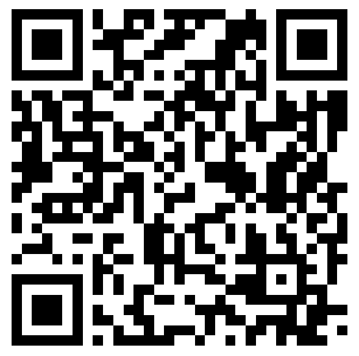

::: {.columns}
::: {.column width="58%"}
Scannez le **code QR**, ou ouvrez [Wooclap](https://app.wooclap.com/TZSACKH){target="_blank" rel="noopener noreferrer"}.

**Code de l’évènement : TZSACKH**

Utilisez votre identifiant UQAR selon les consignes.
:::
::: {.column width="42%"}
[{fig-alt="Code QR Wooclap TZSACKH" width="420"}](https://app.wooclap.com/TZSACKH){target="_blank" rel="noopener noreferrer"}
:::
:::
