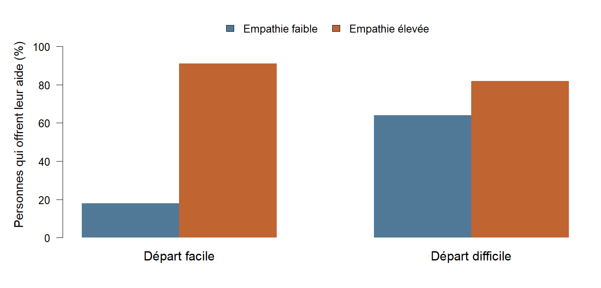
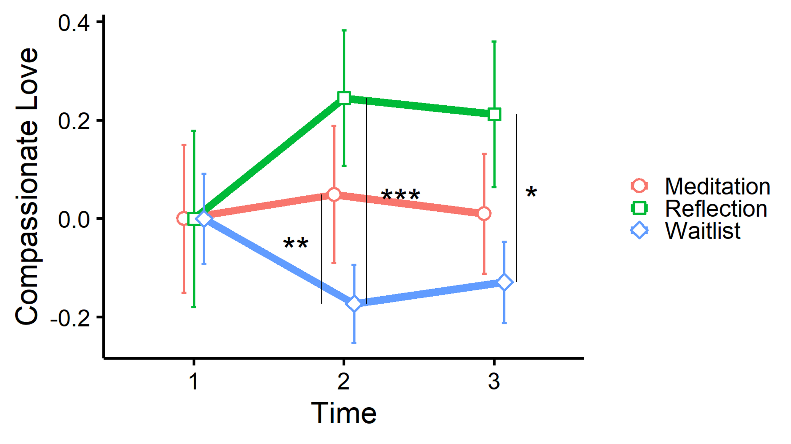
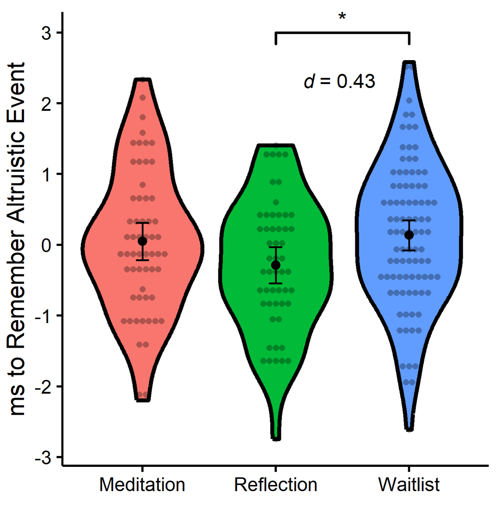
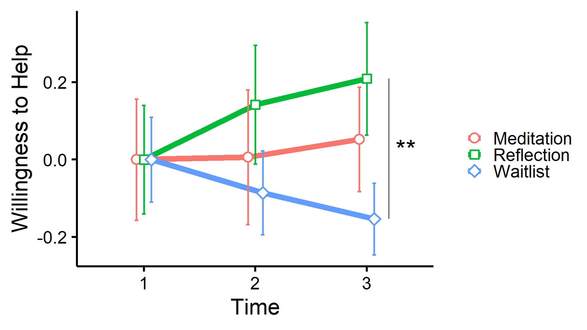
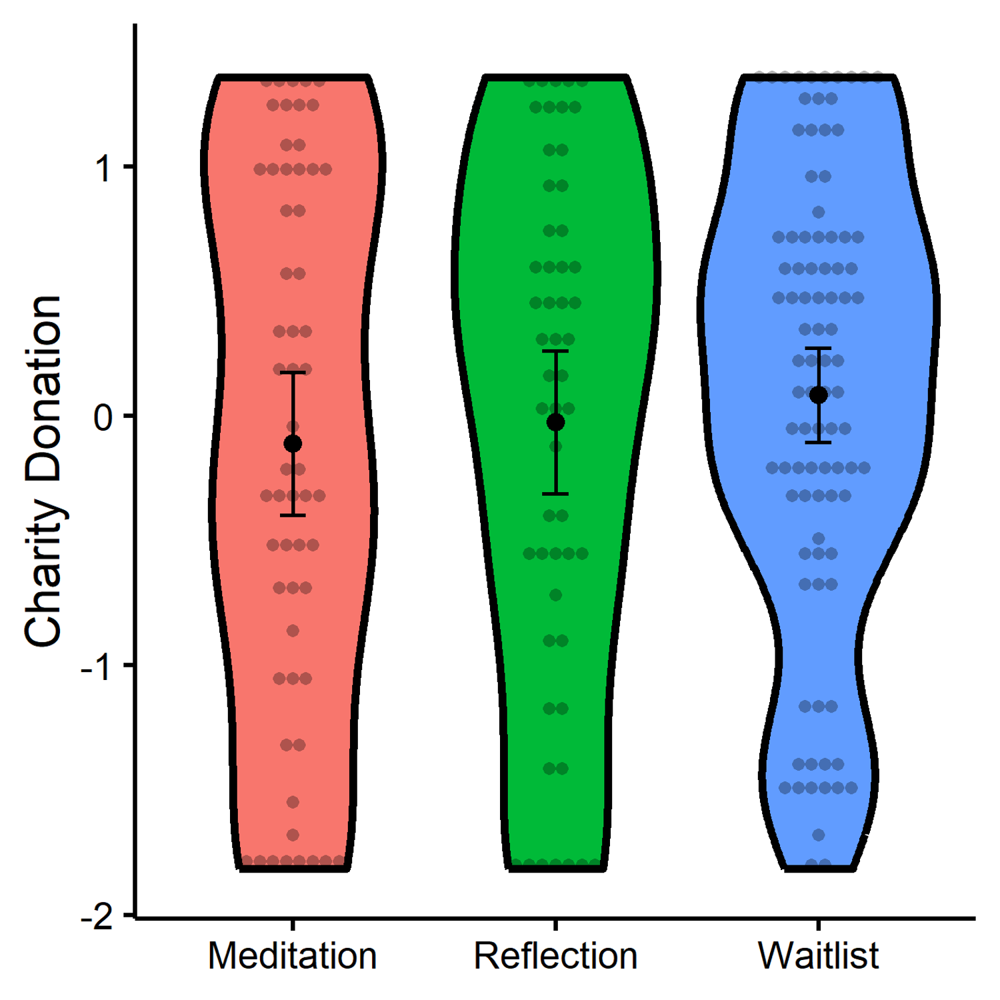
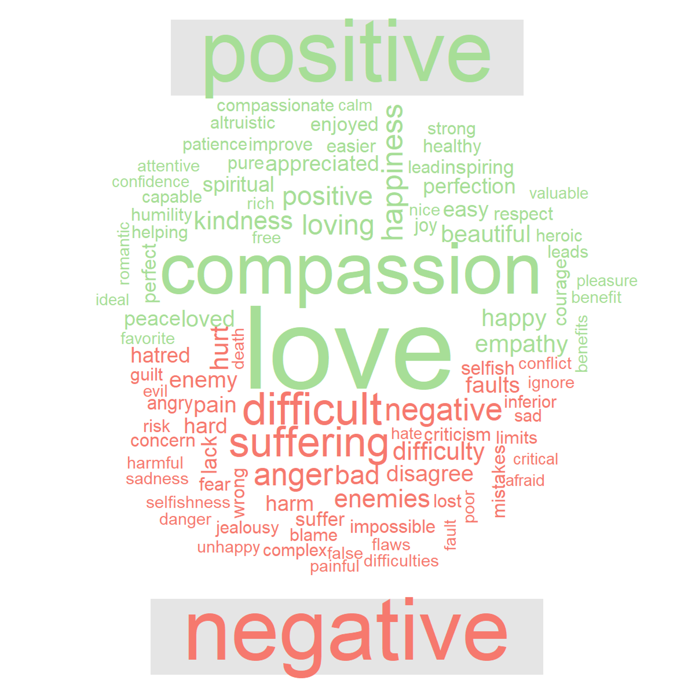

## Quiz de lecture 7 — 1,25 %

**Cours 8 et chapitre 9 · 8 questions · 10 minutes · Travail individuel**





::: {.notes}
Vérifier l’identification UQAR et la connexion avant de lancer les dix minutes. Le code du quiz est TZSACKH. Les activités et les pauses utilisent RDCXFGC. Les huit meilleurs quiz sur neuf comptent pour 10 %. Prévoir le secours autorisé en cas de difficulté technique; ne pas improviser une nouvelle modalité de notation.
:::

## Quiz et examen — quoi préparer?

**Cours 11 annulé (grève étudiante) · Chapitre 12 facultatif et exclu de l’examen.**

**Quiz 8 · 1er décembre · 1,25 %**

Cours 9 et chapitre 10 — Les comportements d’aide.

8 questions · 10 minutes · Les 8 meilleurs quiz sur 9 : **10 %**.

**Examen 3 · 15 décembre · 35 % · 120 minutes maximum**

Cours 9, 10 et 12 · Chapitres 10, 11 et 13 · 32 QCM et 8 réponses courtes.

**50 % cours / 50 % manuel · 56 points.**

::: {.notes}
Distinguer la lecture du jour du périmètre du quiz qui vient de se terminer. Le cours 12 est maintenu le 8 décembre. Le quiz 9 aura lieu ce jour-là et portera sur le cours 10 et le chapitre 11. Certaines notions sur les groupes seront abordées aux cours 10 et 12 et pourront être évaluées comme matière du cours si elles figurent au guide d’étude. Rappeler carte étudiante, matériel d’écriture et identifiant UQAR pour l’examen. Les mesures individuelles confirmées s’appliquent.
:::

## Connectez-vous à Wooclap {#retour-examen-2}



**Examen 2** · Deux estimations, puis les résultats de la classe.

::: {.notes}
4 minutes. Dans Wooclap uniquement : faire estimer la médiane, puis le maximum; afficher ensuite la diapositive descriptive préparée pour l'évènement. Ne pas projeter la note minimale ni des copies individuelles.
:::

## Plan de la séance

1. **L’aide, l’altruisme et les motivations**
2. **Les témoins et les obstacles à l’aide**
3. **La coopération et les conséquences de l’aide**

**Pour commencer :** voir une personne en difficulté suffit-il pour l’aider?

::: {.notes}
Fil conducteur : les prolongements fictifs du projet de cédérom de Sélina au profit d’une activité scolaire. Comprendre pourquoi un geste ne révèle pas tout son motif, puis comment une organisation peut faciliter une aide utile. Présenter les cas comme des prolongements inventés à partir du projet de cédérom, sans récit personnel demandé. Possibilité de réfléchir par écrit avant le partage.
:::

## L’entraide {#lentraide}

```{=html}
<iframe id="ramdam-entraide" width="1450" height="540" src="https://www.youtube.com/embed/tATPusr2qtU?start=0&amp;end=91&amp;rel=0" title="Ramdam — Surprise, surprise… : l’entraide" allow="autoplay; fullscreen; encrypted-media" allowfullscreen></iframe>
<div style="margin-top:12px">
<button type="button" onclick="document.getElementById('ramdam-entraide').src='https://www.youtube.com/embed/tATPusr2qtU?start=0&amp;end=91&amp;autoplay=1&amp;rel=0'" style="font:inherit;font-size:26px;padding:8px 18px;cursor:pointer">Rejouer</button>
</div>
```

::: {.credit}
Ramdam · saison 1, épisode 39 · *Surprise, surprise…* · 0:18–1:27 · [Ouvrir la vidéo](https://www.youtube.com/watch?v=tATPusr2qtU&t=18s).
:::

::: {.notes}
Avant de lancer : « Sélina veut vendre des copies de l’album de l’école et verser la moitié des recettes au comité qui finance la classe-neige, une sortie scolaire d’hiver. Elle a de la difficulté à graver le disque. Que pourrait faire Manolo pour l’aider? » Recueillir une ou deux prédictions. Pendant la scène, repérer ce qu’il offre de faire et comment Sélina réagit. Après : il vérifie le branchement et propose de graver les CD. Sélina accepte de lui confier le travail. Décrire l’offre avant de discuter de ses motivations. Que faudrait-il entendre ou observer pour savoir ce qui l’amène à aider? Distinguer l’offre montrée de la suite de l’épisode. Transfert : « Dans un travail d’équipe, comment vérifier si la personne veut qu’on lui montre la marche à suivre, qu’on le fasse ensemble ou qu’on prenne la tâche en charge? » Si le lecteur ne démarre pas, ouvrir le lien à 0:18 ou raconter l’offre et la réponse de Sélina.
:::

## Les comportements prosociaux et l’aide

Un **comportement prosocial** vise à bénéficier à autrui.

Le **comportement d’aide** est un geste social posé au bénéfice d’une autre personne.

**Dans l’extrait :** Sélina veut vendre des CD de l’album de l’école pour contribuer au financement de la classe-neige. Manolo lui propose de les graver.

Que voit-on? Que faudrait-il demander à Sélina?

::: {.notes}
Manuel p. 301 et glossaire p. 440. « Prosocial » fournit un repère général dans le cours. Préciser que le chapitre définit surtout l’aide et l’altruisme. Observer l’offre et vérifier le besoin. Sélina pourrait avoir besoin qu’on lui montre comment graver une copie. Demander « Qu’est-ce qui t’aiderait maintenant? ». Relier à la distinction soutien instrumental/informationnel du cours 7 sans ajouter une taxonomie. Faire raconter brièvement la scène, puis passer du geste observable à la question du motif sur la diapositive suivante. Annoncer que les exemples qui suivent sont des variantes fictives.
:::

## L’altruisme et les motivations

L’**altruisme** est une conduite au bénéfice d’autrui sans récompense attendue. Une **motivation altruiste** vise le bien d’autrui.

**Même geste : graver les cédéroms.**

- « Je veux que Sélina puisse livrer ses cédéroms à temps. »
- « Je veux qu’on me remarque pour mon engagement. »
- « Je veux qu’elle m’aide à monter ma prochaine vidéo. »

Le geste est visible; le but demande d’autres indices.

::: {.notes}
Éviter d’inférer une motivation pure d’un seul comportement. Manuel p. 301, 316–317 et glossaire p. 438 et 446. Montrer la distinction entre conduite et but. Le chapitre distingue une aide motivée par le bien de la personne et une aide motivée par un bénéfice pour soi. Les motifs peuvent coexister. Un bénéfice personnel après l’aide ne suffit pas à montrer que ce bénéfice était le but initial. Transfert professionnel : reconnaitre une aide utile sans prétendre lire les intentions de la personne qui la donne.
:::

## Les motivations et le choix d’aider

**Variante fictive :** Mariane et Simon aident Sélina à préparer la vente des CD pour la classe-neige.

<div class="c09-paire"><div><strong>En privé</strong><p>Manolo grave des copies avant que Mariane et Simon arrivent.</p></div><div><strong>Devant les autres</strong><p>Manolo grave les mêmes copies sous leurs yeux.</p></div></div>

::: {.notes}
Faire prédire ce qui changerait si l’objectif était d’être remarqué, puis si l’objectif était que le matériel soit prêt. Les deux versions gardent la même tâche et le même besoin. Seule la présence de Mariane et Simon change. L’indice probant est le changement de conduite lorsque la reconnaissance est retirée alors que le besoin demeure comparable. Prépare la ronde 1.
:::

## L’empathie et la détresse personnelle

Une **émotion empathique** est une réaction de compassion qui correspond à ce que vit autrui.

La **détresse personnelle** est un malaise centré sur sa propre réaction à la souffrance observée.

Sélina semble dépassée :

- Chercher ce qui pourrait lui être utile.
- Vouloir surtout ne plus ressentir ce malaise.

::: {.notes}
Manuel p. 315–317 et glossaire p. 442. Dans le modèle intégratif de Batson, la détresse personnelle peut pousser à soulager son propre malaise et l’émotion empathique peut pousser à soulager autrui. Les deux réactions peuvent conduire à aider; le comportement seul ne les départage pas. Faire comparer les buts : soulager la situation de Sélina ou soulager son propre inconfort. Si une personne quitte la scène, plusieurs explications restent possibles; ne pas conclure qu’elle manque d’empathie. Aucune confidence demandée.
:::

## L’empathie et la possibilité de partir

Une personne reçoit une demande d’aide.

**Deux questions pour prédire :**

1. Se représente-t-elle ce que vit la personne?
2. Peut-elle facilement quitter la situation?

Si le but est le bien d’autrui, partir règle-t-il le problème?

::: {.notes}
Faire prédire les quatre conditions du tableau 10.2 avant de montrer la figure. Dans l’expérience de Batson et ses collègues, des personnes observent une autre personne censée recevoir des chocs. On leur offre de prendre sa place. L’empathie est suscitée à des degrés différents et partir est facile ou difficile selon la condition. Manuel p. 316–317. Aucune mise en scène de chocs en classe.
:::


## L’empathie et la décision d’aider

{height=560px fig-alt="Barres comparant la proportion d’aide selon le niveau d’empathie et la possibilité de partir."}

::: {.credit}
Batson et coll. (1981), résultats rapportés dans le manuel, tableau 10.2, p. 317.
:::

::: {.notes}
Comparer d’abord facile et difficile dans les barres d’empathie faible, puis refaire la comparaison à empathie élevée. Quand partir est facile, s’éloigner peut suffire à réduire sa propre détresse. Si le but est de soulager autrui, partir laisse son problème entier. Le profil est compatible avec deux motivations et ne révèle pas le motif de chaque personne. Aucun chiffre à mémoriser. Transfert : pour comprendre une offre d’aide, regarder si elle répond au besoin exprimé même quand on pourrait simplement s’éloigner.
:::

## L’humeur et le calcul des couts

- **Effet d’être de bonne humeur** — Dans plusieurs situations, une humeur positive favorise l’aide.
- **Soulagement des émotions négatives** — Aider peut atténuer son propre malaise.
- **Activation–cout–bénéfice** — En situation d’urgence, l’activation ressentie et les couts anticipés orientent la façon d’y répondre.

Pour la vente des CD, qu’est-ce qui change si aider prend cinq minutes ou tout l’après-midi?

::: {.notes}
Manuel p. 309 et 313–315, glossaire p. 438, 440, 442 et 445. Le chapitre distingue le soulagement de son humeur, l’activation suscitée par l’urgence et le calcul du passant. Pour ce dernier, comparer aussi le cout de ne pas aider pour soi et pour la personne qui a besoin d’aide. Expliquer que l’humeur négative peut encourager ou freiner l’aide selon les circonstances. Variante rapide : une personne en retard peut relayer la demande à quelqu’un de disponible. Faire nommer ce que cette solution change pour les deux personnes.
:::
## Les couts pour la personne aidante et pour autrui

<div class="c09-paire"><div><strong>Intervenir directement</strong><p>Impossible de rester après 15 h.</p></div><div><strong>Relayer la demande</strong><p>Une autre personne est libre, mais ne l’a pas encore reçue.</p></div></div>

::: {.notes}
Faire comparer le cout d’agir et celui de laisser la demande sans suite. Le relai réduit l’effort pour la personne qui ne peut rester et garde une chance de réponse pour l’autre. Faire préciser comment savoir que le relai a effectivement pris la tâche.
:::

## Les normes et le comportement d’aide

**Réciprocité :** rendre l’aide reçue.

**Responsabilité sociale :** aider une personne qui dépend de notre aide, même sans retour attendu.

Manolo aide à préparer le kiosque avec Mariane après qu’elle l’a aidé à monter sa vidéo.

Simon montre à une personne qui vient aider à la vente comment faire fonctionner le kiosque.

**Équité** — corriger un déséquilibre perçu. **Justice** — aider selon ce qu’on juge mérité.

::: {.notes}
Manuel p. 302–303 et glossaire p. 446. Équité : après une répartition inégale des copies à graver, rééquilibrer le travail. Justice : discuter du jugement selon lequel une personne mérite ou non de recevoir de l’aide et de ses effets. Faire relever l’indice : aide passée dans le premier cas; besoin et absence de retour attendu dans le second. Les normes sont des attentes sociales, pas des garanties d’action. Modifier le premier cas : aucune aide passée, mais la personne ne sait pas graver seule. Le mécanisme à proposer change. En stage, clarifier les responsabilités de l’équipe plutôt que supposer qu’une dette personnelle assure la continuité du service.
:::


## Les normes d’aide en comparaison

| Norme | Indice à rechercher | Exemple pour la vente des CD |
|---|---|---|
| **Réciprocité** | Un service a déjà été rendu. | Simon aide Sélina en retour de son aide pour une vidéo. |
| **Responsabilité sociale** | La personne dépend du coup de main. | Simon montre à une nouvelle personne comment tenir le kiosque. |
| **Équité** | La répartition parait déséquilibrée. | On redistribue les copies à graver pour répartir la charge. |
| **Justice** | Le geste dépend de ce qu’on juge mérité. | Une personne décide qui mérite qu’on l’aide à rattraper son retard. |

::: {.notes}
Faire comparer les raisons d’aider, en gardant le même objectif de vente. Donner un indice à changer pour passer de la réciprocité à la responsabilité sociale. Pour la justice, distinguer jugement de mérite et véritable besoin. Comparer l’équité, qui porte ici sur la répartition du travail. Le même geste peut correspondre à plus d’une norme selon les raisons données.
:::

## Les modèles et l’apprentissage de l’aide

Le **modelage** consiste à apprendre en observant une personne dont on peut reprendre la conduite.

Mariane voit Simon offrir à Sélina de graver un disque avec elle ou de s’en charger. Plus tard, Mariane propose ce même choix à une autre personne qui aide à la vente.

**Qu’a-t-elle pu apprendre en le regardant?**

::: {.notes}
Manuel p. 303–306 et glossaire p. 445, entrée « Modèle ». Distinguer deux apprentissages dans la scène : comment aider et dans quelles circonstances le groupe considère l’aide appropriée. Comparer un encouragement verbal, une démonstration par un modèle semblable et le comportement de personnes qui ne font rien. Faire proposer une façon de montrer la conduite souhaitée à une nouvelle recrue. Les médias peuvent aussi présenter des modèles. Laisser les messages implicites à la lecture.
:::
## Wooclap — les motivations



Quatre questions · Une réponse individuelle, puis une justification.

[Reprendre le cours après la ronde](#pause-1)

::: {.notes}
Prévoir 8 minutes pour la ronde et son débreffage. Les quatre questions suivantes sont formatives, pas le quiz évalué. En présentation, ouvrir l’évènement puis reprendre directement à la pause; les diapositives suivantes servent d’archives. Tant que l’évènement manque, lire les choix et faire voter sans téléphone.
:::

## Le geste et le motif

En fin de journée, on voit Manolo remettre à Sélina des copies du cédérom qu’il a gravées. Quelle observation permettrait le mieux de distinguer une motivation altruiste d’une recherche de reconnaissance?

- A. Le nombre de copies qu’il a gravées.
- B. Le fait qu’il grave aussi des copies quand son aide restera anonyme.
- C. Le fait que les copies fonctionnent.
- D. Le nombre de personnes qui achètent le cédérom.

::: {.notes}
B rend moins plausible la recherche de reconnaissance publique. Aider sans public ne suffit pas à établir que le motif est altruiste. Demander quel autre motif pourrait aussi expliquer ce geste.
:::

## Les normes d’aide

Sélina a aidé Simon à monter une vidéo. Simon vient préparer les cédéroms parce qu’il souhaite lui rendre ce service. Quelle norme décrit le mieux son geste?

- A. La norme de responsabilité sociale.
- B. La norme d’équité.
- C. La norme de réciprocité.
- D. La norme de justice.

::: {.notes}
C. L’indice est le service que Simon souhaite rendre. Transformer le cas : quelqu’un dépend de Simon pour accéder au matériel et ne lui a jamais rendu de service. Quelle norme devient plus pertinente?
:::

## L’empathie et la possibilité de partir

Dans l’étude de Batson vue en classe, pour quel groupe la possibilité de partir facilement a-t-elle le plus changé la fréquence de l’aide?

- A. Le groupe où l’empathie suscitée était faible.
- B. Le groupe où l’empathie suscitée était élevée.
- C. Les deux groupes ont changé à peu près autant.
- D. Aucun des deux groupes n’a montré de changement.

::: {.notes}
A. Revenir brièvement à la figure. À faible empathie, l’aide est nettement moins fréquente lorsque le départ est facile. Demander ce que partir peut changer pour la personne qui observe et pour celle qui a besoin d’aide.
:::

## Le modelage

Pendant la préparation de la vente, Simon demande à Sélina si elle préfère faire un essai de gravure avec lui ou lui confier la tâche. Mariane observe l’échange et reprend cette manière d’offrir de l’aide à une autre personne qui aide à la vente. Quel processus décrit le mieux son apprentissage?

- A. La réciprocité.
- B. Le soulagement des émotions négatives.
- C. L’encouragement verbal.
- D. Le modelage.

::: {.notes}
D. Mariane apprend en observant une façon d’aider qu’elle peut reprendre. Demander ce qu’une personne expérimentée pourrait montrer à une nouvelle recrue pour rendre visible une conduite utile.
:::

## Pause — 10 minutes {#pause-1}



Proposez une chanson ou une photo de votre animal de compagnie.

::: {.notes}
Annoncer oralement l’heure de retour. Prévoir la question ouverte Wooclap : réponses multiples, J’aime, images, compte à rebours dix minutes, modération désactivée; vérifier les autorisations avant projection. Tirage indépendant habituel. La reprise mène à l’effet du passant.
:::

## L’effet du passant

L’**effet du passant** désigne une diminution possible de l’aide individuelle en présence d’autres témoins.

**La présence d’autres personnes peut changer ce que chacun interprète et prend en charge.**

Dans le clavardage de l’équipe, dix lectures du message ne donnent pas dix engagements.

::: {.notes}
Faire prédire ce que la présence d’autres témoins peut changer. Ce cas numérique est une application à discuter, pas une réplication de laboratoire. Éviter la règle absolue « plus il y a de monde, jamais d’aide ». Ne pas confondre probabilité qu’une personne aide et probabilité qu’au moins une aide apparaisse dans un groupe. Manuel p. 306–309, figure 10.3 et glossaire p. 442. Dans l’étude par interphone, une voix semble faire un malaise. La personne qui se croit l’unique autre auditrice signale plus souvent et plus vite le problème que celles qui croient que d’autres l’entendent. Les personnes sont isolées et ne voient pas la réaction des autres : faire expliquer pourquoi cette comparaison illustre la diffusion de responsabilité. Aucun chiffre à mémoriser. En situation dangereuse, la présence d’autres personnes peut aussi fournir un appui.
:::

## L’effet du passant à l’interphone

<div class="c09-paire"><div><strong>Une seule autre personne à l’écoute</strong><p>Je pense être la seule personne à entendre la demande.</p></div><div><strong>Plusieurs autres à l’écoute</strong><p>Je crois que d’autres entendent la même demande.</p></div></div>

::: {.notes}
Prédire quel groupe signalera le plus souvent et le plus vite la situation avant de rappeler le résultat général de l’étude (manuel p. 306–309). Les personnes sont isolées et ne peuvent pas voir le calme d’autrui. La manipulation permet de tester ce qui change quand la responsabilité peut paraitre partagée.
:::

## La diffusion de la responsabilité

La **diffusion de la responsabilité** réduit le sentiment de devoir intervenir personnellement quand d’autres pourraient le faire.

« Quelqu’un d’autre va répondre. »

**Changer un détail :** attribuer une tâche précise et demander confirmation.

::: {.notes}
Ici le besoin peut être reconnu, mais la prise en charge reste indéfinie. Comparer « tout le monde peut aider » à une demande adressée à une personne, limitée dans le temps. Le silence peut aussi venir d’une indisponibilité réelle : vérifier au lieu d’accuser. En milieu professionnel, transmettre une tâche et obtenir un retour ferme la boucle; désigner un nom sans confirmation ne suffit pas.
:::

## Quand tout le monde attend quelqu’un {#citation-responsabilite}

::: {.c09-citation lang="en"}
> This is a story about four people named **Everybody**, **Somebody**, **Anybody** and **Nobody**.
>
> There was an important job to be done and **Everybody** was sure that **Somebody** would do it. **Anybody** could have done it, but **Nobody** did it. **Somebody** got angry about that, because it was **Everybody**’s job.
>
> **Everybody** thought **Anybody** could do it, but **Nobody** realized that **Everybody** wouldn’t do it. It ended up that **Everybody** blamed **Somebody** when **Nobody** did what **Anybody** could have.
:::

::: {.credit}
Attribué à Charles R. Swindoll.
:::

::: {.notes}
Résumer le jeu de mots en français : tout le monde sait qu’il y a une tâche, chacun s’attend à ce que quelqu’un s’en charge et personne ne la fait. Faire nommer le blocage, puis demander quelle confirmation permettrait de savoir que la tâche est prise en charge. L’attribution à Swindoll circule dans des sources secondaires, et le récit est aussi publié sans nom d’auteur.
:::

## L’ignorance pluraliste

L’**ignorance pluraliste** survient lorsque des personnes interprètent la réserve des autres comme le signe qu’il n’y a pas de problème, alors qu’elles s’interrogent aussi.

« Personne ne réagit : ce ne doit pas être important. »

**Changer un détail :** rendre le besoin explicite.

::: {.notes}
Ici l’interprétation de la situation est centrale. Reprendre le message : « Il reste vingt copies à graver. Sans aide, on ne les aura pas pour l’ouverture du kiosque à 16 h. » Ne pas inventer que toute l’équipe pense déjà la même chose. Faire comparer : comprendre l’urgence mais attendre autrui = diffusion; utiliser le calme apparent d’autrui pour minimiser l’urgence = ignorance pluraliste. Les deux peuvent se succéder.
:::

## L’interprétation du besoin et la prise en charge

<div class="c09-paire"><div><strong>Une pièce enfumée</strong><p>Les autres restent assis. Y a-t-il vraiment un problème?</p></div><div><strong>Un appel à l’interphone</strong><p>Le besoin est clair. Est-ce à moi de m’en occuper?</p></div></div>

::: {.notes}
Dans l’expérience de Latané et Darley (1968), les personnes seules signalaient la fumée plus souvent que celles entourées de comparses qui restaient passifs. Comparer ce résultat avec l’expérience de l’interphone. Demander quel obstacle chacune des deux phrases illustre. Au retour au clavardage, rendre le besoin clair agit sur l’interprétation. Une demande adressée avec confirmation agit sur la prise en charge.
:::

## La crainte d’être jugé dans une intervention

Une personne peut hésiter à intervenir parce qu’elle craint de se tromper devant les autres.

« Et si mon offre était déplacée? »

**Une première démarche :** demander discrètement si une aide serait utile.

::: {.notes}
Éviter de figer un terme technique avant comparaison avec le chapitre. Distinguer cette crainte de l’idée qu’une autre personne s’en occupe et du doute sur l’existence du besoin. En stage, proposer « Souhaitez-vous que je vous indique la personne responsable? » au lieu d’imposer une intervention. L’enjeu est une prise de contact adaptée, pas se substituer à un rôle pour lequel on n’a pas la formation.
:::

## La diffusion de la responsabilité dans le clavardage

<div class="c09-meme-gru">
  
  <ol>
    <li>J’envoie une demande au groupe.</li>
    <li>Dix personnes la voient.</li>
    <li>Tout le monde attend que quelqu’un réponde.</li>
    <li>Tout le monde attend que quelqu’un réponde.</li>
  </ol>
</div>

::: {.credit}
Gru’s Plan · [Modèle Imgflip](https://imgflip.com/meme/Grus-Plan) · Légendes françaises.
:::

::: {.notes}
Une minute. Faire dire précisément ce que le nombre de lectures ne garantit pas : une prise en charge. « Je pensais que quelqu’un d’autre s’en occupait » apporte un indice de diffusion. Un message lu sans autre information peut aussi avoir été ignoré par manque de disponibilité. Demander quelle confirmation remplacerait le seul indicateur Vu.
:::

## Les obstacles à l’intervention

| Obstacle | Ce que la personne se dit | Une réponse possible |
|---|---|---|
| **Ignorance pluraliste** | « Personne ne réagit. Ce n’est sans doute pas urgent. » | Préciser le besoin et l’échéance. |
| **Diffusion de la responsabilité** | « C’est urgent. Quelqu’un d’autre va répondre. » | Demander à une personne de confirmer. |
| **Crainte du jugement** | « Et si mon offre était mal reçue? » | Vérifier discrètement si une aide serait utile. |

::: {.notes}
Faire identifier l’indice qui permet de départager les trois situations. L’ignorance pluraliste touche l’interprétation du besoin. La diffusion touche la prise en charge. La crainte du jugement porte sur la réaction qu’on anticipe. Demander quel détail on pourrait changer dans chacun des exemples. Le tableau synthétise les distinctions déjà présentées.
:::

## Le modèle de Latané et Darley {#modele-aide}

<div class="c09-decision" role="group" aria-label="Les cinq étapes du comportement d’aide. À chaque étape, oui permet de continuer. Non signifie que l’aide n’est pas apportée à ce moment.">
<div class="c09-decision-etape" style="--ligne:1"><div class="c09-decision-question"><span>1</span>Est-ce que je remarque la situation?</div><div class="c09-decision-oui">Oui ↓</div></div>
<div class="c09-decision-non" style="--ligne:1">Non <span aria-hidden="true">→</span></div>
<div class="c09-decision-etape" style="--ligne:2"><div class="c09-decision-question"><span>2</span>Est-ce que je comprends que quelqu’un a besoin d’aide?</div><div class="c09-decision-oui">Oui ↓</div></div>
<div class="c09-decision-non" style="--ligne:2">Non <span aria-hidden="true">→</span></div>
<div class="c09-decision-etape" style="--ligne:3"><div class="c09-decision-question"><span>3</span>Est-ce que je me sens responsable d’intervenir?</div><div class="c09-decision-oui">Oui ↓</div></div>
<div class="c09-decision-non" style="--ligne:3">Non <span aria-hidden="true">→</span></div>
<div class="c09-decision-etape" style="--ligne:4"><div class="c09-decision-question"><span>4</span>Est-ce que je sais quel geste serait utile?</div><div class="c09-decision-oui">Oui ↓</div></div>
<div class="c09-decision-non" style="--ligne:4">Non <span aria-hidden="true">→</span></div>
<div class="c09-decision-etape" style="--ligne:5"><div class="c09-decision-question"><span>5</span>Est-ce que je passe à l’action?</div><div class="c09-decision-oui">Oui ↓</div></div>
<div class="c09-decision-non" style="--ligne:5">Non <span aria-hidden="true">→</span></div>
<div class="c09-decision-arret"><strong>L’aide s’arrête ici</strong><br><span>Le besoin peut rester sans réponse.</span></div>
<div class="c09-decision-aide">L’aide est apportée</div>
</div>

::: {.credit}
Adapté du modèle cognitif du comportement d’aide présenté au chapitre 10, p. 306–309, figure 10.2.
:::

::: {.notes}
Le modèle de Latané et Darley décrit les questions successives qui peuvent se poser à une personne témoin d’une situation d’urgence. Présenter d’abord le parcours qui mène à l’aide. Puis demander : « Si la réponse est non à n’importe quelle étape, qu’est-ce que l’on observe de l’extérieur? » Attendu : la personne n’intervient pas à ce moment, et plusieurs blocages peuvent produire le même résultat observable. Dans notre transposition dans l’équipe de vente, on va changer un indice à la fois pour repérer le blocage. Prévoir environ 15 minutes pour la figure, les cinq microcas et l’application, avant l’atelier d’application.
:::


## 1. Remarquer la situation {#aide-remarquer}

**Repérer un signal** indiquant qu’il se passe quelque chose. Cette étape dépend de l’attention disponible.

- **Ce qui peut faire obstacle.** La distraction, le bruit ou le fait d’être pressé peuvent détourner l’attention du signal.
- **Dans notre scénario.** Simon cherche l’heure du kiosque dans le clavardage. Il passe devant le message de Sélina sans le remarquer.

::: {.notes}
Manuel, chapitre 10, p. 306–309, figure 10.2. Distinguer un message reçu d’un message remarqué. Comparer deux cas : Simon passe devant le message en cherchant l’heure, ou il le lit et pense que rien ne presse. Dans le premier, le signal n’a pas retenu son attention. Dans le second, il l’a repéré et en a interprété le sens (étape 2). Faire proposer un emplacement ou un signal qui rend le message plus visible sans multiplier les notifications. En stage, placer les demandes actives dans le canal convenu.
:::

## 2. Interpréter le besoin {#aide-interpreter}

**Déterminer si la situation exige de l’aide** et à quel point elle est urgente.

- **Quand la situation est ambigüe**, les personnes présentes observent parfois les réactions des autres pour comprendre ce qui se passe.
- **Ignorance pluraliste.** Chacun se demande s’il y a un problème, mais prend le calme apparent des autres pour un signe que tout va bien.
- **Dans notre scénario.** Mariane lit « On est en retard sur les CD ». Le silence du groupe lui donne l’impression que ça peut attendre.

::: {.notes}
Revenir à l’exemple de la fumée : le témoin voit la fumée, hésite sur sa signification et voit les autres rester calmes. Le calme apparent devient un indice, alors que les autres peuvent eux aussi hésiter. Dans le clavardage, l’ignorance pluraliste suppose que d’autres s’inquiètent également. Pour éclaircir la situation, donner un fait vérifiable : « Il reste vingt CD à graver et le kiosque ouvre à 16 h. » Si Mariane comprend déjà l’urgence et compte sur quelqu’un d’autre, passer à l’étape 3.
:::

## 3. Se sentir responsable {#aide-responsabilite}

**Se reconnaitre un rôle** dans la réponse à un besoin qu’on a compris.

- **Diffusion de la responsabilité.** Si plusieurs personnes pourraient agir, chacune peut se sentir moins tenue d’intervenir et attendre qu’une autre s’en charge.
- **Dans notre scénario.** Simon sait qu’il manque des CD pour 16 h. Il attend parce que neuf autres personnes ont reçu la demande.

::: {.notes}
Revenir à l’interphone : les personnes ne voyaient pas la réaction des autres. Ce qui changeait, c’était le nombre d’autres personnes qu’elles croyaient à l’écoute. Tester le contraste : « Ce n’est probablement pas urgent » relève de l’étape 2. « C’est urgent et quelqu’un d’autre va répondre » relève de l’étape 3. Demander à Simon s’il peut prendre une tâche précise et obtenir une confirmation. S’il décline, solliciter un relai.
:::

## 4. Choisir comment aider {#aide-choisir}

**Trouver une intervention adaptée** au besoin, à ses compétences et à ce qu’on a à sa disposition.

- **Aide directe.** Accomplir soi-même un geste qu’on sait faire.
- **Aide indirecte.** Faire appel à une personne mieux placée ou mieux outillée.
- **Dans notre scénario.** Mariane veut aider. Elle peut vérifier les CD déjà gravés ou demander à quelqu’un qui connait le logiciel de terminer la gravure.

::: {.notes}
La personne veut contribuer et cherche une manière de le faire. Faire comparer une tâche que Mariane sait déjà accomplir et une tâche qui exige d’aller chercher un appui. Demander en quoi chacune fait avancer le projet. En stage, signaler la situation à la personne responsable peut être la forme d’aide la plus adaptée quand l’intervention dépasse son rôle. Distinguer « je sais qui peut intervenir » et « j’ai effectivement demandé son aide ».
:::

## 5. Passer à l’action {#aide-agir}

**Mettre en œuvre l’aide choisie.** Le passage à l’acte dépend notamment des contraintes et des couts anticipés.

- Un imprévu, le temps requis, un risque ou la crainte de se tromper devant les autres peuvent freiner l’intervention.
- **Dans notre scénario.** Simon a choisi de graver cinq CD. Un imprévu réduit son temps libre. Il peut commencer la gravure s’il peut la terminer à temps ou prévenir l’équipe pour trouver un relai.

::: {.notes}
Faire distinguer l’aide prévue du geste observable : annoncer « je peux graver cinq CD » exprime un engagement, lancer la gravure ou joindre un relai est un début d’exécution. Mettre en lien avec le calcul du passant : ici, agir peut prendre du temps et attendre peut laisser l’équipe sans copies. L’utilité du geste compte aussi dans le choix de la solution. La crainte d’être jugé peut intervenir à plusieurs étapes. Ici, elle peut freiner une action déjà choisie.
:::

## Où l’aide se bloque-t-elle?

| Situation dans l’équipe de vente | Étape à repérer |
|---|---|
| Simon sait qu’il faut agir vite. Il attend une réponse d’une autre personne. | Quelle question du modèle reste sans « oui »? |
| Mariane se sent responsable, mais elle ne sait pas comment contribuer. | Quelle information lui permettrait de continuer? |
| Manolo sait quoi faire et a promis cinq copies. Il n’a encore rien gravé. | Qu’observerait-on s’il franchissait l’étape suivante? |

**En stage, quelle intervention serait utile dans chacun des trois cas?**

::: {.notes}
Faire réfléchir 30 secondes, puis demander à deux personnes de justifier un choix par un indice observable. Cas 1, étape 3 : comprendre le besoin n’implique pas de se sentir chargé d’y répondre. Faire une demande adressée et vérifier la réponse. Cas 2, étape 4 : clarifier la tâche, montrer comment la réaliser ou identifier un geste que la personne sait faire. Cas 3, étape 5 : le plan et l’engagement sont déjà là. Vérifier ce qui bloque l’exécution, convenir d’un délai réalisable et confirmer le résultat ou le relai. Pour le transfert en stage, utiliser par exemple un accueil qui doit être pris en charge et nommer la personne responsable selon les procédures du milieu. Faire expliquer ce que changerait l’intervention choisie.
:::

## Les cinq étapes de l’aide en résumé

| Étape | Question que se pose la personne | Exemple dans l’équipe de vente |
|---|---|---|
| **1. Remarquer la situation** | Ai-je vu qu’il se passe quelque chose? | Je vois le message de Sélina. |
| **2. Interpréter le besoin** | Est-ce une situation qui demande de l’aide? | Je comprends que des copies manqueront à 16 h. |
| **3. Se sentir responsable** | Est-ce à moi d’intervenir? | Je prends une partie de la gravure en charge. |
| **4. Choisir comment aider** | Quel geste serait utile ici? | Je choisis de graver cinq copies. |
| **5. Agir** | Est-ce que je passe effectivement à l’action? | Je grave les copies et les remets au kiosque. |

**L’aide peut s’arrêter à chacune de ces étapes.**

::: {.credit}
Manuel, chapitre 10, p. 306–309, figure 10.2.
:::

::: {.notes}
Revenir au chemin complet après les cinq microcas. Demander de fermer les notes et de reconstituer le parcours avec un exemple par étape. Utiliser le tableau pour vérifier ce qui distingue se sentir responsable, choisir un geste précis et le faire.
:::

## Le comportement d’aide en public {#reportage-bon-samaritain}

**À observer** · Qu’est-ce qui change entre les deux scènes à l’arrêt du tram?

<iframe width="1120" height="540" src="https://www.youtube.com/embed/lK2w2I4JE4g" title="Envoyé spécial — L’étoffe du héros" referrerpolicy="strict-origin-when-cross-origin" allow="accelerometer; autoplay; clipboard-write; encrypted-media; gyroscope; picture-in-picture; web-share" allowfullscreen></iframe>

::: {.credit}
*Envoyé spécial*, « L’étoffe du héros » (2015) · Extrait en français (3 min 12) · [Vidéo sur YouTube](https://www.youtube.com/watch?v=lK2w2I4JE4g)
:::

::: {.notes}
Avant la vidéo, faire prédire quelles différences entre deux scènes publiques pourraient changer la réaction des témoins. Le reportage explique d’abord l’effet du passant, puis montre deux mises en situation à un arrêt de tram. Les personnes qui simulent le malaise et leur tenue diffèrent. Demander ce qu’il faudrait garder identique pour isoler l’effet de la tenue. L’effet du passant porte sur la probabilité qu’une personne donnée intervienne. Pour comparer la pression du temps, passer à l’étude du bon Samaritain. Si le lecteur ne démarre pas, ouvrir le lien YouTube.
:::

## L’expérience du bon Samaritain {#experience-bon-samaritain}

Des séminaristes vont enregistrer un exposé. En chemin, chacun croise une personne qui semble en détresse.

- **Ce qui varie** · On leur dit qu’ils ont du temps, qu’on les attend ou qu’ils sont déjà en retard.
- **Ce qu’on observe** · Les personnes pressées s’arrêtent moins souvent pour aider.

::: {.credit}
Darley et Batson (1973) · [Article original](https://faculty.washington.edu/jdb/345/345%20Articles/Darley%20%26%20Batson%20%281973%29.pdf)
:::

::: {.notes}
Faire nommer ce que les chercheurs ont fait varier. Le sujet de l’exposé variait aussi. Parler de la parabole du bon Samaritain n’a pas eu d’effet statistiquement concluant sur l’aide dans l’analyse principale. Le nombre de témoins n’était pas manipulé. Dans le modèle, la pression du temps peut détourner l’attention, changer l’interprétation ou freiner une intervention malgré un besoin reconnu. L’étude mesure l’aide observée et ne permet pas de localiser un blocage unique chez chaque personne. Aucun pourcentage à mémoriser.
:::

## Porter secours au Québec {#secours-quebec}

- **Devoir de porter secours.** Quand la vie d’une personne est en péril, on doit l’aider directement ou obtenir du secours, sauf s’il y a un risque pour soi ou pour autrui, ou un autre motif raisonnable.
- **Protection civile de la personne qui aide.** La personne qui porte secours est exonérée de responsabilité pour le préjudice qui peut en résulter, sauf faute intentionnelle ou faute lourde.

::: {.credit}
[Charte des droits et libertés de la personne, art. 2](https://www.legisquebec.gouv.qc.ca/fr/pdf/lc/C-12.pdf#page=3) · [Code civil du Québec, art. 1471](https://www.legisquebec.gouv.qc.ca/fr/pdf/cs/ccq-1991.pdf#page=294)
:::

::: {.notes}
Faire le lien avec les étapes 4 et 5 : obtenir du secours est une façon d’agir. Si une vie semble en péril, un appel au 911 est un exemple de démarche immédiate pour obtenir du secours.
:::

## Les influences personnelles et interpersonnelles

**Même besoin, circonstances différentes :**

- Manolo sait graver les disques. Simon n’a jamais utilisé ce logiciel.
- Mariane peut rester vingt minutes; Sélina doit partir.
- La demande vient d’une amie ou d’une personne nouvelle.

Que faudrait-il modifier pour rendre l’aide possible?

::: {.notes}
Relier compétence perçue, couts et proximité au cas sans déduire un trait « généreux » ou « égoïste » du refus. Manuel p. 309–313 et 319–320. Donner comme facteurs personnels l’empathie dispositionnelle et la compétence. Pour les influences interpersonnelles, distinguer similarité perçue et relation communale, où le besoin guide l’aide plutôt qu’un retour attendu. Les facteurs génétiques, le sexe de la personne aidante selon le contexte et le maintien de l’autoévaluation restent principalement à la lecture. Proposer un essai de gravure, des tâches courtes et un accueil explicite des personnes nouvelles. Ne pas reprendre les généralisations de genre ou d’origine de l’ancien support Blais comme lois universelles.
:::


## Les attributions, les émotions et le comportement d’aide

Dans le modèle de **Weiner**, ce qu’on croit de la cause du besoin influence ce qu’on ressent et la réponse qu’on propose.

**Même demande** — Une personne qui prépare la vente demande de l’aide pour terminer les copies avant la vente.

- Le logiciel de gravure est tombé en panne pendant sa préparation.
- Elle a choisi de reporter la gravure pour regarder un film.

Quelle attribution change? Quelle réaction devient plus plausible?

::: {.notes}
Manuel p. 318–319, figure 10.5 et glossaire p. 439 et 445. Comparer la contrôlabilité perçue, puis la responsabilité attribuée, la sympathie ou la colère et la disposition à aider. La responsabilité perçue est un jugement qui peut être erroné. En stage, vérifier les obstacles avant d’interpréter un retard ou une demande répétée. Si le groupe conclut que tout le monde réagira pareil, demander un contre-exemple où une personne aide par règle professionnelle.
:::
## La responsabilité perçue et la réaction à une demande

<div class="c09-paire"><div><strong>Ce qu’on sait</strong><p>Les copies sont en retard et la personne demande de l’aide.</p></div><div><strong>Ce qu’on suppose</strong><p>Elle aurait pu éviter le retard.</p></div></div>

::: {.notes}
Faire remplacer le jugement initial par une question qui permet de vérifier l’obstacle. Le fait, la cause supposée et le degré de contrôle attribué sont distincts. Selon le modèle de Weiner, l’attribution peut déplacer l’émotion et la volonté d’aider. Le rôle professionnel peut encore guider la réponse.
:::

## La coopération {#coordination-taches}

:::: {.columns}
::: {.column width="58%"}
La **coopération** consiste à coordonner ses actions pour atteindre un but commun.

**Dans notre scénario.** Trois personnes gravent les CD, mais personne ne vérifie les copies ni ne tient le kiosque.

Pour que la vente fonctionne, l’équipe doit répartir les tâches et s’assurer que les copies vérifiées arrivent au kiosque.
:::
::: {.column width="42%"}
<div class="naruto-gif" data-gif>

<canvas hidden aria-hidden="true"></canvas>
<button type="button" aria-pressed="false">Figer le GIF</button>
<p class="gif-credit">Dragon Ball Z · <a href="https://tenor.com/view/gotenks-fusion-dragon-ball-z-goten-trunks-gif-13825935" target="_blank" rel="noopener noreferrer">GIF : Tenor</a></p>
</div>
:::
::::

::: {.notes}
Objectif : expliquer pourquoi des efforts individuels peuvent laisser le but commun hors d’atteinte si les tâches complémentaires ne sont pas coordonnées. Les rôles de la vente de CD servent d’exemple. Faire distinguer aider une personne et organiser une activité commune. Une même action peut relever des deux.
:::

## Les conséquences de l’aide

Dans notre variante, Manolo prend la souris et termine la gravure sans demander l’avis de Sélina.

La personne aidée voulait apprendre à le faire et se sent mise à l’écart.

**Une aide peut résoudre une tâche et créer une difficulté relationnelle.**

Que demander avant d’agir? Que proposer pour préserver son choix?

::: {.notes}
Le plan demande les conséquences de l’aide et de sa non-adoption. Proposition concrète : « Veux-tu que je le fasse avec toi, que je te montre comment graver un disque, ou que je te laisse terminer? ». Analyser besoin, autonomie et compétence sans présumer que toute aide menace l’estime de soi. En stage, demander le consentement et adapter l’offre au rôle et aux préférences. Manuel p. 322–325. Pour la personne aidante, faire nommer un gain possible (bien-être, sentiment de contribuer) et un cout possible (fatigue, pression). Pour la personne aidée, comparer la gratitude suscitée par une aide respectueuse avec la menace à l’estime de soi qu’une offre condescendante peut susciter. Le contexte et la motivation modulent ces effets.
:::

## Les formes d’aide et l’autonomie

| Façon d’aider | Dans notre scénario | Ce que Sélina peut faire |
|---|---|---|
| **Prendre la tâche en charge** | « Veux-tu que je grave les disques? » | Confier la tâche si elle le souhaite. |
| **Montrer comment faire** | « Veux-tu que je te montre une fois? » | Observer puis essayer. |
| **Faire ensemble** | « Veux-tu qu’on grave le premier disque ensemble? » | Participer avec un appui. |

**Quelle offre correspond à son objectif d’apprendre?**

::: {.notes}
Les trois offres laissent un choix. Si la priorité est d’avoir des copies rapidement, prendre la tâche en charge peut être utile si Sélina le souhaite. Si elle veut apprendre, montrer ou faire ensemble lui donne l’occasion de pratiquer. Revenir à la situation précédente où Manolo prend la souris sans demander. En stage, demander si la personne veut un exemple, un appui ou une prise en charge.
:::

## Les conséquences de l’absence d’aide

Personne ne répond. Le kiosque ouvre à 16 h avec moins de cédéroms que prévu.

**Conséquences possibles :** besoin non satisfait, charge reportée, confiance fragilisée.

Une réponse négative explicite peut-elle être plus utile qu’un silence?

::: {.notes}
Oui dans ce cas : elle permet de chercher une autre ressource. Dire « Je ne peux pas venir, mais je peux transmettre la demande à la personne responsable » si cela est réellement possible. Ne pas promettre une solution indisponible. Manuel p. 325–327. Distinguer les conséquences pour la personne qui n’aide pas (p. ex. culpabilité) et pour celle qui reste sans aide (p. ex. besoin non satisfait ou sentiment de rejet). Distinguer aussi une offre refusée, qui peut préserver l’autonomie et être vécue différemment des deux côtés. Pour les questions sur le cours : disponibilités après la séance ou rendez-vous par courriel, selon le plan; aucune promesse de réponse immédiate.
:::

## Les conséquences du silence

<div class="c09-paire"><div><strong>L’équipe attend</strong><p>À 16 h, le kiosque ouvre avec moins de cédéroms que prévu.</p></div><div><strong>Une personne répond</strong><p>Elle indique quand elle est disponible, ou prévient qu’il faut trouver un relai.</p></div></div>

::: {.notes}
Demander de formuler une réponse utile même quand la personne ne peut venir. La conséquence du silence dépend de la situation. Une réponse claire donne de l’information à la personne qui organise l’aide. Ne pas promettre un relai qui n’existe pas.
:::

## La répartition des tâches

<div class="c09-etapes"><span><strong>Gravure</strong><br>qui fait les copies?</span><span><strong>Vérification</strong><br>qui teste les copies?</span><span><strong>Vente</strong><br>qui tient le kiosque?</span></div>

**Où manque-t-il une confirmation?**

::: {.notes}
Demander à deux personnes de proposer une répartition qu’une équipe de stage pourrait utiliser. Une tâche attribuée mais non confirmée reste incertaine. L’objectif commun exige que les trois fonctions soient couvertes, pas que tout le monde fasse la même chose.
:::

## Wooclap — les obstacles et la coopération



Quatre questions · Identifier l’indice, puis proposer une modification concrète.

[Passer à la deuxième pause](#pause-2)

::: {.notes}
8 minutes avec débreffage. Questions formatives suivantes; passer directement à la deuxième pause après la ronde. Repli par vote en classe. Ne pas ajouter de second atelier ni de billet de sortie obligatoire.
:::

## La diffusion de la responsabilité

Simon comprend qu’il faut graver les cédéroms avant l’ouverture du kiosque. Il attend parce qu’il pense qu’une des neuf autres personnes qui ont reçu le message va y répondre. Quel mécanisme décrit le mieux son raisonnement?

- A. L’ignorance pluraliste.
- B. La diffusion de la responsabilité.
- C. La crainte d’être jugé.
- D. La norme de réciprocité.

::: {.notes}
B. Le besoin est déjà reconnu. Le frein est la prise en charge personnelle. Faire proposer une demande précise à une personne, avec confirmation et possibilité de refus.
:::

## L’ignorance pluraliste

Les membres de l’équipe se demandent en privé s’il faut graver les dernières copies tout de suite. En voyant que les autres ne réagissent pas, chaque personne conclut que la situation peut attendre. Quel mécanisme décrit cette interprétation?

- A. La diffusion de la responsabilité.
- B. La crainte d’être jugé.
- C. L’ignorance pluraliste.
- D. Le calcul des couts de l’aide.

::: {.notes}
C. Le silence est traité comme un indice sur l’urgence. Comparer avec la question précédente. Faire ajouter au message un fait qui rend le besoin plus clair, par exemple le nombre de copies restantes et l’heure d’ouverture du kiosque.
:::

## Les conséquences de l’aide

Sélina veut apprendre à graver elle-même les CD de l’album. Quelle offre l’aide à avancer tout en lui laissant le choix de ce qu’elle fait elle-même?

- A. Je peux graver les disques pendant que tu tiens le kiosque.
- B. Je peux demander à Simon de prendre la gravure en charge.
- C. Je peux graver toutes les copies et tu vérifieras le résultat.
- D. Veux-tu que je te montre comment graver un disque ou qu’on en grave un ensemble?

::: {.notes}
D. La proposition tient compte de son objectif et lui laisse un choix avant d’agir. Demander ce que les autres formulations changent dans son rôle. Transfert : formuler une offre équivalente en stage.
:::

## La coopération

Pour la vente des CD, tout le monde grave les cédéroms. Il faut encore vérifier les copies et tenir le kiosque. Quelle décision de l’équipe règle le problème de coordination?

- A. Répartir la gravure, la vérification et la vente, puis confirmer qui prend chaque tâche.
- B. Demander au groupe de décider ensemble quels disques graver en premier.
- C. Fixer une heure commune pour lancer la gravure.
- D. Demander à chaque personne de choisir un disque à graver.

::: {.notes}
A. Le défi est de couvrir les rôles nécessaires au but commun. Les autres choix organisent seulement la gravure. En équipe de stage, demander quelle tâche n’a encore personne pour la prendre.
:::

## Pause — 10 minutes {#pause-2}



Proposez une chanson ou une photo de votre animal de compagnie.

::: {.notes}
Annoncer oralement l’heure de retour. Même évènement d’engagement, distinct du quiz; réglages identiques à la première pause. Lancer l’atelier au retour de la pause.
:::

## Du silence à l’action {#atelier-aide}

Sélina écrit au groupe qui prépare la vente des CD pour la classe-neige : « Je ne pourrai pas finir de graver les CD seule avant 16 h. Est-ce que quelqu’un peut venir? » Dix personnes ont vu le message. Personne ne répond.

**Par équipes de trois ou quatre**

1. **Diagnostiquer.** Proposez deux blocages à des étapes différentes du modèle de Latané et Darley. Pour chacun, nommez l’étape et l’indice qui permettrait de vérifier votre hypothèse.
2. **Organiser l’aide.** Réécrivez la demande de Sélina. Rédigez une réponse qui précise l’aide offerte et le premier geste à poser.
3. **Transférer.** Appliquez la même démarche à une demande d’aide en équipe de stage ou de travail.

**10 minutes pleines de travail après les consignes.**



::: {.notes}
Consignes 3 minutes, travail 10 minutes au minuteur, partage et débreffage 9 minutes. Lancer le minuteur après les consignes. Une personne porte-parole par équipe. À 5 minutes, passer aux deux formulations. Aucune expérience personnelle à raconter.

Débreffage : recueillir deux hypothèses en 3 minutes. Consacrer 4 minutes à les départager. À l’étape 2, une personne peut sous-estimer le besoin en voyant le calme apparent des autres. À l’étape 3, elle peut comprendre le besoin et s’attendre à ce qu’une autre personne y réponde. Demander quel indice permet de trancher, puis distinguer choisir un geste (étape 4) et l’exécuter (étape 5). Le statut « Vu » ne suffit pas à établir l’étape qui bloque.

Demande possible : « Il reste vingt CD à graver pour 16 h. Simon, peux-tu me confirmer avant 14 h si tu peux venir graver des copies de 15 h à 15 h 30? Si tu n’es pas disponible, dis-le-moi et je demanderai à quelqu’un d’autre. » Réponse possible : « Je peux être là à 15 h. Je vais commencer par faire une copie d’essai. » Faire préciser comment vérifier que la copie d’essai a été faite.

Garder 2 minutes de transfert. En stage : « Quelqu’un pourrait accueillir la prochaine personne? » Préciser le besoin, nommer une personne, obtenir une confirmation et prévoir un relais si elle est indisponible.
:::

## La bienveillance dans mes recherches {#recherches-bienveillance}

**Six semaines · Répartition aléatoire en trois groupes**

| Méditation | Lecture et réflexion | Liste d’attente |
|---|---|---|
| Méditations guidées sur la bienveillance | Lectures et courtes réflexions écrites sur la bienveillance | Pas d’intervention pendant l’étude |
| Environ 10 min par jour + une séance de 30 min par semaine | Environ 10 min par jour + un balado de 30 min par semaine | Mesures aux mêmes moments |

**Prédiction.** Un programme qui change ce qu’on ressent change-t-il aussi ce qu’on fait pour aider?

::: {.credit}
Thériault, Masson et Dandeneau · [Préprint (2025)](https://doi.org/10.31234/osf.io/x4p9v_v1).
:::

::: {.notes}
Prévoir 7 minutes pour la séquence. En 1 minute, rappeler le dispositif aléatoire présenté au cours 8 et faire prendre position sur la prédiction. J’ai mesuré, entre autres, la compassion déclarée, le temps pour se rappeler un geste altruiste, l’intention d’aider et le don. Préciser que la lecture–réflexion comprenait des extraits, de courtes réflexions écrites et des balados. Passer ensuite aux livres.
:::

## Les livres du programme de lecture–réflexion {#livres-bienveillance}

Les lectures quotidiennes étaient des **extraits** de neuf ouvrages.

:::: {.columns}
::: {.column width="50%"}
- *Un cœur vaste comme le monde* — Salzberg, 1998
- *De la bienveillance à l’amour inconditionnel* — Hénépola Gunaratana, 2019
- *Comment s’ouvrir à l’amour véritable* — Salzberg, 2018
- *Plaidoyer pour l’altruisme* — Ricard, 2013
:::
::: {.column width="50%"}
- *Aimez vos ennemis* — Salzberg et Thurman, 2014
- *Huit étapes vers le bonheur* — Gyatso, 2002
- *L’attention, l’autre nom de l’amour* — Poletti, 2015
- *L’amour au cœur de la vie* — Harvey, 2017
- *Enseignements sur l’amour* — Thích Nhât Hanh, 2004
:::
::::

::: {.notes}
Environ 30 secondes. Donner un ou deux exemples, comme Plaidoyer pour l’altruisme et Aimez vos ennemis. Après chaque extrait, j’invitais les personnes participantes à écrire une courte réflexion. Les titres servent à situer le contenu du programme.
:::

## {#lkm-compassion data-menu-title="La compassion déclarée" aria-label="La compassion déclarée"}



::: {.notes}
Figures 3 et tableaux 3–4 du préprint. Environ une minute par figure. Les carrés sont lecture–réflexion, les cercles méditation et les losanges liste d’attente. Les scores sont rapportés sur une échelle standardisée et la figure prend le départ comme repère. La compassion est déclarée dans un questionnaire. Après le programme, les deux groupes déclarent davantage de compassion que la liste d’attente. Au suivi, l’écart avec la liste d’attente est encore détecté pour lecture–réflexion.
:::

## {#lkm-souvenir data-menu-title="Le rappel d’un geste altruiste" aria-label="Le rappel d’un geste altruiste"}



::: {.notes}
Figure 4 et tableau 3. La consigne était de penser à un geste altruiste passé et d’appuyer lorsqu’un souvenir précis revenait. L’axe anglais nomme la mesure d’origine en millisecondes. Les valeurs affichées sont standardisées. Le groupe lecture–réflexion retrouve un souvenir altruiste plus vite que le groupe en attente. La rapidité du rappel renseigne sur l’accessibilité du souvenir. Le nombre de gestes aidants posés pendant l’étude n’a pas été mesuré par cette tâche. Cette tâche a été administrée seulement après le programme.
:::

## {#lkm-intentions data-menu-title="L’intention d’aider" aria-label="L’intention d’aider"}



::: {.notes}
Figure 3 et tableaux 3–4. Les personnes indiquaient à quel point elles seraient disposées à aider dans des situations hypothétiques. L’écart lecture–réflexion contre attente est détecté au suivi. Demander quel comportement on pourrait observer pour aller au-delà d’une intention déclarée, puis passer à la mesure des dons.
:::

## {#lkm-dons data-menu-title="Les dons" aria-label="Les dons"}



::: {.notes}
Figure 4 et tableau 3. La tâche mesure les montants proposés après le programme. Un choix tiré au sort était appliqué. L’analyse ne détecte pas de différence entre les groupes. Les valeurs négatives sur le graphique représentent des scores standardisés. Revenir à la prédiction : les résultats diffèrent selon qu’on mesure la compassion ressentie, l’intention d’aider ou un geste précis. Demander quel autre geste on pourrait observer dans une équipe pour compléter la mesure du don.
:::

## Les réactions aux lectures {#lkm-commentaires}

<style>
.reveal #lkm-commentaires h2 { font-size: 1.16em; }
.reveal #lkm-commentaires blockquote { margin: .8em auto; }
.reveal #lkm-commentaires blockquote p { margin: .6em 0; }
</style>

:::: {.columns}
::: {.column width="57%"}
:::: {.lkm-verbatims style="font-size:.66em"}
<blockquote><p>« &#231;a me donne envie de passer &#224; l&#39;action, d&#39;aller fouiller mes blocages int&#233;rieurs pour m&#39;amener vers une compassion grandissante envers les autres. »</p></blockquote>

<blockquote><p>« l&#39;extrait m&#39;a donn&#233; envie de recontacter certaines personnes plut&#244;t que de continuer &#224; entretenir quelconque &#233;motion n&#233;gative &#224; leur &#233;gard. »</p></blockquote>

<blockquote><p>« Je trouve que des gestes h&#233;ro&#239;ques comme ceux d&#233;crits sont absolument admirables. C’est gr&#226;ce &#224; des histoires comme celles-ci que je veux agir et d&#233;noncer lorsque je suis confront&#233;e &#224; l’injustice »</p></blockquote>
::::
:::
::: {.column width="43%"}


<p style="font-size:16px;text-align:center;margin:3px 0">Mots des journaux de lecture traduits en anglais</p>
:::
::::

::: {.notes}
Environ 1 minute 30. Présenter trois extraits des journaux de lecture, sans identifiant. Les commentaires portent sur une réflexion ou une intention. Le nuage (figure 2 du préprint) indique les mots employés dans les journaux de lecture. Il sert à illustrer les thèmes abordés.
:::

## Quiz et examen — quoi préparer? {#evaluations-fin}

**Quiz 8 · 1er décembre · Cours 9 et chapitre 10 · 1,25 %**

8 questions · 10 minutes · 8 meilleurs sur 9 = **10 %**.

**Prochaine lecture : chapitre 11 — L’influence sociale.**

**Examen 3 · 15 décembre · 35 % · 120 minutes maximum**

Cours 9, 10 et 12 et chapitres 10, 11 et 13 · 32 QCM + 8 réponses courtes · 56 points · 50 % cours / 50 % manuel.

::: {.notes}
Rappeler carte étudiante, matériel d’écriture et identifiant UQAR. La lecture de préparation du 1er décembre est le chapitre 11; le quiz du même jour porte sur le chapitre 10 et le cours 9. Les articles cités ne deviennent pas des lectures intégrales obligatoires.
:::
